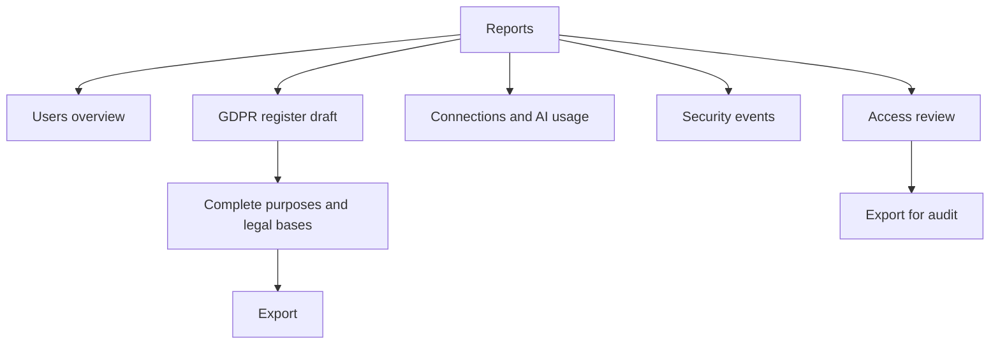

🏠 [Specs](../../../README.md) › 🧩 [Functional capabilities](../../README.md) › 🛡️ [F1 Administration](../README.md) ›
🔀 [Flows](README.md) › 🔀 FL-F1-09 Administration reports

# 🔀 FL-F1-09 Administration reports

**Status:** ✅ specified

## Summary

Reading the administration reports and keeping the GDPR register current.

## Personas

- [U07 Administrator](../../../01-users/personas/u07-administrator.md)

## Flowchart

## Sequence diagram

See
[UC-F1-12](../use-cases/09-administration-reports/uc-f01-12-draft-the-record-of-processing-activities.md#sequence-diagram).

## Steps

| Step | Persona | Screen | Use case | What happens |
|---|---|---|---|---|
| 1 | U07 | [S-F1-12](../screens/09-administration-reports/s-f01-12-users-overview-dashboard.md) | [UC-F1-12](../use-cases/09-administration-reports/uc-f01-12-draft-the-record-of-processing-activities.md) | Open the GDPR register draft |
| 2 | U07 | [S-F1-12](../screens/09-administration-reports/s-f01-12-users-overview-dashboard.md) | [UC-F1-12](../use-cases/09-administration-reports/uc-f01-12-draft-the-record-of-processing-activities.md) | Complete and export |
| 3 | [U07](../../../01-users/personas/u07-administrator.md) | [S-F1-24](../screens/09-administration-reports/s-f01-24-access-rights-dashboard.md) | [UC-F1-18](../use-cases/11-team-delegation-and-access-review/uc-f01-18-run-an-access-review-campaign.md) | Read who holds which rights, and export it for an audit |
| 4 | [U07](../../../01-users/personas/u07-administrator.md) | [S-F1-25](../screens/09-administration-reports/s-f01-25-connections-and-ai-usage-dashboard.md) | [UC-F1-08](../use-cases/06-choose-an-ai-provider/uc-f01-08-choose-the-ai-provider-of-a-feature.md) | Read the calls per connection and the AI requests per feature and provider |
| 5 | [U07](../../../01-users/personas/u07-administrator.md) | [S-F1-26](../screens/09-administration-reports/s-f01-26-security-events-dashboard.md) | [UC-F1-22](../use-cases/13-security-and-audit/uc-f01-22-search-the-audit-trail-and-export-it-to-a-siem.md) | Read the failed sign-ins, two-factor resets and provider sessions |

### Entities and screens

| Entity | States in this flow | Shown at step and screen | Aggregated view |
|---|---|---|---|
| [E-F1-22 Record of processing activities](../data/e-f01-22-record-of-processing-activities.md) | Active | 1, 2 [S-F1-12](../screens/09-administration-reports/s-f01-12-users-overview-dashboard.md) | Record of processing activities |
| [E-F1-12 Provider session](../data/e-f01-12-provider-session.md) | Live, Closed | Shown elsewhere: [S-F1-11 Provider access log](../screens/08-provider-and-client-companies/s-f01-11-provider-access-log.md) | Provider sessions |

## Errors

None.

## Images

Every step and error, for each persona taking part, in light and dark mode (D120). Steps are numbered as in the Steps
table; E rows are the error cases.

| Step | Persona | Device | Light | Dark |
|---|---|---|---|---|
| 1 | U07 | desktop | [light](../images/09-administration-reports/u07-administrator/1-open-gdpr-register-desktop-light.png) | [dark](../images/09-administration-reports/u07-administrator/1-open-gdpr-register-desktop-dark.png) |
| 2 | U07 | desktop | [light](../images/09-administration-reports/u07-administrator/2-complete-and-export-desktop-light.png) | [dark](../images/09-administration-reports/u07-administrator/2-complete-and-export-desktop-dark.png) |
| 1 | U13 | desktop | [light](../images/09-administration-reports/u13-owner/1-open-gdpr-register-desktop-light.png) | [dark](../images/09-administration-reports/u13-owner/1-open-gdpr-register-desktop-dark.png) |
| 2 | U13 | desktop | [light](../images/09-administration-reports/u13-owner/2-complete-and-export-desktop-light.png) | [dark](../images/09-administration-reports/u13-owner/2-complete-and-export-desktop-dark.png) |
| 3 | U07 | desktop | [light](../images/09-administration-reports/u07-administrator/3-access-rights-dashboard-desktop-light.png) | [dark](../images/09-administration-reports/u07-administrator/3-access-rights-dashboard-desktop-dark.png) |
| 4 | U07 | desktop | [light](../images/09-administration-reports/u07-administrator/4-connections-and-ai-usage-dashboard-desktop-light.png) | [dark](../images/09-administration-reports/u07-administrator/4-connections-and-ai-usage-dashboard-desktop-dark.png) |
| 5 | U07 | desktop | [light](../images/09-administration-reports/u07-administrator/5-security-events-dashboard-desktop-light.png) | [dark](../images/09-administration-reports/u07-administrator/5-security-events-dashboard-desktop-dark.png) |

## Open questions

None.

---

⬅️ [FL-F1-08 The provider and its client companies](fl-f01-08-provider-and-client-companies.md) · ⬆️ [Up](README.md) ·
➡️ [FL-F1-10 Bring users in at scale](fl-f01-10-bring-users-in-at-scale.md)
