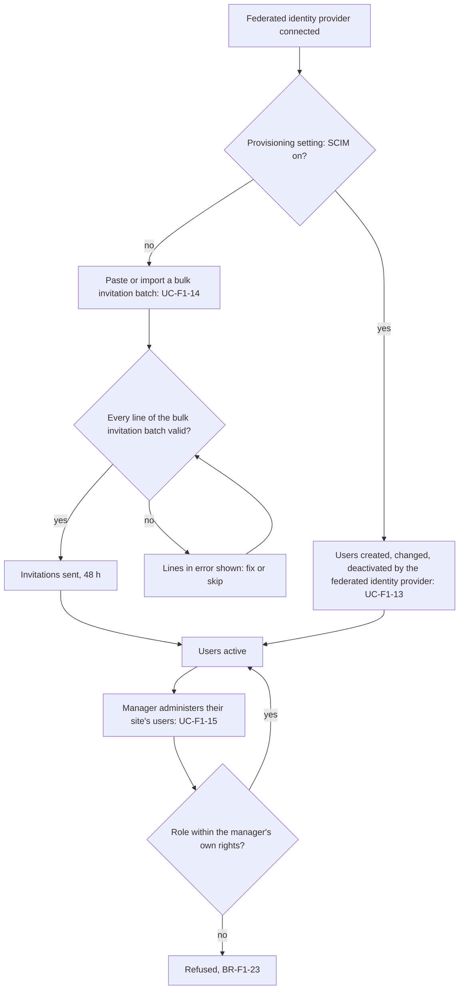

🏠 [Specs](../../../README.md) › 🧩 [Functional capabilities](../../README.md) › 🛡️ [F1 Administration](../README.md) ›
🔀 [Flows](README.md) › 🔀 FL-F1-10 Bring users in at scale

# 🔀 FL-F1-10 Bring users in at scale

**Status:** ✅ specified

## Summary

Users arrive in batches: from the identity provider (SCIM), from a pasted or imported list, or from a site manager who
administers their own site's staff.

## Personas

- [U07 Administrator](../../../01-users/personas/u07-administrator.md)
- [U23 Store manager](../../../01-users/personas/u23-store-manager.md)
- [U02 Manager](../../../01-users/personas/u02-manager.md), acting in the chart, step 36i

## Flowchart

## Sequence diagram

- [UC-F1-14 Invite users in bulk](../use-cases/10-bring-users-in-at-scale/uc-f01-14-invite-users-in-bulk.md#sequence-diagram)

## Steps

| Step | Persona | Screen | Use case | What happens |
|---|---|---|---|---|
| 1 | [U07](../../../01-users/personas/u07-administrator.md) | [S-F1-13](../screens/10-bring-users-in-at-scale/s-f01-13-automatic-provisioning.md) | [UC-F1-13](../use-cases/10-bring-users-in-at-scale/uc-f01-13-provision-users-from-the-identity-provider.md) | Connect SCIM provisioning to the identity provider |
| 2 | [U07](../../../01-users/personas/u07-administrator.md) | [S-F1-14](../screens/10-bring-users-in-at-scale/s-f01-14-bulk-invite.md) | [UC-F1-14](../use-cases/10-bring-users-in-at-scale/uc-f01-14-invite-users-in-bulk.md) | Paste or import a list, check it, send the invitations |
| 3 | [U23](../../../01-users/personas/u23-store-manager.md) | [S-F1-15](../screens/10-bring-users-in-at-scale/s-f01-15-my-sites-users.md) | [UC-F1-15](../use-cases/10-bring-users-in-at-scale/uc-f01-15-administer-the-users-of-ones-own-site.md) | Invite, change or deactivate the users of one's own site |

### Entities and screens

| Entity | States in this flow | Shown at step and screen | Aggregated view |
|---|---|---|---|
| [E-T02-04 Federated identity provider](../../../03-technical/t02-identity-and-access/data/e-t02-04-federated-identity-provider.md) | Active | Shown elsewhere: [S-T02-04 Federated identity provider](../../../03-technical/t02-identity-and-access/screens/s-t02-04-federated-identity-provider.md), from the admin list [S-T02-L04](../../../03-technical/t02-identity-and-access/screens/00-lists/s-t02-l04-federated-identity-providers.md) | Federated identity providers |
| [E-F1-14 Provisioning setting](../data/e-f01-14-provisioning-setting.md) | Off, Tested, On | 1 [S-F1-13](../screens/10-bring-users-in-at-scale/s-f01-13-automatic-provisioning.md) | Provisioning settings |
| [E-F1-03 User](../data/e-f01-03-user.md) | Invited, Active, Deactivated | 1 [S-F1-13](../screens/10-bring-users-in-at-scale/s-f01-13-automatic-provisioning.md); 2 [S-F1-14](../screens/10-bring-users-in-at-scale/s-f01-14-bulk-invite.md); 3 [S-F1-15](../screens/10-bring-users-in-at-scale/s-f01-15-my-sites-users.md) | Users |
| [E-F1-15 Bulk invitation batch](../data/e-f01-15-bulk-invitation-batch.md) | Draft, Sent | 2 [S-F1-14](../screens/10-bring-users-in-at-scale/s-f01-14-bulk-invite.md) | Bulk invitation batches |
| [E-F1-04 Invitation](../data/e-f01-04-invitation.md) | Sent | 2 [S-F1-14](../screens/10-bring-users-in-at-scale/s-f01-14-bulk-invite.md) | Invitations |
| [E-F3-11 Knowledge proposal](../../f03-assistant/data/e-f03-11-knowledge-proposal.md) | Open, Approved, Declined | Shown elsewhere: [S-F3-07 Knowledge base](../../f03-assistant/screens/07-manage-knowledge/s-f03-07-knowledge-base.md) | Knowledge proposals |
| [E-F1-02 Company site](../data/e-f01-02-company-site.md) | Open, Closed | 3 [S-F1-15](../screens/10-bring-users-in-at-scale/s-f01-15-my-sites-users.md) | Company sites |
| [E-F1-06 Role](../data/e-f01-06-role.md) | Active | 3 [S-F1-15](../screens/10-bring-users-in-at-scale/s-f01-15-my-sites-users.md) | Roles |

## Errors

A provider sending a user outside the allowed domains, a list line in error, a site manager giving a role above their
own rights (BR-F1-21 to BR-F1-23).

## Images

Every step and error, for each persona taking part, in light and dark mode (D120). Steps are numbered as in the Steps
table; E rows are the error cases.

| Step | Persona | Device | Light | Dark |
|---|---|---|---|---|
| 1 | U07 | desktop | [light](../images/10-bring-users-in-at-scale/u07-administrator/1-automatic-provisioning-desktop-light.png) | [dark](../images/10-bring-users-in-at-scale/u07-administrator/1-automatic-provisioning-desktop-dark.png) |
| 2 | U07 | desktop | [light](../images/10-bring-users-in-at-scale/u07-administrator/2-bulk-invite-desktop-light.png) | [dark](../images/10-bring-users-in-at-scale/u07-administrator/2-bulk-invite-desktop-dark.png) |
| 3 | U23 | desktop | [light](../images/10-bring-users-in-at-scale/u23-store-manager/3-my-sites-users-desktop-light.png) | [dark](../images/10-bring-users-in-at-scale/u23-store-manager/3-my-sites-users-desktop-dark.png) |
| 3 | U23 | phone | [light](../images/10-bring-users-in-at-scale/u23-store-manager/3-my-sites-users-phone-light.png) | [dark](../images/10-bring-users-in-at-scale/u23-store-manager/3-my-sites-users-phone-dark.png) |
| 3 | U23 | tablet | [light](../images/10-bring-users-in-at-scale/u23-store-manager/3-my-sites-users-tablet-light.png) | [dark](../images/10-bring-users-in-at-scale/u23-store-manager/3-my-sites-users-tablet-dark.png) |
| E1 | U07 | desktop | [light](../images/10-bring-users-in-at-scale/u07-administrator/e1-automatic-provisioning-refused-desktop-light.png) | [dark](../images/10-bring-users-in-at-scale/u07-administrator/e1-automatic-provisioning-refused-desktop-dark.png) |

## Open questions

None.

---

⬅️ [FL-F1-09 Administration reports](fl-f01-09-administration-reports.md) · ⬆️ [Up](README.md) ·
➡️ [FL-F1-11 Team, delegation and access review](fl-f01-11-team-delegation-and-access-review.md)
