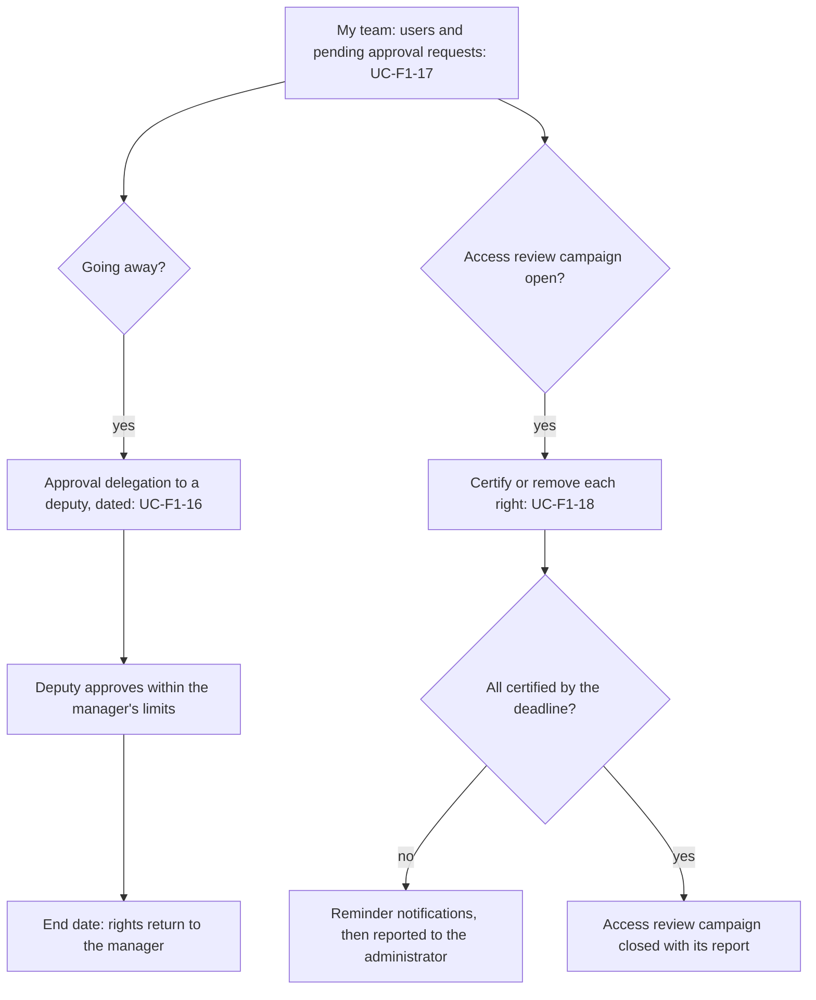

🏠 [Specs](../../../README.md) › 🧩 [Functional capabilities](../../README.md) › 🛡️ [F1 Administration](../README.md) ›
🔀 [Flows](README.md) › 🔀 FL-F1-11 Team, delegation and access review

# 🔀 FL-F1-11 Team, delegation and access review

**Status:** ✅ specified

## Summary

A manager sees their team's accounts and what waits for them, hands their approvals to a deputy while away, and
certifies their team's rights when an access review campaign asks.

## Personas

- [U02 Manager](../../../01-users/personas/u02-manager.md)
- [U07 Administrator](../../../01-users/personas/u07-administrator.md)

## Flowchart

## Sequence diagram

- [UC-F1-16 Delegate approvals during an absence](../use-cases/11-team-delegation-and-access-review/uc-f01-16-delegate-approvals-during-an-absence.md#sequence-diagram)

## Steps

| Step | Persona | Screen | Use case | What happens |
|---|---|---|---|---|
| 1 | [U02](../../../01-users/personas/u02-manager.md) | [S-F1-17](../screens/11-team-delegation-and-access-review/s-f01-17-my-team.md) | [UC-F1-17](../use-cases/11-team-delegation-and-access-review/uc-f01-17-see-my-teams-accounts-and-pending-requests.md) | See the team's accounts and the requests waiting |
| 2 | [U02](../../../01-users/personas/u02-manager.md) | [S-F1-16](../screens/11-team-delegation-and-access-review/s-f01-16-delegation.md) | [UC-F1-16](../use-cases/11-team-delegation-and-access-review/uc-f01-16-delegate-approvals-during-an-absence.md) | Delegate approvals to a deputy for the absence |
| 3 | [U07](../../../01-users/personas/u07-administrator.md) | [S-F1-18](../screens/11-team-delegation-and-access-review/s-f01-18-access-reviews.md) | [UC-F1-18](../use-cases/11-team-delegation-and-access-review/uc-f01-18-run-an-access-review-campaign.md) | Launch an access review campaign |
| 4 | [U02](../../../01-users/personas/u02-manager.md) | [S-F1-18](../screens/11-team-delegation-and-access-review/s-f01-18-access-reviews.md) | [UC-F1-18](../use-cases/11-team-delegation-and-access-review/uc-f01-18-run-an-access-review-campaign.md) | Certify or remove each right of the team |

### Entities and screens

| Entity | States in this flow | Shown at step and screen | Aggregated view |
|---|---|---|---|
| [E-F1-03 User](../data/e-f01-03-user.md) | Invited, Active, Deactivated | 1 [S-F1-17](../screens/11-team-delegation-and-access-review/s-f01-17-my-team.md); 2 [S-F1-16](../screens/11-team-delegation-and-access-review/s-f01-16-delegation.md); 3, 4 [S-F1-18](../screens/11-team-delegation-and-access-review/s-f01-18-access-reviews.md) | Users |
| [E-F9-14 Approval request](../../f09-hr-and-projects/data/e-f09-14-approval-request.md) | To approve, Approved, Refused | Shown elsewhere: [S-F9-13 Approvals and lunch](../../f09-hr-and-projects/screens/05-workplace-services/s-f09-13-approvals-and-lunch.md) | Approval requests |
| [E-F1-13 Approval delegation](../data/e-f01-13-approval-delegation.md) | Planned, Active, Cancelled, Ended | 1 [S-F1-17](../screens/11-team-delegation-and-access-review/s-f01-17-my-team.md); 2 [S-F1-16](../screens/11-team-delegation-and-access-review/s-f01-16-delegation.md) | Approval delegations |
| [E-F1-16 Access review campaign](../data/e-f01-16-access-review-campaign.md) | Open, Closed | 3, 4 [S-F1-18](../screens/11-team-delegation-and-access-review/s-f01-18-access-reviews.md) | Access review campaigns |
| [E-T10-02 Notification](../../../03-technical/t10-translations-and-notifications/data/e-t10-02-notification.md) | Active | Shown elsewhere: [S-T10-02 Notification](../../../03-technical/t10-translations-and-notifications/screens/s-t10-02-notification.md), from the admin list [S-T10-L02](../../../03-technical/t10-translations-and-notifications/screens/00-lists/s-t10-l02-notifications.md) | Notifications |

## Errors

A deputy without access to the records, overlapping delegations, a right left uncertified at the deadline (BR-F1-24,
BR-F1-25).

## Images

Every step and error, for each persona taking part, in light and dark mode (D120). Steps are numbered as in the Steps
table; E rows are the error cases.

| Step | Persona | Device | Light | Dark |
|---|---|---|---|---|
| 1 | U02 | desktop | [light](../images/11-team-delegation-and-access-review/u02-manager/1-my-team-desktop-light.png) | [dark](../images/11-team-delegation-and-access-review/u02-manager/1-my-team-desktop-dark.png) |
| 1 | U02 | phone | [light](../images/11-team-delegation-and-access-review/u02-manager/1-my-team-phone-light.png) | [dark](../images/11-team-delegation-and-access-review/u02-manager/1-my-team-phone-dark.png) |
| 2 | U02 | desktop | [light](../images/11-team-delegation-and-access-review/u02-manager/2-delegation-desktop-light.png) | [dark](../images/11-team-delegation-and-access-review/u02-manager/2-delegation-desktop-dark.png) |
| 2 | U02 | phone | [light](../images/11-team-delegation-and-access-review/u02-manager/2-delegation-phone-light.png) | [dark](../images/11-team-delegation-and-access-review/u02-manager/2-delegation-phone-dark.png) |
| 3 | U07 | desktop | [light](../images/11-team-delegation-and-access-review/u07-administrator/3-access-reviews-desktop-light.png) | [dark](../images/11-team-delegation-and-access-review/u07-administrator/3-access-reviews-desktop-dark.png) |
| 4 | U02 | desktop | [light](../images/11-team-delegation-and-access-review/u02-manager/4-access-reviews-desktop-light.png) | [dark](../images/11-team-delegation-and-access-review/u02-manager/4-access-reviews-desktop-dark.png) |
| 4 | U02 | phone | [light](../images/11-team-delegation-and-access-review/u02-manager/4-access-reviews-phone-light.png) | [dark](../images/11-team-delegation-and-access-review/u02-manager/4-access-reviews-phone-dark.png) |
| E1 | U02 | desktop | [light](../images/11-team-delegation-and-access-review/u02-manager/e1-my-team-refused-desktop-light.png) | [dark](../images/11-team-delegation-and-access-review/u02-manager/e1-my-team-refused-desktop-dark.png) |
| E1 | U02 | phone | [light](../images/11-team-delegation-and-access-review/u02-manager/e1-my-team-refused-phone-light.png) | [dark](../images/11-team-delegation-and-access-review/u02-manager/e1-my-team-refused-phone-dark.png) |

## Open questions

None.

---

⬅️ [FL-F1-10 Bring users in at scale](fl-f01-10-bring-users-in-at-scale.md) · ⬆️ [Up](README.md) ·
➡️ [FL-F1-12 Portal accounts and integrations](fl-f01-12-portal-accounts-and-integrations.md)
