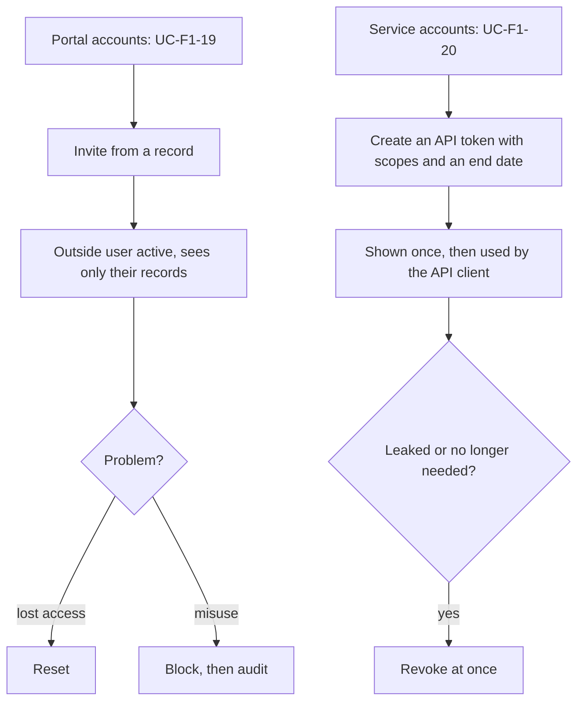

🏠 [Specs](../../../README.md) › 🧩 [Functional capabilities](../../README.md) › 🛡️ [F1 Administration](../README.md) ›
🔀 [Flows](README.md) › 🔀 FL-F1-12 Portal accounts and integrations

# 🔀 FL-F1-12 Portal accounts and integrations

**Status:** ✅ specified

## Summary

Accounts that are not employees: customers, suppliers and the people of sector record types on the portals, and the
service accounts and API tokens of integrations.

## Personas

- [U07 Administrator](../../../01-users/personas/u07-administrator.md)
- [U09 Customer](../../../01-users/personas/u09-customer.md)

## Flowchart

## Sequence diagram

- [UC-F1-20 Create and revoke API tokens and service accounts](../use-cases/12-portal-accounts-and-integrations/uc-f01-20-create-and-revoke-api-tokens-and-service-accounts.md#sequence-diagram)

## Steps

| Step | Persona | Screen | Use case | What happens |
|---|---|---|---|---|
| 1 | [U07](../../../01-users/personas/u07-administrator.md) | [S-F1-19](../screens/12-portal-accounts-and-integrations/s-f01-19-portal-accounts.md) | [UC-F1-19](../use-cases/12-portal-accounts-and-integrations/uc-f01-19-manage-portal-accounts.md) | Invite a customer, supplier or family member to a portal |
| 2 | [U09](../../../01-users/personas/u09-customer.md) | [S-F1-19](../screens/12-portal-accounts-and-integrations/s-f01-19-portal-accounts.md) | [UC-F1-19](../use-cases/12-portal-accounts-and-integrations/uc-f01-19-manage-portal-accounts.md) | Accept and see only one's own records |
| 3 | [U07](../../../01-users/personas/u07-administrator.md) | [S-F1-19](../screens/12-portal-accounts-and-integrations/s-f01-19-portal-accounts.md) | [UC-F1-19](../use-cases/12-portal-accounts-and-integrations/uc-f01-19-manage-portal-accounts.md) | Block, reset or audit a portal account |
| 4 | [U07](../../../01-users/personas/u07-administrator.md) | [S-F1-20](../screens/12-portal-accounts-and-integrations/s-f01-20-api-tokens.md) | [UC-F1-20](../use-cases/12-portal-accounts-and-integrations/uc-f01-20-create-and-revoke-api-tokens-and-service-accounts.md) | Create a service account and a scoped token, revoke it |

### Entities and screens

| Entity | States in this flow | Shown at step and screen | Aggregated view |
|---|---|---|---|
| [E-F1-17 Portal account](../data/e-f01-17-portal-account.md) | Invited, Active, Blocked | 1, 2, 3 [S-F1-19](../screens/12-portal-accounts-and-integrations/s-f01-19-portal-accounts.md) | Portal accounts |
| [E-F6-01 Customer record](../../f06-customers-and-sales/data/e-f06-01-customer-record.md) | Active | Shown elsewhere: [S-F6-04 Customer portal](../../f06-customers-and-sales/screens/02-quote-to-order/s-f06-04-customer-portal.md) | Customer records |
| [E-T02-03 Service account](../../../03-technical/t02-identity-and-access/data/e-t02-03-service-account.md) | Active | Shown elsewhere: [S-T02-03 Service account](../../../03-technical/t02-identity-and-access/screens/s-t02-03-service-account.md), from the admin list [S-T02-L03](../../../03-technical/t02-identity-and-access/screens/00-lists/s-t02-l03-service-accounts.md) | Service accounts |
| [E-F1-18 API token](../data/e-f01-18-api-token.md) | Active, Expired | 4 [S-F1-20](../screens/12-portal-accounts-and-integrations/s-f01-20-api-tokens.md) | API tokens |
| [E-T05-01 API client](../../../03-technical/t05-api-and-webhooks/data/e-t05-01-api-client.md) | Active | Shown elsewhere: [S-T05-01 API client](../../../03-technical/t05-api-and-webhooks/screens/s-t05-01-api-client.md), from the admin list [S-T05-L01](../../../03-technical/t05-api-and-webhooks/screens/00-lists/s-t05-l01-api-clients.md) | API clients |

## Errors

A portal invitation to a record without an email, a token whose scopes exceed the service account's role, an expired
token (BR-F1-26, BR-F1-27).

## Images

Every step and error, for each persona taking part, in light and dark mode (D120). Steps are numbered as in the Steps
table; E rows are the error cases.

| Step | Persona | Device | Light | Dark |
|---|---|---|---|---|
| 1 | U07 | desktop | [light](../images/12-portal-accounts-and-integrations/u07-administrator/1-portal-accounts-desktop-light.png) | [dark](../images/12-portal-accounts-and-integrations/u07-administrator/1-portal-accounts-desktop-dark.png) |
| 2 | U09 | phone | [light](../images/12-portal-accounts-and-integrations/u09-customer/2-portal-accounts-phone-light.png) | [dark](../images/12-portal-accounts-and-integrations/u09-customer/2-portal-accounts-phone-dark.png) |
| 3 | U07 | desktop | [light](../images/12-portal-accounts-and-integrations/u07-administrator/3-portal-accounts-desktop-light.png) | [dark](../images/12-portal-accounts-and-integrations/u07-administrator/3-portal-accounts-desktop-dark.png) |
| 4 | U07 | desktop | [light](../images/12-portal-accounts-and-integrations/u07-administrator/4-api-tokens-desktop-light.png) | [dark](../images/12-portal-accounts-and-integrations/u07-administrator/4-api-tokens-desktop-dark.png) |
| E1 | U07 | desktop | [light](../images/12-portal-accounts-and-integrations/u07-administrator/e1-portal-accounts-refused-desktop-light.png) | [dark](../images/12-portal-accounts-and-integrations/u07-administrator/e1-portal-accounts-refused-desktop-dark.png) |

## Open questions

None.

---

⬅️ [FL-F1-11 Team, delegation and access review](fl-f01-11-team-delegation-and-access-review.md) · ⬆️ [Up](README.md) ·
➡️ [FL-F1-13 Security and audit](fl-f01-13-security-and-audit.md)
