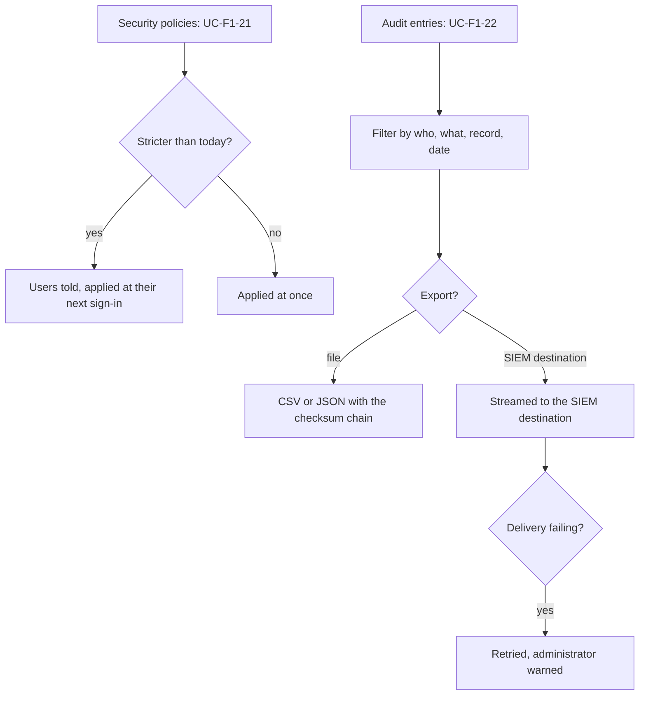

🏠 [Specs](../../../README.md) › 🧩 [Functional capabilities](../../README.md) › 🛡️ [F1 Administration](../README.md) ›
🔀 [Flows](README.md) › 🔀 FL-F1-13 Security and audit

# 🔀 FL-F1-13 Security and audit

**Status:** ✅ specified

## Summary

The administrator sets the company's security policies and searches the audit trail, which can be streamed to the
company's SIEM.

## Personas

- [U07 Administrator](../../../01-users/personas/u07-administrator.md)
- [U13 Owner](../../../01-users/personas/u13-owner.md)

## Flowchart

## Sequence diagram

- [UC-F1-22 Search the audit trail and export it to a SIEM](../use-cases/13-security-and-audit/uc-f01-22-search-the-audit-trail-and-export-it-to-a-siem.md#sequence-diagram)

## Steps

| Step | Persona | Screen | Use case | What happens |
|---|---|---|---|---|
| 1 | [U07](../../../01-users/personas/u07-administrator.md) | [S-F1-21](../screens/13-security-and-audit/s-f01-21-security-policies.md) | [UC-F1-21](../use-cases/13-security-and-audit/uc-f01-21-set-the-security-policies.md) | Set password, session, two-factor, IP and device rules |
| 2 | [U07](../../../01-users/personas/u07-administrator.md) | [S-F1-22](../screens/13-security-and-audit/s-f01-22-audit-trail.md) | [UC-F1-22](../use-cases/13-security-and-audit/uc-f01-22-search-the-audit-trail-and-export-it-to-a-siem.md) | Search the audit trail |
| 3 | [U07](../../../01-users/personas/u07-administrator.md) | [S-F1-22](../screens/13-security-and-audit/s-f01-22-audit-trail.md) | [UC-F1-22](../use-cases/13-security-and-audit/uc-f01-22-search-the-audit-trail-and-export-it-to-a-siem.md) | Export it or stream it to the SIEM |
| 4 | [U13](../../../01-users/personas/u13-owner.md) | [S-F1-22](../screens/13-security-and-audit/s-f01-22-audit-trail.md) | [UC-F1-22](../use-cases/13-security-and-audit/uc-f01-22-search-the-audit-trail-and-export-it-to-a-siem.md) | Read who changed a record |

### Entities and screens

| Entity | States in this flow | Shown at step and screen | Aggregated view |
|---|---|---|---|
| [E-F1-19 Security policy](../data/e-f01-19-security-policy.md) | Active | 1 [S-F1-21](../screens/13-security-and-audit/s-f01-21-security-policies.md) | Security policies |
| [E-F1-03 User](../data/e-f01-03-user.md) | Invited, Active, Deactivated | Shown elsewhere: [S-F1-03 Users](../screens/03-user-lifecycle/s-f01-03-users.md) | Users |
| [E-T02-04 Federated identity provider](../../../03-technical/t02-identity-and-access/data/e-t02-04-federated-identity-provider.md) | Active | Shown elsewhere: [S-T02-04 Federated identity provider](../../../03-technical/t02-identity-and-access/screens/s-t02-04-federated-identity-provider.md), from the admin list [S-T02-L04](../../../03-technical/t02-identity-and-access/screens/00-lists/s-t02-l04-federated-identity-providers.md) | Federated identity providers |
| [E-T03-03 Chain checkpoint](../../../03-technical/t03-audit-trail/data/e-t03-03-chain-checkpoint.md) | Recorded | Shown elsewhere: [S-T03-03 Chain checkpoint](../../../03-technical/t03-audit-trail/screens/s-t03-03-chain-checkpoint.md), from the admin list [S-T03-L03](../../../03-technical/t03-audit-trail/screens/00-lists/s-t03-l03-chain-checkpoints.md) | Chain checkpoints |
| [E-F1-20 SIEM destination](../data/e-f01-20-siem-destination.md) | Off, On, Failing | 2, 3, 4 [S-F1-22](../screens/13-security-and-audit/s-f01-22-audit-trail.md) | SIEM destinations |
| [E-T03-01 Audit entry](../../../03-technical/t03-audit-trail/data/e-t03-01-audit-entry.md) | Recorded | Shown elsewhere: [S-T03-01 Audit entry](../../../03-technical/t03-audit-trail/screens/s-t03-01-audit-entry.md) | Audit entries |

## Errors

A policy that would lock out every administrator, an export too large for one file, a SIEM that refuses the events
(BR-F1-28, BR-F1-29).

## Images

Every step and error, for each persona taking part, in light and dark mode (D120). Steps are numbered as in the Steps
table; E rows are the error cases.

| Step | Persona | Device | Light | Dark |
|---|---|---|---|---|
| 1 | U07 | desktop | [light](../images/13-security-and-audit/u07-administrator/1-security-policies-desktop-light.png) | [dark](../images/13-security-and-audit/u07-administrator/1-security-policies-desktop-dark.png) |
| 2 | U07 | desktop | [light](../images/13-security-and-audit/u07-administrator/2-audit-trail-desktop-light.png) | [dark](../images/13-security-and-audit/u07-administrator/2-audit-trail-desktop-dark.png) |
| 3 | U07 | desktop | [light](../images/13-security-and-audit/u07-administrator/3-audit-trail-desktop-light.png) | [dark](../images/13-security-and-audit/u07-administrator/3-audit-trail-desktop-dark.png) |
| 4 | U13 | desktop | [light](../images/13-security-and-audit/u13-owner/4-audit-trail-desktop-light.png) | [dark](../images/13-security-and-audit/u13-owner/4-audit-trail-desktop-dark.png) |
| 4 | U13 | phone | [light](../images/13-security-and-audit/u13-owner/4-audit-trail-phone-light.png) | [dark](../images/13-security-and-audit/u13-owner/4-audit-trail-phone-dark.png) |
| E1 | U07 | desktop | [light](../images/13-security-and-audit/u07-administrator/e1-security-policies-refused-desktop-light.png) | [dark](../images/13-security-and-audit/u07-administrator/e1-security-policies-refused-desktop-dark.png) |

## Open questions

None.

---

⬅️ [FL-F1-12 Portal accounts and integrations](fl-f01-12-portal-accounts-and-integrations.md) · ⬆️ [Up](README.md) ·
➡️ [FL-F1-14 Close a company](fl-f01-14-close-a-company.md)
