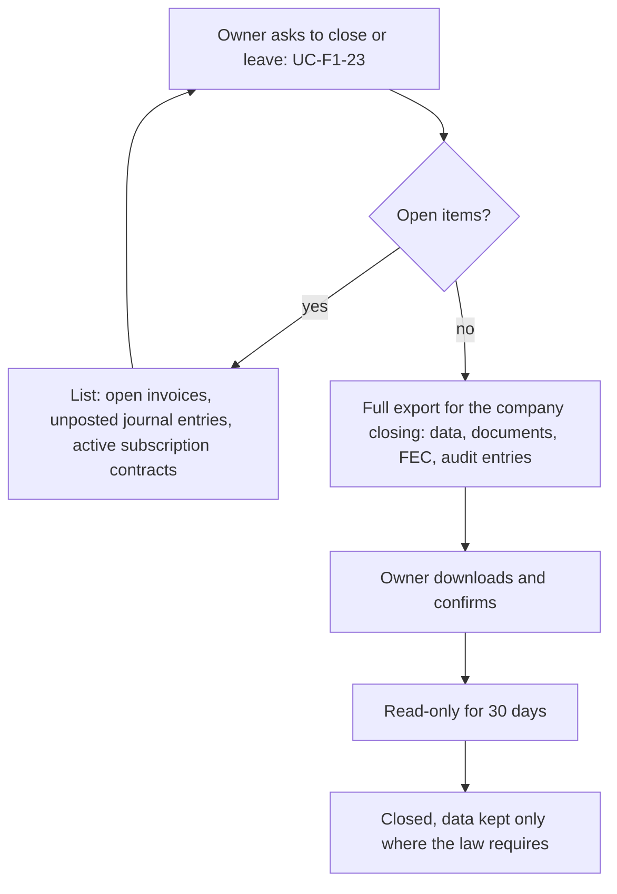

🏠 [Specs](../../../README.md) › 🧩 [Functional capabilities](../../README.md) › 🛡️ [F1 Administration](../README.md) ›
🔀 [Flows](README.md) › 🔀 FL-F1-14 Close a company

# 🔀 FL-F1-14 Close a company

**Status:** ✅ specified

## Summary

The owner closes a company or moves it out of the hosted edition: everything is exported in open formats, then the
company is closed and its data deleted once the legal periods allow.

## Personas

- [U07 Administrator](../../../01-users/personas/u07-administrator.md)
- [U11 IT provider administrator](../../../01-users/personas/u11-provider-admin.md)
- [U13 Owner](../../../01-users/personas/u13-owner.md)

## Flowchart

## Sequence diagram

- [UC-F1-23 Close a company and export all its data](../use-cases/14-close-a-company/uc-f01-23-close-a-company-and-export-all-its-data.md#sequence-diagram)

## Steps

| Step | Persona | Screen | Use case | What happens |
|---|---|---|---|---|
| 1 | [U13](../../../01-users/personas/u13-owner.md) | [S-F1-23](../screens/14-close-a-company/s-f01-23-close-the-company.md) | [UC-F1-23](../use-cases/14-close-a-company/uc-f01-23-close-a-company-and-export-all-its-data.md) | Ask to close the company or leave the hosted edition |
| 2 | [U07](../../../01-users/personas/u07-administrator.md) | [S-F1-23](../screens/14-close-a-company/s-f01-23-close-the-company.md) | [UC-F1-23](../use-cases/14-close-a-company/uc-f01-23-close-a-company-and-export-all-its-data.md) | Clear the open items listed |
| 3 | [U13](../../../01-users/personas/u13-owner.md) | [S-F1-23](../screens/14-close-a-company/s-f01-23-close-the-company.md) | [UC-F1-23](../use-cases/14-close-a-company/uc-f01-23-close-a-company-and-export-all-its-data.md) | Download the full export and confirm the closing |
| 4 | [U11](../../../01-users/personas/u11-provider-admin.md) | [S-F1-23](../screens/14-close-a-company/s-f01-23-close-the-company.md) | [UC-F1-23](../use-cases/14-close-a-company/uc-f01-23-close-a-company-and-export-all-its-data.md) | The provider administrator archives the closed company |

### Entities and screens

| Entity | States in this flow | Shown at step and screen | Aggregated view |
|---|---|---|---|
| [E-F6-05 Invoice](../../f06-customers-and-sales/data/e-f06-05-invoice.md) | Sent, Received, Refused, Paid, Draft, Issued, Partly paid, Overdue | Shown elsewhere: [S-F6-06 Invoice](../../f06-customers-and-sales/screens/03-invoice-and-get-paid/s-f06-06-invoice.md) | Invoices |
| [E-F6-07 Subscription contract](../../f06-customers-and-sales/data/e-f06-07-subscription-contract.md) | Active | Shown elsewhere: [S-F6-09 Subscriptions](../../f06-customers-and-sales/screens/04-subscriptions/s-f06-09-subscriptions.md) | Subscription contracts |
| [E-F1-21 Company closing](../data/e-f01-21-company-closing.md) | Asked, Exported, Confirmed, Closed | 1, 2, 3, 4 [S-F1-23](../screens/14-close-a-company/s-f01-23-close-the-company.md) | Company closings |
| [E-F2-13 Document](../../f02-no-code-configuration/data/e-f02-13-document.md) | To sort, To validate, Done | Shown elsewhere: [S-F2-13 Documents workspace](../../f02-no-code-configuration/screens/07-benchmark-additions/s-f02-13-documents-workspace.md) | Documents |
| [E-F8-27 FEC file](../../f08-accounting/data/e-f08-27-fec-file.md) | Active | 1, 2, 3, 4 [S-F1-23](../screens/14-close-a-company/s-f01-23-close-the-company.md) | FEC files |
| [E-T03-01 Audit entry](../../../03-technical/t03-audit-trail/data/e-t03-01-audit-entry.md) | Recorded | Shown elsewhere: [S-T03-01 Audit entry](../../../03-technical/t03-audit-trail/screens/s-t03-01-audit-entry.md) | Audit entries |

## Errors

Open items that block the closing, an export that fails part way, a confirmation by someone who is not the owner
(BR-F1-30, BR-F1-31).

## Images

Every step and error, for each persona taking part, in light and dark mode (D120). Steps are numbered as in the Steps
table; E rows are the error cases.

| Step | Persona | Device | Light | Dark |
|---|---|---|---|---|
| 1 | U13 | desktop | [light](../images/14-close-a-company/u13-owner/1-close-the-company-desktop-light.png) | [dark](../images/14-close-a-company/u13-owner/1-close-the-company-desktop-dark.png) |
| 1 | U13 | phone | [light](../images/14-close-a-company/u13-owner/1-close-the-company-phone-light.png) | [dark](../images/14-close-a-company/u13-owner/1-close-the-company-phone-dark.png) |
| 2 | U07 | desktop | [light](../images/14-close-a-company/u07-administrator/2-close-the-company-desktop-light.png) | [dark](../images/14-close-a-company/u07-administrator/2-close-the-company-desktop-dark.png) |
| 3 | U13 | desktop | [light](../images/14-close-a-company/u13-owner/3-close-the-company-desktop-light.png) | [dark](../images/14-close-a-company/u13-owner/3-close-the-company-desktop-dark.png) |
| 3 | U13 | phone | [light](../images/14-close-a-company/u13-owner/3-close-the-company-phone-light.png) | [dark](../images/14-close-a-company/u13-owner/3-close-the-company-phone-dark.png) |
| 4 | U11 | desktop | [light](../images/14-close-a-company/u11-provider-admin/4-close-the-company-desktop-light.png) | [dark](../images/14-close-a-company/u11-provider-admin/4-close-the-company-desktop-dark.png) |
| E1 | U13 | desktop | [light](../images/14-close-a-company/u13-owner/e1-close-the-company-refused-desktop-light.png) | [dark](../images/14-close-a-company/u13-owner/e1-close-the-company-refused-desktop-dark.png) |
| E1 | U13 | phone | [light](../images/14-close-a-company/u13-owner/e1-close-the-company-refused-phone-light.png) | [dark](../images/14-close-a-company/u13-owner/e1-close-the-company-refused-phone-dark.png) |

## Open questions

None.

---

⬅️ [FL-F1-13 Security and audit](fl-f01-13-security-and-audit.md) · ⬆️ [Up](README.md) ·
➡️ [FL-F1-15 Security and group data](fl-f01-15-security-and-group-data.md)
