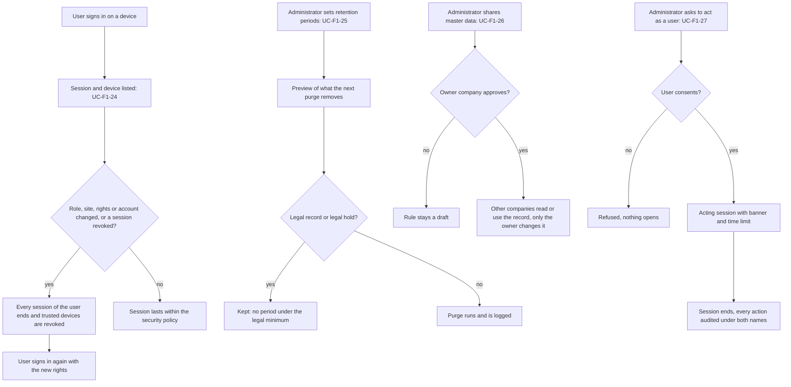
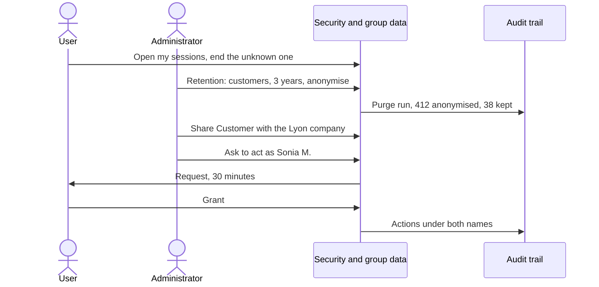

🏠 [Specs](../../../README.md) › 🧩 [Functional capabilities](../../README.md) › 🛡️ [F1 Administration](../README.md) ›
🔀 [Flows](README.md) › 🔀 FL-F1-15 Security and group data

# 🔀 FL-F1-15 Security and group data

**Status:** ✅ specified

## Summary

Four administration tasks that benchmarked suites offer and simple-ERP lacked: users see and end their sessions and
trusted devices, and sessions end when rights change
([UC-F1-24](../use-cases/15-security-and-group-data/uc-f01-24-manage-sessions-and-trusted-devices.md)), the
administrator sets how long personal data is kept and purges it without touching legal records
([UC-F1-25](../use-cases/15-security-and-group-data/uc-f01-25-set-retention-and-purge-personal-data.md)), a group of
companies shares master data under one owner company
([UC-F1-26](../use-cases/15-security-and-group-data/uc-f01-26-share-master-data-across-the-group.md)), and an
administrator acts as a user only with that user's consent
([UC-F1-27](../use-cases/15-security-and-group-data/uc-f01-27-act-as-a-user-with-consent.md)). The owner chose each in
the 2026-11-14 interview ([D520](../../../06-decisions/f01-administration/d520-benchmark-gaps-f01-administration.md)).

## Personas

- [U07 Administrator](../../../01-users/personas/u07-administrator.md)
- [U01 Employee](../../../01-users/personas/u01-employee.md)
- [U13 Owner](../../../01-users/personas/u13-owner.md)

## Flowchart

## Sequence diagram

## Steps

| Step | Persona | Screen | Use case | What happens |
|---|---|---|---|---|
| 1 | [U07](../../../01-users/personas/u07-administrator.md), [U01](../../../01-users/personas/u01-employee.md) | [S-F1-27](../screens/15-security-and-group-data/s-f01-27-sessions-and-devices.md) | [UC-F1-24](../use-cases/15-security-and-group-data/uc-f01-24-manage-sessions-and-trusted-devices.md) | The administrator checks the sessions of the company and ends or revokes one, and a user sees and ends their own sessions on a phone |
| 2 | [U07](../../../01-users/personas/u07-administrator.md) | [S-F1-28](../screens/15-security-and-group-data/s-f01-28-retention-policies.md) | [UC-F1-25](../use-cases/15-security-and-group-data/uc-f01-25-set-retention-and-purge-personal-data.md) | The administrator sets the retention periods, previews a purge and switches the policy on |
| 3 | [U07](../../../01-users/personas/u07-administrator.md), [U13](../../../01-users/personas/u13-owner.md) | [S-F1-29](../screens/15-security-and-group-data/s-f01-29-group-sharing.md) | [UC-F1-26](../use-cases/15-security-and-group-data/uc-f01-26-share-master-data-across-the-group.md) | The administrator writes a sharing rule for the group and the owner approves it |
| 4 | [U07](../../../01-users/personas/u07-administrator.md), [U01](../../../01-users/personas/u01-employee.md) | [S-F1-30](../screens/15-security-and-group-data/s-f01-30-act-as-user.md) | [UC-F1-27](../use-cases/15-security-and-group-data/uc-f01-27-act-as-a-user-with-consent.md) | The administrator asks to act as a user, with a reason, and the user grants or refuses on their phone |

### Entities and screens

| Entity | States in this flow | Shown at step and screen | Aggregated view |
|---|---|---|---|
| [E-F1-23 User session](../data/e-f01-23-user-session.md) | Active, Signed out, Revoked, Ended by a change, Expired | 1 [S-F1-27](../screens/15-security-and-group-data/s-f01-27-sessions-and-devices.md) | User sessions |
| [E-F1-24 Retention policy](../data/e-f01-24-retention-policy.md) | Draft, Active, Paused, Retired | 2 [S-F1-28](../screens/15-security-and-group-data/s-f01-28-retention-policies.md) | Retention policies |
| [E-F1-25 Sharing rule](../data/e-f01-25-sharing-rule.md) | Draft, Active, Paused, Ended | 3 [S-F1-29](../screens/15-security-and-group-data/s-f01-29-group-sharing.md) | Sharing rules |
| [E-F1-26 Act-as session](../data/e-f01-26-act-as-session.md) | Requested, Granted, Refused, Active, Ended, Expired | 4 [S-F1-30](../screens/15-security-and-group-data/s-f01-30-act-as-user.md) | Act-as sessions |
| [E-F1-19 Security policy](../data/e-f01-19-security-policy.md) | Active | Shown elsewhere: [S-F1-21](../screens/13-security-and-audit/s-f01-21-security-policies.md) | Security policies |

## Errors

- **E1 The user refuses to be acted as.** The administrator is told, nothing opens and the refusal is audited
  ([BR-F1-36](../business-rules/br-f01-36-acting-as-a-user-needs-consent-and-is-audited.md)), step 4.
- **E2 A period under the legal minimum.** Refused with the minimum shown
  ([BR-F1-34](../business-rules/br-f01-34-purges-are-logged-and-never-touch-legal-records.md)), step 2.
- **E3 A sharing rule not approved by the owner company.** It stays a draft
  ([BR-F1-35](../business-rules/br-f01-35-shared-records-keep-one-owner-company.md)), step 3.
- **E4 The last administrator's session.** It cannot be ended by another administrator
  ([BR-F1-28](../business-rules/br-f01-28-security-policies-never-lock-out-every-administrator.md)), step 1.

## Images

Every step and error, for each persona taking part, in light and dark mode (D120). Steps are numbered as in the Steps
table; E rows are the error cases.

| Step | Persona | Device | Light | Dark |
|---|---|---|---|---|
| 1 | U01 | phone | [light](../images/15-security-and-group-data/u01-employee/1-sessions-and-devices-phone-light.png) | [dark](../images/15-security-and-group-data/u01-employee/1-sessions-and-devices-phone-dark.png) |
| 1 | U07 | desktop | [light](../images/15-security-and-group-data/u07-administrator/1-sessions-and-devices-desktop-light.png) | [dark](../images/15-security-and-group-data/u07-administrator/1-sessions-and-devices-desktop-dark.png) |
| 1 | U01 | desktop | [light](../images/15-security-and-group-data/u01-employee/1-sessions-and-devices-desktop-light.png) | [dark](../images/15-security-and-group-data/u01-employee/1-sessions-and-devices-desktop-dark.png) |
| 1 | U01 | phone | [light](../images/15-security-and-group-data/u01-employee/1-sessions-and-devices-phone-light.png) | [dark](../images/15-security-and-group-data/u01-employee/1-sessions-and-devices-phone-dark.png) |
| 1 | U07 | desktop | [light](../images/15-security-and-group-data/u07-administrator/1-sessions-and-devices-desktop-light.png) | [dark](../images/15-security-and-group-data/u07-administrator/1-sessions-and-devices-desktop-dark.png) |
| 2 | U07 | desktop | [light](../images/15-security-and-group-data/u07-administrator/2-retention-policies-desktop-light.png) | [dark](../images/15-security-and-group-data/u07-administrator/2-retention-policies-desktop-dark.png) |
| 2 | U07 | desktop | [light](../images/15-security-and-group-data/u07-administrator/2-retention-policies-desktop-light.png) | [dark](../images/15-security-and-group-data/u07-administrator/2-retention-policies-desktop-dark.png) |
| 3 | U07 | desktop | [light](../images/15-security-and-group-data/u07-administrator/3-group-sharing-desktop-light.png) | [dark](../images/15-security-and-group-data/u07-administrator/3-group-sharing-desktop-dark.png) |
| 3 | U13 | desktop | [light](../images/15-security-and-group-data/u13-owner/3-group-sharing-desktop-light.png) | [dark](../images/15-security-and-group-data/u13-owner/3-group-sharing-desktop-dark.png) |
| 3 | U07 | desktop | [light](../images/15-security-and-group-data/u07-administrator/3-group-sharing-desktop-light.png) | [dark](../images/15-security-and-group-data/u07-administrator/3-group-sharing-desktop-dark.png) |
| 3 | U13 | desktop | [light](../images/15-security-and-group-data/u13-owner/3-group-sharing-desktop-light.png) | [dark](../images/15-security-and-group-data/u13-owner/3-group-sharing-desktop-dark.png) |
| 3 | U13 | phone | [light](../images/15-security-and-group-data/u13-owner/3-group-sharing-phone-light.png) | [dark](../images/15-security-and-group-data/u13-owner/3-group-sharing-phone-dark.png) |
| 4 | U01 | phone | [light](../images/15-security-and-group-data/u01-employee/4-act-as-user-phone-light.png) | [dark](../images/15-security-and-group-data/u01-employee/4-act-as-user-phone-dark.png) |
| 4 | U07 | desktop | [light](../images/15-security-and-group-data/u07-administrator/4-act-as-user-desktop-light.png) | [dark](../images/15-security-and-group-data/u07-administrator/4-act-as-user-desktop-dark.png) |
| 4 | U01 | desktop | [light](../images/15-security-and-group-data/u01-employee/4-act-as-user-desktop-light.png) | [dark](../images/15-security-and-group-data/u01-employee/4-act-as-user-desktop-dark.png) |
| 4 | U01 | phone | [light](../images/15-security-and-group-data/u01-employee/4-act-as-user-phone-light.png) | [dark](../images/15-security-and-group-data/u01-employee/4-act-as-user-phone-dark.png) |
| 4 | U07 | desktop | [light](../images/15-security-and-group-data/u07-administrator/4-act-as-user-desktop-light.png) | [dark](../images/15-security-and-group-data/u07-administrator/4-act-as-user-desktop-dark.png) |
| E1 | U07 | desktop | [light](../images/15-security-and-group-data/u07-administrator/e1-the-user-refuses-to-be-acted-as-desktop-light.png) | [dark](../images/15-security-and-group-data/u07-administrator/e1-the-user-refuses-to-be-acted-as-desktop-dark.png) |

## Open questions

None.

---

⬅️ [FL-F1-14 Close a company](fl-f01-14-close-a-company.md) · ⬆️ [Up](README.md)
