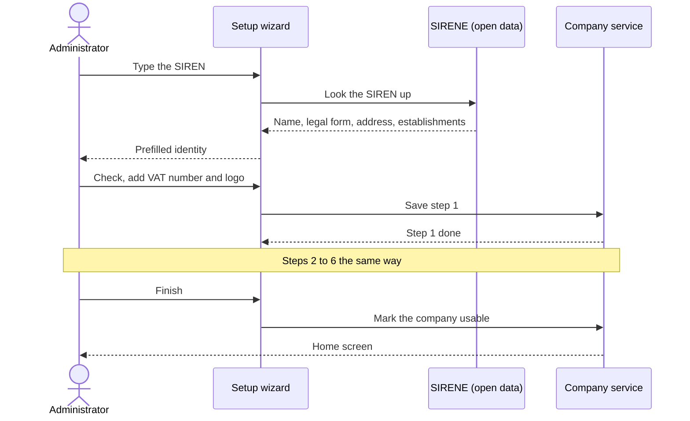

🏠 [Specs](../../../../README.md) › 🧩 [Functional capabilities](../../../README.md) ›
🛡️ [F1 Administration](../../README.md) › 📝 [Use cases](../README.md) ›
📝 [Use cases: FL-F1-01 Guided setup](README.md) › 📝 UC-F1-01 Set up a new company

# 📝 UC-F1-01 Set up a new company

**Status:** ✅ specified

## Summary

The first administrator of a brand-new company goes through the seven steps of the guided setup, after which the company
can be used.

## Personas

- [U07 Administrator](../../../../01-users/personas/u07-administrator.md)
- [U13 Owner](../../../../01-users/personas/u13-owner.md), in a small company

## Goal

A company ready for its users: identity, money settings, sites, sector pack, users and its existing data in place.

## Trigger

The first sign-in to a brand-new company, created on the company's own install or by an IT provider (UC-F1-10).

## Frequency

Once per company; resumed as often as needed until done.

## Preconditions

- The company exists, empty (T1).
- The person has the administrator role.

## Postconditions

- **Success:** all seven steps done; the company is usable; the setup checklist is closed
  ([D59](../../../../06-decisions/f01-administration/d59-every-setup-step-required.md)).
- **Left before the end:** what was done is kept; the next sign-in reopens the wizard at the first step not done
  ([D54](../../../../06-decisions/f01-administration/d54-guided-setup.md)).

## Main flow

1. The administrator signs in; simple-ERP opens the setup wizard at step 1.
2. **Company identity:** they type the SIREN; simple-ERP fills the name, legal form, address and establishments from
   SIRENE ([D60](../../../../06-decisions/f01-administration/d60-sirene-lookup.md)); they check them, add the VAT number
   and upload the logo.
3. **Money:** they choose the currency, the fiscal year start and the VAT regime.
4. **Sites:** the head office comes from step 2; they add the other sites with address, hours, whether it holds stock,
   and its manager ([D36](../../../../06-decisions/f07-purchasing-and-stock/d36-what-a-location-holds.md)).
5. **Sector pack:** they pick one of the eight sector packs, or none.
6. **Users:** they invite users by email, or turn single sign-on on
   ([D55](../../../../06-decisions/technical/d55-user-onboarding.md)).
7. **Data import:** they import spreadsheet templates, the FEC of the previous software, or another ERP's data, or
   choose nothing to import ([D61](../../../../06-decisions/f01-administration/d61-setup-imports.md)).
8. **Done:** simple-ERP shows the checklist, all done, and opens the home screen.

## Alternative flows

- 2a. SIRENE lookup turned off or unavailable: the administrator types the identity by hand.
- 2b. Not a French company: no SIREN; the identity is typed by hand.
- 4a. Only one site: the head office is the only site.
- 6a. Single sign-on chosen: invitations are optional.
- Any step: the administrator leaves; the wizard resumes there next time.

## Error flows

- 2e. The SIREN does not exist or is closed in SIRENE: a message says so; the administrator corrects it or
  types the identity by hand.
- 2f. The VAT number does not match the SIREN (French VAT number key): the field is refused with the expected format.
- 7e. An import file has errors: they are listed line by line and nothing is saved until the file is fixed or
  the faulty lines are left out.

## Business rules

- [BR-F1-03 A company is usable once set up](../../business-rules/br-f01-03-company-usable-once-set-up.md)

## Entities

- [E-F1-01 Company](../../data/e-f01-01-company.md)
- [E-F1-02 Company site](../../data/e-f01-02-company-site.md)

## Permissions

The administrator role only; an IT provider administrator can do it too
([D53](../../../../06-decisions/ux/d53-provider-access-always.md)).

## Notifications

- Each invited user gets their invitation email (UC-F1-03).
- When the setup is done, the administrator gets a summary email.

## Audit events

Each step done, with who and when; each import with its file name, counts and errors; the SIRENE lookup with
the SIREN asked.

## AI involvement

The AI assistant explains a field ("What is a VAT regime?"), suggests the sector pack from the company's activity code
(NAF), and can prefill whole steps (the sites from the SIRENE establishments, users from a pasted list) that the
administrator approves before they are saved. See
[D62](../../../../06-decisions/f01-administration/d62-assistant-in-setup.md).

## API, MCP and A2A exposure

None: the setup is done in the screens only
([D62](../../../../06-decisions/f01-administration/d62-assistant-in-setup.md)).

## Screens

- [S-F1-01 Setup wizard](../../screens/01-guided-setup/s-f01-01-setup-wizard.md)

## Flowchart

See [FL-F1-01 Guided setup](../../flows/fl-f01-01-guided-setup.md#flowchart).

## Sequence diagram

## Acceptance criteria

1. **Given** a brand-new company **when** its administrator signs in **then** the setup wizard opens at step 1 and no
   other screen is reachable.
2. **Given** a valid French SIREN and the lookup on **when** it is typed **then** the name, legal form, address and
   establishments are filled from SIRENE and stay editable.
3. **Given** the lookup turned off **when** the SIREN is typed **then** no outside call is made.
4. **Given** the administrator leaves at step 4 **when** they sign in again **then** the wizard opens at step 4 with
   steps 1 to 3 kept.
5. **Given** step 4 **when** "none" is chosen **then** the step counts as done.
6. **Given** an import file with errors **when** it is uploaded **then** each error is listed with its line and nothing
   is saved.
7. **Given** all seven steps done **when** the administrator finishes **then** the home screen opens and the company is
   usable by its users.

## Non-functional notes

- Every step works on a desktop; steps 1 to 5 also work on a tablet.
- WCAG 2.2 AA and RGAA (D46).

## Regulatory references

- SIRENE open data (INSEE), under the Licence Ouverte.
- The FEC format: article A47 A-1 of the French tax procedures book (livre des procédures fiscales).

Legal values from the France country pack:
[CR-FR-001 Company identifiers](../../../../10-country-packs/france/company/cr-fr-001-company-identifiers.md),
[CR-FR-005 Accounting entries file (FEC)](../../../../10-country-packs/france/accounting/cr-fr-005-fec-export.md).

## Related use cases

UC-F1-02 Add or change a site; UC-F1-03 Invite a user; UC-F1-09 Set up single sign-on; UC-F1-10 Create a client company
on the platform (planned).

- [UC-F1-23 Close a company and export all its data](../14-close-a-company/uc-f01-23-close-a-company-and-export-all-its-data.md)

## Open questions

None.

---

⬆️ [Up](README.md) · ➡️ [UC-F1-02 Add or change a site](../02-manage-sites/uc-f01-02-add-or-change-a-site.md)
