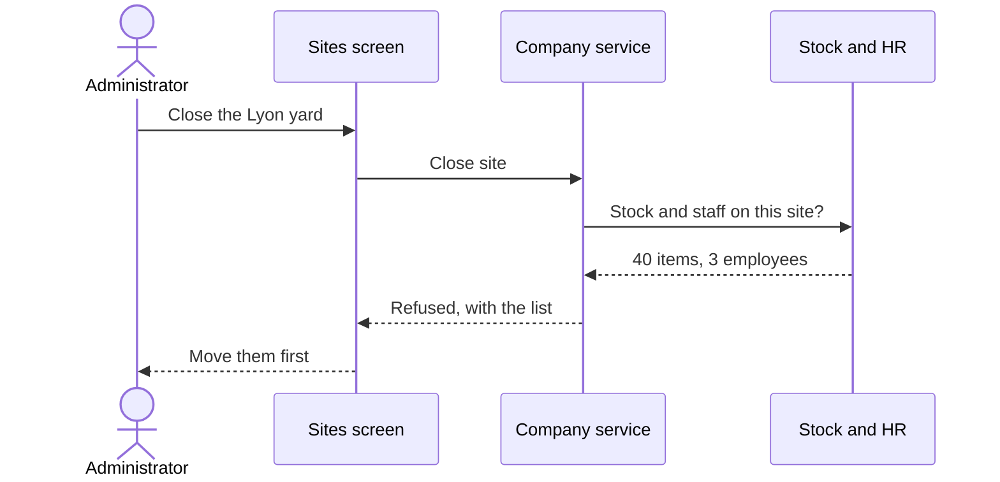

🏠 [Specs](../../../../README.md) › 🧩 [Functional capabilities](../../../README.md) ›
🛡️ [F1 Administration](../../README.md) › 📝 [Use cases](../README.md) ›
📝 [Use cases: FL-F1-02 Manage sites](README.md) › 📝 UC-F1-02 Add or change a site

# 📝 UC-F1-02 Add or change a site

**Status:** ✅ specified

## Summary

The administrator adds a site, changes it, moves the head office or closes a site; a site's manager updates their site's
hours and contacts.

## Personas

- [U07 Administrator](../../../../01-users/personas/u07-administrator.md)
- [U13 Owner](../../../../01-users/personas/u13-owner.md)
- [U02 Manager](../../../../01-users/personas/u02-manager.md), for their own site's hours and contacts

## Goal

The company's sites always match its real locations.

## Trigger

A new location, a move, new opening hours, a closure.

## Frequency

A few times a year per company.

## Preconditions

The company is set up (BR-F1-03).

## Postconditions

- **Success:** the site is added, changed, made head office or closed; the change is dated in the history.
- **Refused:** nothing changes; the reason is shown.

## Main flow

1. The administrator opens Administration › Sites ([S-F1-02](../../screens/02-manage-sites/s-f01-02-sites.md)): every
   site with its address, manager and whether it holds stock.
2. They add a site: name, address, opening hours, whether it holds stock, its manager and, if wanted, its SIRET
   ([D453](../../../../06-decisions/f01-administration/d453-optional-siret-on-a-site.md)).
3. simple-ERP looks the address up; the site gets its document numbering
   ([BR-F1-05](../../business-rules/br-f01-05-document-numbering.md)).
4. They save; the site appears in the list, in the site switcher and on the documents it issues.
5. A site's manager opens their own site and updates its opening hours and contacts
   ([D63](../../../../06-decisions/f01-administration/d63-who-changes-sites.md)).

## Alternative flows

- 2a. **Change:** the administrator changes a site's fields; dated fields apply from their date.
- 2b. **Head office:** the administrator makes another site the head office and confirms; the change is dated
  ([D65](../../../../06-decisions/f01-administration/d65-head-office-can-move.md)).
- 2c. **Close:** the administrator closes an empty site
  ([D64](../../../../06-decisions/f01-administration/d64-empty-a-site-before-closing.md)).

## Error flows

- 2c-e. The site still holds stock or staff: closing is refused and simple-ERP lists them
  ([BR-F1-04](../../business-rules/br-f01-04-empty-a-site-before-closing-it.md)).
- 2c-f. The site is the head office: closing is refused until another site is head office.
- 3e. The address cannot be found: it is saved as typed, with a warning.

## Business rules

- [BR-F1-04 Empty a site before closing it](../../business-rules/br-f01-04-empty-a-site-before-closing-it.md)
- [BR-F1-05 Document numbering](../../business-rules/br-f01-05-document-numbering.md)

## Entities

- [E-F1-02 Company site](../../data/e-f01-02-company-site.md)

## Permissions

Administrator: everything. A site's manager: their site's hours and contacts only
([D63](../../../../06-decisions/f01-administration/d63-who-changes-sites.md)). The owner, when they hold the
administrator role.

## Notifications

The site's manager is told when their site changes, moves to head office or closes.

## Audit events

Each add, change, head office move and closure, with the old and new values.

## AI involvement

The AI assistant can prefill a site from a SIRENE establishment (SIRET), for the administrator to approve, as in
the setup ([D62](../../../../06-decisions/f01-administration/d62-assistant-in-setup.md)).

## API, MCP and A2A exposure

Read-only: the list of open sites, with their address and hours.

## Screens

- [S-F1-02 Sites](../../screens/02-manage-sites/s-f01-02-sites.md)

## Flowchart

See [FL-F1-02 Manage sites](../../flows/fl-f01-02-manage-sites.md#flowchart).

## Sequence diagram

## Acceptance criteria

1. **Given** Acme Bâtiment with its head office in Lyon **when** the administrator adds the site "Yard Vénissieux"
   holding stock **then** it shows in the site switcher and its delivery notes are numbered on their own.
2. **Given** the site Yard Vénissieux with 12 items in stock **when** the administrator closes it **then** closing is
   refused and the 12 items are listed.
3. **Given** the Lyon head office **when** the administrator makes Villeurbanne the head office from 2027-01-01 **then**
   documents dated from 2027-01-01 carry the Villeurbanne address.
4. **Given** Sophie, manager of the Lyon shop **when** she changes its Saturday hours **then** the change is saved and
   she cannot change its address.

## Non-functional notes

WCAG 2.2 AA and RGAA (D46); the manager's change works on a phone (D34).

## Regulatory references

French invoice numbering: article 242 nonies A of annex II to the French tax code (code général des impôts).

## Related use cases

UC-F1-01 Set up a new company; UC-F1-04 Change a user's role or site (planned).

## Open questions

None.

---

⬅️ [UC-F1-01 Set up a new company](../01-guided-setup/uc-f01-01-set-up-a-new-company.md) · ⬆️ [Up](README.md) ·
➡️ [UC-F1-03 Invite a user](../03-user-lifecycle/uc-f01-03-invite-a-user.md)
