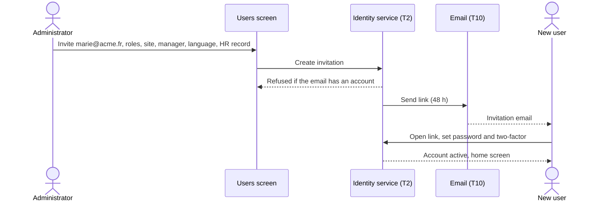

🏠 [Specs](../../../../README.md) › 🧩 [Functional capabilities](../../../README.md) ›
🛡️ [F1 Administration](../../README.md) › 📝 [Use cases](../README.md) ›
📝 [Use cases: FL-F1-03 User lifecycle](README.md) › 📝 UC-F1-03 Invite a user

# 📝 UC-F1-03 Invite a user

**Status:** ✅ specified

## Summary

The administrator invites someone by email with their roles, site, manager, language and HR record; the person accepts
within 48 hours and sets their password and two-factor authentication.

## Personas

- [U07 Administrator](../../../../01-users/personas/u07-administrator.md)
- [U01 Employee](../../../../01-users/personas/u01-employee.md), who receives and accepts the invitation

## Goal

A new user who can work as soon as they accept.

## Trigger

A new employee, or an employee who needs access (F9 hiring can suggest it).

## Frequency

A few a month per company.

## Preconditions

- The company is set up (BR-F1-03).
- The email has no account in the company (BR-F1-07).

## Postconditions

- **Accepted:** an active user with the roles, site, manager, language and HR link set.
- **Expired:** no account; the invitation shows as expired and can be resent.

## Main flow

1. The administrator opens Users and chooses "Invite".
2. They type the email and choose the roles, the site and manager, the language, and the HR record to link
   ([D67](../../../../06-decisions/f01-administration/d67-what-an-invitation-sets.md)).
3. They send; simple-ERP emails a link valid 48 hours.
4. The person opens the link, sets a password and two-factor authentication.
5. Their account is active; their home screen opens.

## Alternative flows

- 2a. The HR record does not exist yet: the link is left empty and set later (UC-F1-04).
- 3a. Single sign-on is on (D55): the invitation tells them to sign in with their company account; no password is set.
- 4a. The link expired: the person asks again; the administrator resends.

## Error flows

- 2e. The email already has an account: refused, the existing user opens (BR-F1-07).
- 4e. The link has expired or was used: refused with a message (BR-F1-06).
- 3e. The email cannot be delivered: the invitation shows "not delivered" with the reason.

## Business rules

- [BR-F1-06 Invitation link valid 48 hours](../../business-rules/br-f01-06-invitation-link-valid-48-hours.md)
- [BR-F1-07 One account per email](../../business-rules/br-f01-07-one-account-per-email.md)

## Entities

- [E-F1-03 User](../../data/e-f01-03-user.md)
- [E-F1-04 Invitation](../../data/e-f01-04-invitation.md)

## Permissions

The administrator role; the IT provider administrator (D53).

## Notifications

- The invitation email, in the language chosen.
- The administrator is told when the invitation is accepted or expires.

## Audit events

Invitation sent, resent, accepted, expired, not delivered; with who and when.

## AI involvement

The AI assistant can prepare invitations from a pasted list, for the administrator to approve, as in the setup (D62).

## API, MCP and A2A exposure

None: invitations are sent from the screens only.

## Screens

- [S-F1-03 Users](../../screens/03-user-lifecycle/s-f01-03-users.md)

## Flowchart

See [FL-F1-03 User lifecycle](../../flows/fl-f01-03-user-lifecycle.md#flowchart).

## Sequence diagram

## Acceptance criteria

1. **Given** an email with no account **when** the administrator invites it with roles, site, manager, language and HR
   record **then** an email with a link is sent.
2. **Given** the link opened within 48 hours **when** the person sets a password and two-factor **then** their account
   is active with every setting of the invitation.
3. **Given** the link opened after 48 hours **when** it is used **then** it is refused as expired.
4. **Given** an email that already has an account **when** it is invited **then** the invitation is refused and that
   user's page opens.
5. **Given** single sign-on is on **when** the person opens the invitation **then** they sign in with their company
   account and set no password.

## Non-functional notes

The acceptance page works on a phone (D34).

## Regulatory references

GDPR: the email and name are personal data, kept while the account exists.

## Related use cases

UC-F1-04 Change a user's role or site; UC-F1-05 Deactivate and offboard a user; UC-F1-09 Set up single sign-on
(planned).

- [UC-F1-14 Invite users in bulk](../10-bring-users-in-at-scale/uc-f01-14-invite-users-in-bulk.md)

- [UC-F1-15 Administer the users of one's own site](../10-bring-users-in-at-scale/uc-f01-15-administer-the-users-of-ones-own-site.md)

## Open questions

None.

---

⬅️ [UC-F1-02 Add or change a site](../02-manage-sites/uc-f01-02-add-or-change-a-site.md) · ⬆️ [Up](README.md) ·
➡️ [UC-F1-04 Change a user's role or site](uc-f01-04-change-a-users-role-or-site.md)
