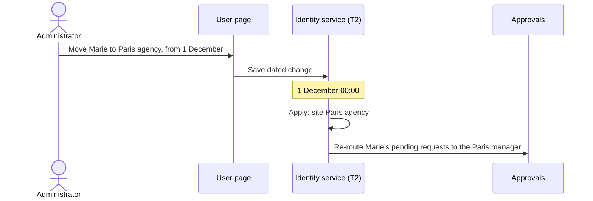

🏠 [Specs](../../../../README.md) › 🧩 [Functional capabilities](../../../README.md) ›
🛡️ [F1 Administration](../../README.md) › 📝 [Use cases](../README.md) ›
📝 [Use cases: FL-F1-03 User lifecycle](README.md) › 📝 UC-F1-04 Change a user's role or site

# 📝 UC-F1-04 Change a user's role or site

**Status:** ✅ specified

## Summary

The administrator changes a user's roles, site, manager, language or HR link, at once or from a date.

## Personas

- [U07 Administrator](../../../../01-users/personas/u07-administrator.md)
- [U01 Employee](../../../../01-users/personas/u01-employee.md), whose rights change

## Goal

Each user's rights and place match their job.

## Trigger

A promotion, a transfer, a new task, a correction.

## Frequency

A few a month per company.

## Preconditions

The user is active.

## Postconditions

- **At once:** the new rights apply at the user's next action; removed rights end.
- **Dated:** the change waits on the user's page and applies on its date (BR-F1-09).

## Main flow

1. The administrator opens the user's page.
2. They change the roles (several allowed, [D72](../../../../06-decisions/f01-administration/d72-several-roles.md)), the
   site, the manager, the language or the HR link.
3. They choose "at once" or a date ([D70](../../../../06-decisions/f01-administration/d70-role-change-timing.md)).
4. They save; the change applies, or waits for its date.

## Alternative flows

- 2a. **Site move:** the user's open items stay theirs under the new site; requests waiting for the old site's manager
  go to the new site's manager ([D71](../../../../06-decisions/f01-administration/d71-site-move.md)).
- 3a. **Cancel a dated change:** the administrator cancels it before its date.

## Error flows

- 2e. Removing the last administrator role of the company: refused, a company always keeps one administrator.
- 2f. The new manager is the user themself: refused.

## Business rules

- [BR-F1-08 Rights add up](../../business-rules/br-f01-08-rights-add-up.md)
- [BR-F1-09 Dated changes](../../business-rules/br-f01-09-dated-changes.md)
- [BR-F1-02 Administrator sees settings only](../../business-rules/br-f01-02-administrator-sees-settings-only.md)

## Entities

- [E-F1-03 User](../../data/e-f01-03-user.md)

## Permissions

The administrator role; the IT provider administrator (D53).

## Notifications

The user is told of a change of their roles or site; the old and new site managers are told of a move.

## Audit events

Every change, with old and new values, who, when, and its date of effect.

## AI involvement

The AI assistant can explain what a role allows ("What can a Manager see?").

## API, MCP and A2A exposure

None.

## Screens

- [S-F1-04 User page](../../screens/03-user-lifecycle/s-f01-04-user-page.md)

## Flowchart

See [FL-F1-03 User lifecycle](../../flows/fl-f01-03-user-lifecycle.md#flowchart).

## Sequence diagram

## Acceptance criteria

1. **Given** a user with Sales **when** Manager is added at once **then** they can use the Manager's rights at their
   next action.
2. **Given** a user with two roles **when** their rights are checked **then** they have every right of both (BR-F1-08).
3. **Given** a change dated 1 December **when** that day starts **then** it applies with no action.
4. **Given** a user moved to another site with a time-off request waiting for the old manager **when** the move applies
   **then** the request waits for the new site's manager, and the user's open items stay theirs.
5. **Given** the company's only administrator **when** their administrator role is removed **then** the change is
   refused.

## Non-functional notes

Rights changes apply within 5 seconds on every channel (screens, AI assistant, API, MCP, A2A, D12).

## Regulatory references

None.

## Related use cases

UC-F1-03 Invite a user; UC-F1-05 Deactivate and offboard a user; UC-F1-06 Edit a role and its record rules (planned).

- [UC-F1-15 Administer the users of one's own site](../10-bring-users-in-at-scale/uc-f01-15-administer-the-users-of-ones-own-site.md)

- [UC-F1-17 See my team's accounts and pending requests](../11-team-delegation-and-access-review/uc-f01-17-see-my-teams-accounts-and-pending-requests.md)

## Open questions

None.

---

⬅️ [UC-F1-03 Invite a user](uc-f01-03-invite-a-user.md) · ⬆️ [Up](README.md) ·
➡️ [UC-F1-05 Deactivate and offboard a user](uc-f01-05-deactivate-and-offboard-a-user.md)
