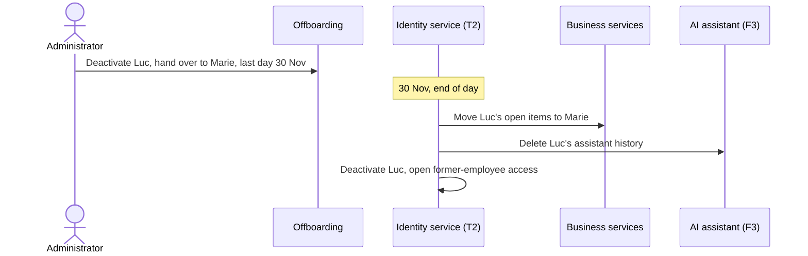

🏠 [Specs](../../../../README.md) › 🧩 [Functional capabilities](../../../README.md) ›
🛡️ [F1 Administration](../../README.md) › 📝 [Use cases](../README.md) ›
📝 [Use cases: FL-F1-03 User lifecycle](README.md) › 📝 UC-F1-05 Deactivate and offboard a user

# 📝 UC-F1-05 Deactivate and offboard a user

**Status:** ✅ specified

## Summary

The administrator deactivates a leaver, at once or at the end of their last day, after picking who takes over their open
items.

## Personas

- [U07 Administrator](../../../../01-users/personas/u07-administrator.md)
- [U01 Employee](../../../../01-users/personas/u01-employee.md), the leaver and the colleague who takes over

## Goal

Nothing is lost when someone leaves, and the leaver's access ends on time.

## Trigger

A departure; the end date set on the linked HR record (F9) suggests it.

## Frequency

A few a year per company.

## Preconditions

The user is active.

## Postconditions

- The user is deactivated, never deleted (BR-F1-01).
- Their open items belong to the colleague picked.
- Their private AI assistant history is deleted (BR-F1-10).
- A former-employee access to their payslips and HR papers is open (D74).

## Main flow

1. The administrator opens the user's page and chooses "Deactivate and hand over".
2. SimpleERP lists the user's open items: customers, open quotes, pending approvals, tasks.
3. The administrator picks the colleague who takes over.
4. They choose "at once" or the last day
   ([D73](../../../../06-decisions/f01-administration/d73-deactivation-timing.md)).
5. They confirm; at that moment the items move, the account is deactivated, the AI assistant history is deleted, and the
   leaver gets the former-employee access email.

## Alternative flows

- 2a. No open item: no hand-over step.
- 4a. Last day taken from the linked HR record's end date.
- Reactivation: the administrator reactivates a deactivated user; items handed over stay with the colleague.

## Error flows

- 3e. The colleague picked is deactivated or is the leaver: refused.
- 5e. The leaver is the company's only administrator: refused until another administrator exists.

## Business rules

- [BR-F1-01 Offboarding hand-over](../../business-rules/br-f01-01-offboarding-hand-over.md)
- [BR-F1-10 A leaver's AI assistant history is deleted](../../business-rules/br-f01-10-leavers-assistant-history-deleted.md)

## Entities

- [E-F1-03 User](../../data/e-f01-03-user.md)
- [E-F1-05 Former-employee access](../../data/e-f01-05-former-employee-access.md)

## Permissions

The administrator role; the IT provider administrator (D53).

## Notifications

- The leaver gets the former-employee access email at deactivation.
- The colleague is told what they take over.

## Audit events

Deactivation, each item handed over (from, to), the AI assistant history deletion, reactivation.

## AI involvement

The AI assistant can suggest who should take over, from the leaver's team and site; the administrator decides.

## API, MCP and A2A exposure

None.

## Screens

- [S-F1-05 Offboarding](../../screens/03-user-lifecycle/s-f01-05-offboarding.md)
- [S-F1-04 User page](../../screens/03-user-lifecycle/s-f01-04-user-page.md)

## Flowchart

See [FL-F1-03 User lifecycle](../../flows/fl-f01-03-user-lifecycle.md#flowchart).

## Sequence diagram

## Acceptance criteria

1. **Given** a leaver with open items **when** the administrator deactivates them **then** they must pick a colleague,
   and the items move to that colleague.
2. **Given** a last day of 30 November **when** that day ends **then** the account is deactivated with no action.
3. **Given** a deactivated user **when** anyone looks at their quotes **then** the history still shows their name.
4. **Given** a deactivated user **when** their AI assistant history is looked for **then** it is gone.
5. **Given** a deactivated user **when** they open the former-employee email link **then** they see their own payslips
   and HR papers only, read-only.
6. **Given** any user **when** an administrator tries to delete them **then** it is refused.

## Non-functional notes

The former-employee access works on a phone (D34).

## Regulatory references

- GDPR: storage limitation (Article 5(1)(e)).
- Payslip availability: [Q12](../../../../07-questions/q12-payslip-availability-period.md).

## Related use cases

UC-F1-04 Change a user's role or site; UC-F1-03 Invite a user.

- [UC-F1-13 Provision users from the identity provider](../10-bring-users-in-at-scale/uc-f01-13-provision-users-from-the-identity-provider.md)

- [UC-F1-15 Administer the users of one's own site](../10-bring-users-in-at-scale/uc-f01-15-administer-the-users-of-ones-own-site.md)

## Open questions

- [Q12 Payslip availability period](../../../../07-questions/q12-payslip-availability-period.md)

---

⬅️ [UC-F1-04 Change a user's role or site](uc-f01-04-change-a-users-role-or-site.md) · ⬆️ [Up](README.md) ·
➡️ [UC-F1-06 Edit a role and its record rules](../04-edit-a-role/uc-f01-06-edit-a-role-and-its-record-rules.md)
