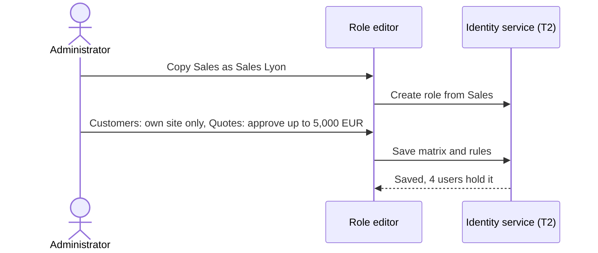

🏠 [Specs](../../../../README.md) › 🧩 [Functional capabilities](../../../README.md) ›
🛡️ [F1 Administration](../../README.md) › 📝 [Use cases](../README.md) › 📝 [Use cases: FL-F1-04 Edit a role](README.md) ›
📝 UC-F1-06 Edit a role and its record rules

# 📝 UC-F1-06 Edit a role and its record rules

**Status:** ✅ specified

## Summary

The administrator copies a ready-made role and edits its permission matrix and record rules.

## Personas

- [U07 Administrator](../../../../01-users/personas/u07-administrator.md)

## Goal

Roles that match how the company works.

## Trigger

A job that the ready-made roles do not fit.

## Frequency

At setup, then a few times a year.

## Preconditions

The company is set up (BR-F1-03).

## Postconditions

The role is saved; its users' rights change at once (D70 applies to role assignments, edits of a role apply at once).

## Main flow

1. The administrator opens Roles and copies a ready-made role (BR-F1-11).
2. They name the copy.
3. In the matrix, they tick See, Create, Change, Delete, Approve, Export per capability
   ([D76](../../../../06-decisions/f01-administration/d76-role-matrix.md)).
4. On a row, they add record rules: own records, own site, own team, amount limits
   ([D77](../../../../06-decisions/f01-administration/d77-record-rule-kinds.md)).
5. They save; the role can be given to users (UC-F1-03, UC-F1-04).

## Alternative flows

- 1a. Edit one of the company's own roles.
- 1b. Compare two roles side by side.
- 5a. Delete an own role that no user holds.

## Error flows

- 1e. Editing a ready-made role: refused, "Copy" offered (BR-F1-11).
- 5e. Deleting a role still held by users: refused, the users are listed.
- 3e. Removing the administration rights from the last role that has them: refused.

## Business rules

- [BR-F1-11 Ready-made roles are copied](../../business-rules/br-f01-11-ready-made-roles-are-copied.md)
- [BR-F1-12 Record rule kinds](../../business-rules/br-f01-12-record-rule-kinds.md)
- [BR-F1-08 Rights add up](../../business-rules/br-f01-08-rights-add-up.md)

## Entities

- [E-F1-06 Role](../../data/e-f01-06-role.md)
- [E-F1-07 Record rule](../../data/e-f01-07-record-rule.md)

## Permissions

The administrator role; the IT provider administrator (D53).

## Notifications

The role's users are told when its rights shrink.

## Audit events

Each role created, copied, changed (cell by cell, old and new), deleted.

## AI involvement

The AI assistant explains a role in plain words and answers "who can approve a 4,000 EUR purchase at the Lyon site?".

## API, MCP and A2A exposure

Read-only: the roles and their matrix, for audits.

## Screens

- [S-F1-06 Role editor](../../screens/04-edit-a-role/s-f01-06-role-editor.md)

## Flowchart

See [FL-F1-04 Edit a role](../../flows/fl-f01-04-edit-a-role.md#flowchart).

## Sequence diagram

## Acceptance criteria

1. **Given** a ready-made role **when** the administrator edits it **then** it is refused and Copy is offered.
2. **Given** a copy **when** See is unticked on Invoices **then** its users no longer see invoices on any channel (D12).
3. **Given** own site only on Customers **when** a user of the Lyon yard lists customers **then** only the Lyon yard's
   customers appear.
4. **Given** an amount limit of 2,000 EUR on purchase approval **when** the user approves a 3,000 EUR purchase **then**
   it is refused and goes to the next approver.
5. **Given** a role held by users **when** it is deleted **then** it is refused and the users are listed.

## Non-functional notes

Permission checks stay within the screen response target (D25).

## Regulatory references

GDPR: data protection by design and by default (Article 25).

Legal values from the France country pack:
[CR-FR-050 Data protection by design and by default](../../../../10-country-packs/france/data-protection/cr-fr-050-privacy-by-design.md).

## Related use cases

UC-F1-03 Invite a user; UC-F1-04 Change a user's role or site.

- [UC-F1-18 Run an access review campaign](../11-team-delegation-and-access-review/uc-f01-18-run-an-access-review-campaign.md)

- [UC-F2-27 Set field-level rights and validation rules](../../../f02-no-code-configuration/use-cases/11-rights-translations-and-approvals/uc-f02-27-set-field-level-rights-and-validation-rules.md)

## Open questions

None.

---

⬅️ [UC-F1-05 Deactivate and offboard a user](../03-user-lifecycle/uc-f01-05-deactivate-and-offboard-a-user.md) ·
⬆️ [Up](README.md) ·
➡️ [UC-F1-07](../05-connect-an-external-tool/uc-f01-07-connect-an-external-mcp-server-or-a2a-agent.md)
