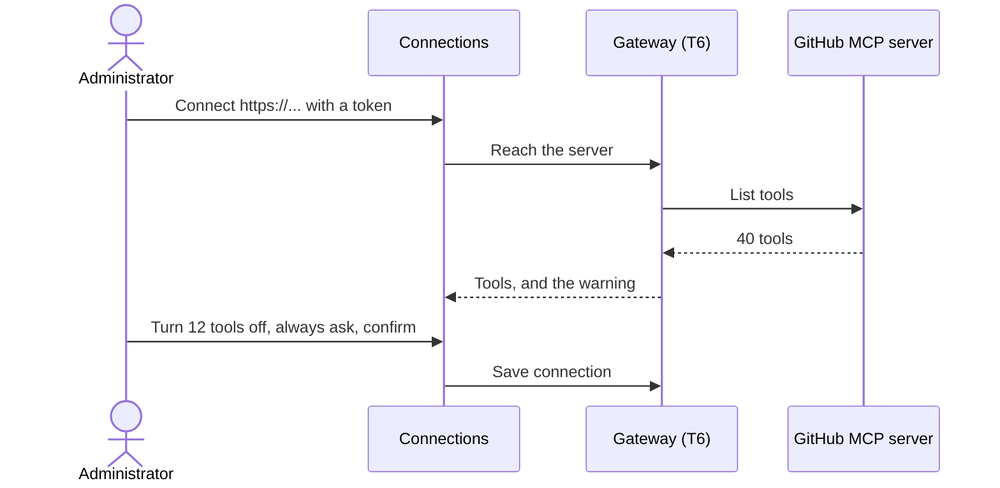

🏠 [Specs](../../../../README.md) › 🧩 [Functional capabilities](../../../README.md) ›
🛡️ [F1 Administration](../../README.md) › 📝 [Use cases](../README.md) ›
📝 [Use cases: FL-F1-05 Connect an external tool](README.md) › 📝 UC-F1-07 Connect an external MCP server or A2A agent

# 📝 UC-F1-07 Connect an external MCP server or A2A agent

**Status:** ✅ specified

## Summary

The administrator connects an outside MCP server or A2A agent, reviews its tools, sets whether changes need
confirmation, and gives roles access to it.

## Personas

- [U07 Administrator](../../../../01-users/personas/u07-administrator.md)

## Goal

The AI assistant can use outside tools (GitHub, Crunchbase...) for the roles that need them (D6).

## Trigger

A team needs data or actions from an outside service.

## Frequency

A few times a year.

## Preconditions

The company is set up (BR-F1-03).

## Postconditions

- **Turned on:** the connection exists, its reviewed tools are on, its confirmation setting is chosen, and no role uses
  it until the role matrix allows it (D80).
- **Cancelled:** nothing is saved.

## Main flow

1. The administrator opens Connections and chooses "Connect".
2. They choose MCP server or A2A agent and type its address and credentials.
3. simple-ERP reaches it and lists its tools (or skills).
4. It shows that data sent there leaves the server
   ([D79](../../../../06-decisions/f01-administration/d79-any-external-tool-with-warning.md)); the administrator reviews
   the tools, turns some off, and confirms.
5. They choose "always ask" or "trusted" for changes
   ([D81](../../../../06-decisions/f01-administration/d81-confirmation-per-connection.md)).
6. In the role editor (UC-F1-06), they give roles See or Change on the connection
   ([D80](../../../../06-decisions/f01-administration/d80-external-tools-per-role.md)).

## Alternative flows

- 3a. The server asks for OAuth sign-in: the administrator signs in in a new window.
- Turn a connection off: the AI assistant stops using it at once.
- Review new tools a connected server added: they stay off until reviewed (BR-F1-13).

## Error flows

- 3e. The server cannot be reached or refuses the credentials: the message says which, nothing is saved.
- 3f. The address is not HTTPS (outside the local network): refused.

## Business rules

- [BR-F1-13 External data warning](../../business-rules/br-f01-13-external-data-warning.md)
- [BR-F1-14 Confirming outside changes](../../business-rules/br-f01-14-confirming-outside-changes.md)

## Entities

- [E-F1-08 Agent connection](../../data/e-f01-08-agent-connection.md)

## Permissions

The administrator role; the IT provider administrator (D53).

## Notifications

The administrators are told when a connection stops answering or adds tools.

## Audit events

Connection created, turned on or off, tools reviewed, setting changed; and every call made through it (user,
tool, time, outcome; not the data sent).

## AI involvement

The AI assistant uses the connection's tools for the roles allowed (D80), asking when BR-F1-14 says so.

## API, MCP and A2A exposure

None: connections are set in the screens only.

## Screens

- [S-F1-07 Connections](../../screens/05-connect-an-external-tool/s-f01-07-connections.md)
- [S-F1-06 Role editor](../../screens/04-edit-a-role/s-f01-06-role-editor.md)

## Flowchart

See [FL-F1-05 Connect an external tool](../../flows/fl-f01-05-connect-an-external-tool.md#flowchart).

## Sequence diagram

## Acceptance criteria

1. **Given** a reachable server **when** the administrator connects it **then** its tools and the warning are shown
   before anything is turned on.
2. **Given** a connection turned on **when** no role has it in the matrix **then** no AI assistant can use it.
3. **Given** "always ask" **when** the AI assistant prepares a change through it **then** the user sees the call and
   must approve it.
4. **Given** "trusted" **when** the AI assistant makes a change **then** it is made and shown in the answer.
5. **Given** a read-only tool **when** it is called **then** no confirmation is asked.
6. **Given** a connection turned off **when** the AI assistant needs it **then** it says the tool is unavailable.

## Non-functional notes

Credentials are stored encrypted (T6) and never shown again after saving.

## Regulatory references

GDPR: sending personal data to an outside service may make it a processor or a transfer outside the EU; the warning
reminds the administrator.

## Related use cases

UC-F1-06 Edit a role and its record rules; UC-F1-08 Choose the AI provider of a feature (planned); the AI assistant
(F3).

- [UC-F1-20 Create and revoke API tokens and service accounts](../12-portal-accounts-and-integrations/uc-f01-20-create-and-revoke-api-tokens-and-service-accounts.md)

## Open questions

None.

---

⬅️ [UC-F1-06 Edit a role and its record rules](../04-edit-a-role/uc-f01-06-edit-a-role-and-its-record-rules.md) ·
⬆️ [Up](README.md) · ➡️ [UC-F1-08](../06-choose-an-ai-provider/uc-f01-08-choose-the-ai-provider-of-a-feature.md)
