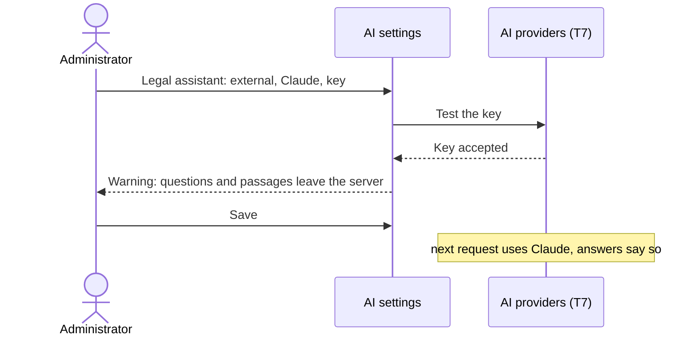

🏠 [Specs](../../../../README.md) › 🧩 [Functional capabilities](../../../README.md) ›
🛡️ [F1 Administration](../../README.md) › 📝 [Use cases](../README.md) ›
📝 [Use cases: FL-F1-06 Choose an AI provider](README.md) › 📝 UC-F1-08 Choose the AI provider of a feature

# 📝 UC-F1-08 Choose the AI provider of a feature

**Status:** ✅ specified

## Summary

The administrator chooses, for each AI feature, the local model or an external provider with the company's own key.

## Personas

- [U07 Administrator](../../../../01-users/personas/u07-administrator.md)

## Goal

Each AI feature runs where the company wants: on its server, or with a provider it trusts (D5).

## Trigger

Better quality wanted, a GPU added or removed, a provider changed.

## Frequency

Rarely: at setup, then a few times a year.

## Preconditions

The company is set up (BR-F1-03); AI is not turned off (D22).

## Postconditions

The feature uses the provider chosen from its next request; answers name the provider.

## Main flow

1. The administrator opens AI settings.
2. For a feature (Assistant (F3), Meetings: speech-to-text (F4), Meetings: summaries (F4), Legal assistant (F15), Social
   media drafts (F5)), they choose the local model or an external provider (such as Claude, OpenAI or Mistral).
3. For an external provider, they enter the company's key; simple-ERP shows the warning
   ([D83](../../../../06-decisions/f01-administration/d83-only-what-the-request-needs.md)) and tests the key.
4. They save; the feature uses it from its next request.

## Alternative flows

- 2a. Back to the local model: no key needed; the external key can be removed.
- 2b. Turn AI off for the whole company (D22): every AI feature stops and says so.

## Error flows

- 3e. The key is refused by the provider: not saved, the message says so.
- 4e. At use, the provider fails: the local model answers (BR-F1-16).

## Business rules

- [BR-F1-15 Only what the request needs](../../business-rules/br-f01-15-only-what-the-request-needs.md)
- [BR-F1-16 Fall back to the local model](../../business-rules/br-f01-16-fall-back-to-the-local-model.md)

## Entities

- [E-F1-09 AI feature setting](../../data/e-f01-09-ai-feature-setting.md)

## Permissions

The administrator role; the IT provider administrator (D53).

## Notifications

The administrators are told when a provider fails often (more than 5 fallbacks in an hour).

## Audit events

Each change of provider or key (never the key itself); each fallback.

## AI involvement

None: this is the AI's own setting.

## API, MCP and A2A exposure

None.

## Screens

- [S-F1-08 AI settings](../../screens/06-choose-an-ai-provider/s-f01-08-ai-settings.md)
- [S-F1-25 Connections and AI usage dashboard](../../screens/09-administration-reports/s-f01-25-connections-and-ai-usage-dashboard.md)

## Flowchart

See [FL-F1-06 Choose an AI provider](../../flows/fl-f01-06-choose-an-ai-provider.md#flowchart).

## Sequence diagram

## Acceptance criteria

1. **Given** a new company **when** AI settings open **then** every feature is on the local model.
2. **Given** an external provider with a valid key **when** saved **then** the feature's next answer names that
   provider.
3. **Given** an external provider **when** a request is sent **then** it holds only the question and the passages
   retrieved within the user's permissions.
4. **Given** the provider fails **when** a user asks **then** the local model answers and says so.
5. **Given** a refused key **when** the administrator saves **then** nothing changes.

## Non-functional notes

Keys are stored encrypted and never shown again (T7).

## Regulatory references

- GDPR: an external provider receiving personal data is a processor; transfers outside the EU need safeguards.
- EU AI Act: users are told they deal with an AI and which one
  ([AI governance](../../../../05-non-functional/ai-governance.md)).

## Related use cases

UC-F1-07 Connect an external MCP server or A2A agent; F3, F4, F5, F15.

- [UC-F3-14 Run the quality evaluation set](../../../f03-assistant/use-cases/11-trust-the-answers/uc-f03-14-run-the-quality-evaluation-set.md)

- [UC-F4-24 Track transcription accuracy per language and model](../../../f04-meetings/use-cases/11-insights-and-accessibility/uc-f04-24-track-transcription-accuracy-per-language-and-model.md)

## Open questions

None.

---

⬅️ [UC-F1-07](../05-connect-an-external-tool/uc-f01-07-connect-an-external-mcp-server-or-a2a-agent.md) ·
⬆️ [Up](README.md) ·
➡️ [UC-F1-09 Set up single sign-on](../07-set-up-single-sign-on/uc-f01-09-set-up-single-sign-on.md)
