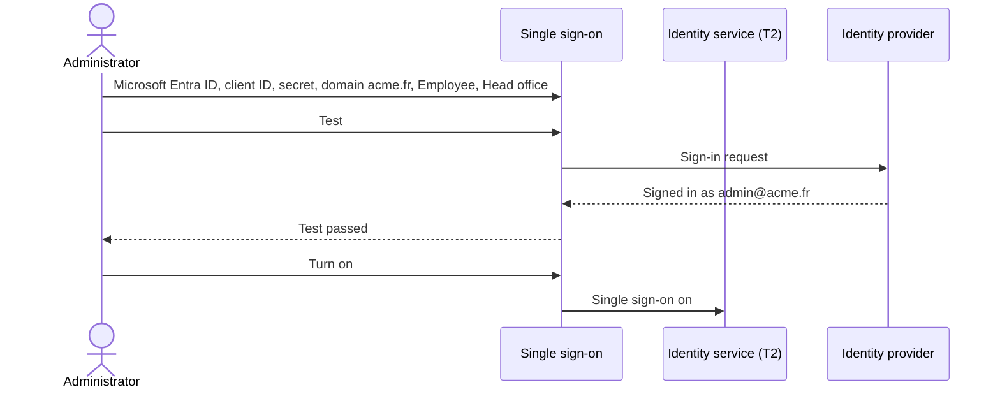

🏠 [Specs](../../../../README.md) › 🧩 [Functional capabilities](../../../README.md) ›
🛡️ [F1 Administration](../../README.md) › 📝 [Use cases](../README.md) ›
📝 [Use cases: FL-F1-07 Set up single sign-on](README.md) › 📝 UC-F1-09 Set up single sign-on

# 📝 UC-F1-09 Set up single sign-on

**Status:** ✅ specified

## Summary

The administrator connects the company's identity provider so that users sign in with their company account, and sets
which domains get an account and with which role.

## Personas

- [U07 Administrator](../../../../01-users/personas/u07-administrator.md)

## Goal

Users sign in with the account they already have; leavers lose access when their company account ends.

## Trigger

The company uses Google Workspace, Microsoft 365, Keycloak or another provider.

## Frequency

Once, then rarely.

## Preconditions

The company is set up, or at setup step 5 (D58).

## Postconditions

Single sign-on is on: users sign in through the provider; only administrators keep a password (BR-F1-17); new colleagues
of allowed domains get an account (BR-F1-18).

## Main flow

1. The administrator opens Connections › Single sign-on.
2. They pick Google Workspace, Microsoft Entra ID, another OpenID Connect provider, or SAML 2.0
   ([D85](../../../../06-decisions/f01-administration/d85-single-sign-on-providers.md)).
3. They enter the provider's details (client ID and secret, or SAML metadata).
4. They list the allowed domains and pick the default role and site
   ([D87](../../../../06-decisions/f01-administration/d87-allowed-domains.md)).
5. They test: SimpleERP opens a sign-in with the provider in a new window and shows the result.
6. They turn single sign-on on.

## Alternative flows

- 6a. Turn it off: everyone signs in with a password again; users without a password get a link to set one.
- 3a. The provider's certificate or secret expires: the administrators are warned 30 days before.

## Error flows

- 5e. The test fails: the provider's message is shown; single sign-on cannot be turned on until a test passes.
- At sign-in, the provider is down: users see a message; administrators can use their password (BR-F1-17).

## Business rules

- [BR-F1-17 Administrators keep a password](../../business-rules/br-f01-17-administrators-keep-a-password.md)
- [BR-F1-18 Allowed domains](../../business-rules/br-f01-18-allowed-domains.md)

## Entities

- [E-F1-10 Single sign-on setting](../../data/e-f01-10-single-sign-on-setting.md)

## Permissions

The administrator role; the IT provider administrator (D53).

## Notifications

When single sign-on is turned on or off, every user is told how to sign in from then on.

## Audit events

Setting changed, test passed or failed, turned on or off; every account created by single sign-on.

## AI involvement

The AI assistant explains each field of the provider's set-up.

## API, MCP and A2A exposure

None.

## Screens

- [S-F1-09 Single sign-on](../../screens/07-set-up-single-sign-on/s-f01-09-single-sign-on.md)

## Flowchart

See [FL-F1-07 Set up single sign-on](../../flows/fl-f01-07-set-up-single-sign-on.md#flowchart).

## Sequence diagram

## Acceptance criteria

1. **Given** single sign-on not tested **when** the administrator turns it on **then** it is refused.
2. **Given** single sign-on on **when** a user of an allowed domain signs in for the first time **then** an account is
   created with the default role and site.
3. **Given** single sign-on on **when** an email of another domain signs in **then** it is refused.
4. **Given** single sign-on on **when** a non-administrator tries a password **then** it is refused.
5. **Given** the provider down **when** an administrator signs in with password and two-factor **then** they get in.

## Non-functional notes

Secrets and certificates are stored encrypted (T2).

## Regulatory references

None.

## Related use cases

UC-F1-03 Invite a user; UC-F1-01 Set up a new company (step 5).

- [UC-F1-13 Provision users from the identity provider](../10-bring-users-in-at-scale/uc-f01-13-provision-users-from-the-identity-provider.md)

- [UC-F1-21 Set the security policies](../13-security-and-audit/uc-f01-21-set-the-security-policies.md)

## Open questions

None.

---

⬅️ [UC-F1-08](../06-choose-an-ai-provider/uc-f01-08-choose-the-ai-provider-of-a-feature.md) · ⬆️ [Up](README.md) ·
➡️ [UC-F1-10](../08-provider-and-client-companies/uc-f01-10-create-a-client-company-on-the-platform.md)
