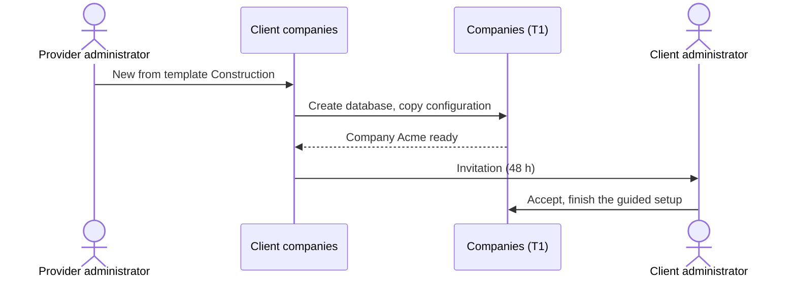

🏠 [Specs](../../../../README.md) › 🧩 [Functional capabilities](../../../README.md) ›
🛡️ [F1 Administration](../../README.md) › 📝 [Use cases](../README.md) ›
📝 [Use cases: FL-F1-08 The provider and its client companies](README.md) ›
📝 UC-F1-10 Create a client company on the platform

# 📝 UC-F1-10 Create a client company on the platform

**Status:** ✅ specified

## Summary

The IT provider administrator creates a client company on its platform from one of its template companies and hands it
to the client's first administrator.

## Personas

- [U11 IT provider administrator](../../../../01-users/personas/u11-provider-admin.md)
- [U07 Administrator](../../../../01-users/personas/u07-administrator.md), the client's first administrator

## Goal

A new client starts configured, on its own database (D19).

## Trigger

A new client signs with the provider.

## Frequency

A few a month per provider.

## Preconditions

The provider's platform runs (D18); at least one template company exists.

## Postconditions

A new company with its own database, the template's configuration, and an invitation to its first administrator, who
then finishes the guided setup (UC-F1-01).

## Main flow

1. The provider administrator opens Client companies and chooses "New".
2. They pick a template company
   ([D88](../../../../06-decisions/f01-administration/d88-client-company-from-a-template.md)).
3. They type the client's name and its first administrator's email.
4. simple-ERP creates the company's database, copies the template's configuration (BR-F1-19) and invites the first
   administrator (UC-F1-03).
5. The client's administrator accepts and runs the guided setup, with the copied steps already done.

## Alternative flows

- 2a. No template: an empty company, as on a company's own install.
- Make a client company a template: the provider marks one of its own companies as a template.

## Error flows

- 4e. The database cannot be created (disk, limits): nothing is created; the provider sees why.

## Business rules

- [BR-F1-19 Templates copy configuration only](../../business-rules/br-f01-19-templates-copy-configuration-only.md)

## Entities

- [E-F1-01 Company](../../data/e-f01-01-company.md)
- [E-F1-11 Company template](../../data/e-f01-11-company-template.md)

## Permissions

The IT provider administrator role, on the provider's platform.

## Notifications

The invitation to the client's first administrator (UC-F1-03).

## Audit events

Company created, from which template, by whom, on the provider's platform log.

## AI involvement

None.

## API, MCP and A2A exposure

A provider API to create client companies, for its own tools.

## Screens

- [S-F1-10 Client companies](../../screens/08-provider-and-client-companies/s-f01-10-client-companies.md)

## Flowchart

See [FL-F1-08 The provider and its client companies](../../flows/fl-f01-08-provider-and-client-companies.md#flowchart).

## Sequence diagram

## Acceptance criteria

1. **Given** a template **when** a client company is created from it **then** the new company has the template's roles,
   forms and sector pack, and none of its customers, invoices or users.
2. **Given** the new company **when** it is checked **then** it has its own database (D19).
3. **Given** the first administrator's email **when** the company is created **then** they receive an invitation and
   land in the guided setup.

## Non-functional notes

Creating a client company takes under a minute.

## Regulatory references

GDPR: the provider is a processor of each client (D53).

Legal values from the France country pack:
[CR-FR-049 Processors and transfers outside the EU](../../../../10-country-packs/france/data-protection/cr-fr-049-processors-and-transfers.md).

## Related use cases

UC-F1-01 Set up a new company; UC-F1-11 Enter a client company to support it.

## Open questions

None.

---

⬅️ [UC-F1-09 Set up single sign-on](../07-set-up-single-sign-on/uc-f01-09-set-up-single-sign-on.md) ·
⬆️ [Up](README.md) ·
➡️ [UC-F1-11 Enter a client company to support it](uc-f01-11-enter-a-client-company-to-support-it.md)
