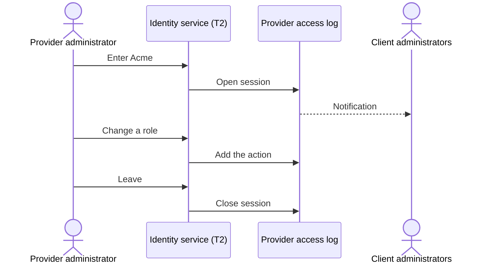

🏠 [Specs](../../../../README.md) › 🧩 [Functional capabilities](../../../README.md) ›
🛡️ [F1 Administration](../../README.md) › 📝 [Use cases](../README.md) ›
📝 [Use cases: FL-F1-08 The provider and its client companies](README.md) ›
📝 UC-F1-11 Enter a client company to support it

# 📝 UC-F1-11 Enter a client company to support it

**Status:** ✅ specified

## Summary

The IT provider administrator enters a client company, at any time, sees and does everything there, and the client sees
the session in its provider access log.

## Personas

- [U11 IT provider administrator](../../../../01-users/personas/u11-provider-admin.md)
- [U07 Administrator](../../../../01-users/personas/u07-administrator.md), who sees the session

## Goal

The provider can support its clients fully, and clients know when it does.

## Trigger

A support request, an update, a check.

## Frequency

As support needs.

## Preconditions

The company is one of the provider's clients.

## Postconditions

A closed session in the client's provider access log, listing what was done.

## Main flow

1. The provider administrator opens Client companies and chooses "Enter" on a client
   ([D53](../../../../06-decisions/ux/d53-provider-access-always.md)).
2. SimpleERP opens a session, logs it in the client's provider access log and notifies the client's administrators
   ([D89](../../../../06-decisions/f01-administration/d89-provider-sessions-visible.md)).
3. Inside, the provider holds the administrator role and every business role
   ([D90](../../../../06-decisions/f01-administration/d90-provider-sees-everything.md)); a banner shows it is a provider
   session.
4. They leave; the session closes with its list of actions.

## Alternative flows

- 4a. 30 minutes idle: the session closes.

## Error flows

None.

## Business rules

- [BR-F1-20 Provider sessions are visible](../../business-rules/br-f01-20-provider-sessions-are-visible.md)
- [BR-F1-02 Administrator sees settings only](../../business-rules/br-f01-02-administrator-sees-settings-only.md) (its
  exception)

## Entities

- [E-F1-12 Provider session](../../data/e-f01-12-provider-session.md)

## Permissions

The IT provider administrator role.

## Notifications

The client's administrators, when a session starts (BR-F1-20).

## Audit events

Every action of the session, in the client's audit trail and its provider access log.

## AI involvement

The provider can use the client's AI assistant, under the session's rights.

## API, MCP and A2A exposure

None.

## Screens

- [S-F1-10 Client companies](../../screens/08-provider-and-client-companies/s-f01-10-client-companies.md)
- [S-F1-11 Provider access log](../../screens/08-provider-and-client-companies/s-f01-11-provider-access-log.md)

## Flowchart

See [FL-F1-08 The provider and its client companies](../../flows/fl-f01-08-provider-and-client-companies.md#flowchart).

## Sequence diagram

## Acceptance criteria

1. **Given** a client company **when** the provider enters it **then** a session opens in its provider access log and
   its administrators are notified.
2. **Given** a provider session **when** the provider opens invoices or salaries **then** they see them (D90).
3. **Given** a provider session **when** the client's administrator opens the log **then** they see who, when and every
   action.
4. **Given** a session idle 30 minutes **when** the time passes **then** it closes.

## Non-functional notes

A banner shows the provider session on every screen.

## Regulatory references

GDPR: the provider is a processor (Article 28), acting on the client's behalf.

Legal values from the France country pack:
[CR-FR-049 Processors and transfers outside the EU](../../../../10-country-packs/france/data-protection/cr-fr-049-processors-and-transfers.md).

## Related use cases

UC-F1-10 Create a client company on the platform.

- [UC-F1-22 Search the audit trail and export it to a SIEM](../13-security-and-audit/uc-f01-22-search-the-audit-trail-and-export-it-to-a-siem.md)

## Open questions

None.

---

⬅️ [UC-F1-10 Create a client company on the platform](uc-f01-10-create-a-client-company-on-the-platform.md) ·
⬆️ [Up](README.md) ·
➡️ [UC-F1-12](../09-administration-reports/uc-f01-12-draft-the-record-of-processing-activities.md)
