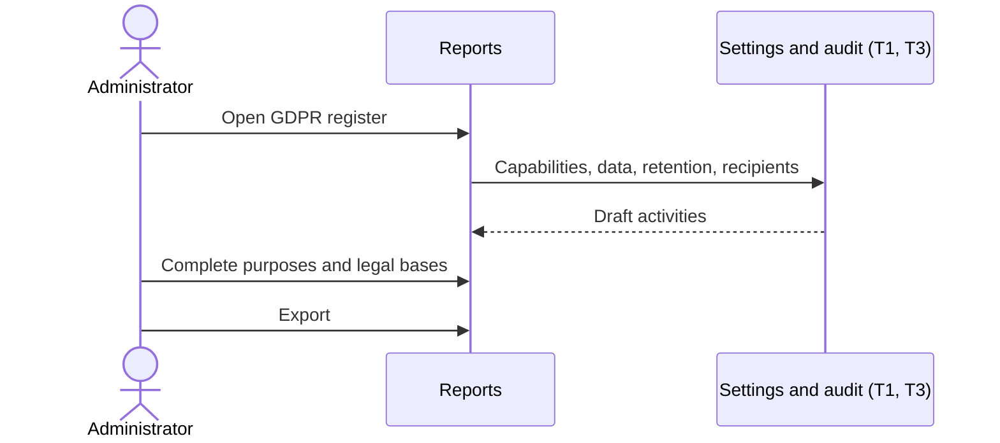

🏠 [Specs](../../../../README.md) › 🧩 [Functional capabilities](../../../README.md) ›
🛡️ [F1 Administration](../../README.md) › 📝 [Use cases](../README.md) ›
📝 [Use cases: FL-F1-09 Administration reports](README.md) › 📝 UC-F1-12 Draft the record of processing activities

# 📝 UC-F1-12 Draft the record of processing activities

**Status:** ✅ specified

## Summary

SimpleERP drafts the company's GDPR record of processing activities from its settings; the administrator completes and
exports it.

## Personas

- [U07 Administrator](../../../../01-users/personas/u07-administrator.md)
- [U13 Owner](../../../../01-users/personas/u13-owner.md), responsible for the register

## Goal

A register kept current with how the company really uses SimpleERP.

## Trigger

First set-up, then a change of capability, retention, connection or AI provider.

## Frequency

Reviewed once a year, and at each such change.

## Preconditions

The company is set up (BR-F1-03).

## Postconditions

A completed register, exportable; its versions kept.

## Main flow

1. The administrator opens Reports › GDPR register
   ([D93](../../../../06-decisions/f01-administration/d93-gdpr-register-draft.md)).
2. SimpleERP shows one processing activity per capability in use (customers and sales, HR, meetings...), with the data
   kept, the people concerned, the retention, and who receives data (connections, AI providers, the IT provider as
   processor, D53).
3. The administrator completes what SimpleERP cannot know: purposes, legal bases, the controller's contact.
4. They export it.

## Alternative flows

- 2a. A setting changed since the last export: the register is marked to review, and the changes are highlighted.

## Error flows

None.

## Business rules

None.

## Entities

None: the register is built from the settings at the time it is opened, and each export is kept.

- [E-F1-22 Record of processing activities](../../data/e-f01-22-record-of-processing-activities.md)

## Permissions

The administrator and the owner roles.

## Notifications

The administrators are told when the register needs a review
([D92](../../../../06-decisions/f01-administration/d92-notification-channels.md)).

## Audit events

Each export.

## AI involvement

The AI assistant suggests purposes and legal bases for each activity, for the administrator to approve.

## API, MCP and A2A exposure

None.

## Screens

- [S-F1-12 Users overview dashboard](../../screens/09-administration-reports/s-f01-12-users-overview-dashboard.md)

## Flowchart

See [FL-F1-09 Administration reports](../../flows/fl-f01-09-administration-reports.md#flowchart).

## Sequence diagram

## Acceptance criteria

1. **Given** a company using F6 and F9 **when** the register opens **then** it lists a processing activity for each,
   with data, people, retention and recipients.
2. **Given** an external AI provider chosen for a feature **when** the register opens **then** that provider is listed
   as a recipient.
3. **Given** a completed register **when** exported **then** the file holds every activity and the administrator's
   additions.

## Non-functional notes

Export as PDF and spreadsheet.

## Regulatory references

GDPR Article 30 (records of processing activities).

Legal values from the France country pack:
[CR-FR-048 Record of processing activities](../../../../10-country-packs/france/data-protection/cr-fr-048-record-of-processing.md).

## Related use cases

UC-F1-07; UC-F1-08; UC-F1-11 (recipients of data).

- [UC-F1-18 Run an access review campaign](../11-team-delegation-and-access-review/uc-f01-18-run-an-access-review-campaign.md)

- [UC-F1-22 Search the audit trail and export it to a SIEM](../13-security-and-audit/uc-f01-22-search-the-audit-trail-and-export-it-to-a-siem.md)

- [UC-F1-23 Close a company and export all its data](../14-close-a-company/uc-f01-23-close-a-company-and-export-all-its-data.md)

- [UC-F4-23 Handle an outside speaker's objection or erasure](../../../f04-meetings/use-cases/13-outside-people-and-follow-up/uc-f04-23-handle-an-outside-speakers-objection-or-erasure.md)

## Open questions

None.

---

⬅️ [UC-F1-11](../08-provider-and-client-companies/uc-f01-11-enter-a-client-company-to-support-it.md) ·
⬆️ [Up](README.md) ·
➡️ [UC-F1-13](../10-bring-users-in-at-scale/uc-f01-13-provision-users-from-the-identity-provider.md)
