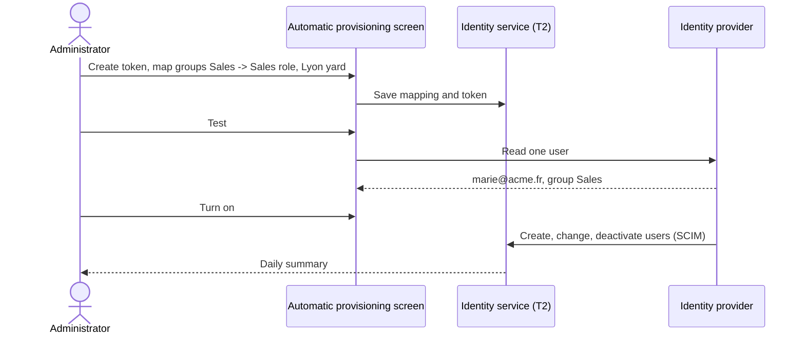

🏠 [Specs](../../../../README.md) › 🧩 [Functional capabilities](../../../README.md) ›
🛡️ [F1 Administration](../../README.md) › 📝 [Use cases](../README.md) ›
📝 [Use cases: FL-F1-10 Bring users in at scale](README.md) › 📝 UC-F1-13 Provision users from the identity provider

# 📝 UC-F1-13 Provision users from the identity provider

**Status:** 🔄 waiting for the owner

## Summary

The administrator turns on automatic provisioning (SCIM) so that the company's identity provider creates, changes and
deactivates users in simple-ERP, without anyone inviting them.

## Personas

- [U07 Administrator](../../../../01-users/personas/u07-administrator.md)
- [U11 IT provider administrator](../../../../01-users/personas/u11-provider-admin.md)

## Goal

Accounts that follow the identity provider: a joiner gets an account, a leaver loses it, the same day.

## Trigger

The company uses an identity provider with SCIM and wants accounts managed there.

## Frequency

Set up once per company; then every joiner, change and leaver on the provider's side.

## Preconditions

- Single sign-on is on ([UC-F1-09](../07-set-up-single-sign-on/uc-f01-09-set-up-single-sign-on.md)).
- The administrator holds the administration rights.

## Postconditions

- **Succeeded:** users are created, changed and deactivated from the provider; each change is in the audit trail.
- **Failed:** the token is refused or the test fails; nothing is changed and accounts stay as they were.

## Main flow

1. The administrator opens Administration › Single sign-on › Automatic provisioning
   ([S-F1-13](../../screens/10-bring-users-in-at-scale/s-f01-13-automatic-provisioning.md)).
2. They create the provisioning token, copy the endpoint address and token into the identity provider, and map the
   provider's groups to roles and sites.
3. They run the test: simple-ERP reads one user from the provider and shows what it would create.
4. They turn provisioning on; the provider sends its users; each new one gets an account with the roles and site of its
   groups, active at once, with no invitation.
5. When the provider deactivates someone, simple-ERP deactivates the user and starts the hand-over of
   [UC-F1-05](../03-user-lifecycle/uc-f01-05-deactivate-and-offboard-a-user.md) for their manager
   ([BR-F1-21](../../business-rules/br-f01-21-deprovisioned-users-are-deactivated-never-deleted.md)).

## Alternative flows

- 2a. A group has no mapping: its users get the default role of
  [BR-F1-18](../../business-rules/br-f01-18-allowed-domains.md) and are listed for the administrator to complete.
- 4a. A user already exists with that email: the account is linked, not duplicated
  ([BR-F1-07](../../business-rules/br-f01-07-one-account-per-email.md)).
- 5a. The provider deletes a user instead of deactivating it: simple-ERP deactivates it the same way.

## Error flows

- 3e. The provider cannot reach simple-ERP or the token is refused: the test shows the provider's error and provisioning
  stays off.
- 4e. A user's email is outside the allowed domains: refused and listed, with the reason.
- 5e. The deactivated user is the last administrator: refused, the provider is told, the administrator is warned
  ([BR-F1-17](../../business-rules/br-f01-17-administrators-keep-a-password.md)).

## Business rules

- [BR-F1-21 Deprovisioned users are deactivated, never deleted](../../business-rules/br-f01-21-deprovisioned-users-are-deactivated-never-deleted.md)
- [BR-F1-07 One account per email](../../business-rules/br-f01-07-one-account-per-email.md)
- [BR-F1-18 Allowed domains](../../business-rules/br-f01-18-allowed-domains.md)

## Entities

- [E-F1-14 Provisioning setting](../../data/e-f01-14-provisioning-setting.md)
- [E-F1-03 User](../../data/e-f01-03-user.md)
- [E-F1-10 Single sign-on setting](../../data/e-f01-10-single-sign-on-setting.md)

## Permissions

The administrator role; the IT provider administrator
([D53](../../../../06-decisions/ux/d53-provider-access-always.md)). The provisioning token can only create, change and
deactivate users and groups.

## Notifications

- The administrator gets a daily summary of users created, changed and deactivated by provisioning (Proposed).
- The manager of a deactivated user gets the hand-over task.

## Audit events

Provisioning turned on or off, token created or revoked, and every user created, changed or deactivated, marked "by
provisioning".

## AI involvement

The AI assistant can explain the screen and prepare the change for the administrator to confirm; it never applies an
administration change itself
([BR-F3-07](../../../f03-assistant/business-rules/br-f03-07-no-deletes-no-irreversible-acts.md)).

## API, MCP and A2A exposure

T5: the SCIM 2.0 Users and Groups endpoints, used only with the provisioning token; no MCP tool or A2A skill.

## Screens

- [S-F1-13 Automatic provisioning](../../screens/10-bring-users-in-at-scale/s-f01-13-automatic-provisioning.md)
- [S-F1-04 User page](../../screens/03-user-lifecycle/s-f01-04-user-page.md)

## Flowchart

See [FL-F1-10 Bring users in at scale](../../flows/fl-f01-10-bring-users-in-at-scale.md#flowchart).

## Sequence diagram

## Acceptance criteria

1. **Given** provisioning on and the group Sales mapped to the Sales role and the Lyon yard **when** the provider
   creates marie@acme.fr in Sales **then** Marie Dupont has an active account with the Sales role at the Lyon yard, and
   no invitation is sent.
2. **Given** Luc Bernard active in simple-ERP **when** the provider deactivates him on 2026-12-01 **then** his account
   is deactivated the same minute and his manager gets the hand-over task.
3. **Given** an existing account paul@acme.fr **when** the provider sends paul@acme.fr **then** the account is linked
   and no second account is created.
4. **Given** the allowed domain acme.fr **when** the provider sends marc@gmail.com **then** the user is refused and
   listed with the reason "domain not allowed".
5. **Given** a wrong token in the provider **when** the test runs **then** the provider's error is shown and
   provisioning stays off.

## Non-functional notes

A provisioning change applies within a minute; a provider sending 500 users at once is processed in the background
without slowing the screens.

## Regulatory references

GDPR: provisioning copies only the fields mapped
([CR-FR-052](../../../../10-country-packs/france/data-protection/cr-fr-052-storage-limitation.md)).

## Related use cases

- [UC-F1-09 Set up single sign-on](../07-set-up-single-sign-on/uc-f01-09-set-up-single-sign-on.md)
- [UC-F1-14 Invite users in bulk](uc-f01-14-invite-users-in-bulk.md)
- [UC-F1-05 Deactivate and offboard a user](../03-user-lifecycle/uc-f01-05-deactivate-and-offboard-a-user.md)

## Open questions

None.

---

⬅️ [UC-F1-12](../09-administration-reports/uc-f01-12-draft-the-record-of-processing-activities.md) ·
⬆️ [Up](README.md) · ➡️ [UC-F1-14 Invite users in bulk](uc-f01-14-invite-users-in-bulk.md)
