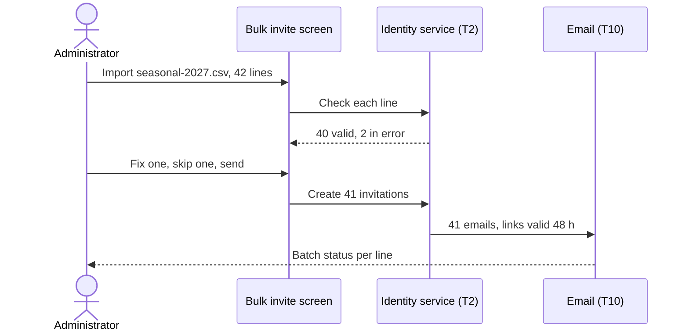

🏠 [Specs](../../../../README.md) › 🧩 [Functional capabilities](../../../README.md) ›
🛡️ [F1 Administration](../../README.md) › 📝 [Use cases](../README.md) ›
📝 [Use cases: FL-F1-10 Bring users in at scale](README.md) › 📝 UC-F1-14 Invite users in bulk

# 📝 UC-F1-14 Invite users in bulk

**Status:** ✅ specified

## Summary

The administrator pastes or imports a list of people, checks it line by line, and sends all the invitations at once, for
example the summer's seasonal staff.

## Personas

- [U07 Administrator](../../../../01-users/personas/u07-administrator.md)
- [U11 IT provider administrator](../../../../01-users/personas/u11-provider-admin.md)

## Goal

Twenty or two hundred people invited in one go, with the right roles and sites, and no mistake sent.

## Trigger

A batch of hires: seasonal staff, a new site opening, a client company taken on by the provider.

## Frequency

A few times a year per company; weekly in a season for hotels, farms and events.

## Preconditions

- The company is set up ([BR-F1-03](../../business-rules/br-f01-03-company-usable-once-set-up.md)).

## Postconditions

- **Succeeded:** one invitation per valid line, each valid 48 hours; the batch is kept with its result per line.
- **Failed:** no invitation is sent while a line is in error and the administrator has not skipped it.

## Main flow

1. The administrator opens Users › Invite in bulk
   ([S-F1-14](../../screens/10-bring-users-in-at-scale/s-f01-14-bulk-invite.md)).
2. They paste a list or import a CSV or spreadsheet file with email, name, role, site, manager and language columns;
   SimpleERP maps the columns.
3. SimpleERP checks every line
   ([BR-F1-22](../../business-rules/br-f01-22-bulk-invitations-are-checked-line-by-line.md)) and shows the valid ones
   and those in error, each with its reason.
4. The administrator fixes or skips the lines in error, then sends; each person gets the invitation of
   [UC-F1-03](../03-user-lifecycle/uc-f01-03-invite-a-user.md) in their language.
5. The batch shows, per line, sent, accepted, expired or not delivered; expired ones can be resent together.

## Alternative flows

- 2a. The administrator asks the AI assistant to read a pasted email or table: it fills the batch for review
  ([D62](../../../../06-decisions/f01-administration/d62-assistant-in-setup.md)).
- 3a. Single sign-on is on: the people are told to sign in with their company account instead.
- 5a. An end date per line (seasonal contract): the accounts are deactivated on that date.

## Error flows

- 3e. An email already has an account, appears twice, or a role or site does not exist: the line is in error and is not
  sent.
- 3e. The file cannot be read or has no email column: refused with the reason, nothing is kept.
- 4e. The batch is larger than 500 lines: the administrator is asked to split it.

## Business rules

- [BR-F1-22 Bulk invitations are checked line by line](../../business-rules/br-f01-22-bulk-invitations-are-checked-line-by-line.md)
- [BR-F1-06 Invitation link valid 48 hours](../../business-rules/br-f01-06-invitation-link-valid-48-hours.md)
- [BR-F1-07 One account per email](../../business-rules/br-f01-07-one-account-per-email.md)

## Entities

- [E-F1-15 Bulk invitation batch](../../data/e-f01-15-bulk-invitation-batch.md)
- [E-F1-04 Invitation](../../data/e-f01-04-invitation.md)
- [E-F1-03 User](../../data/e-f01-03-user.md)

## Permissions

The administrator role; the IT provider administrator
([D53](../../../../06-decisions/ux/d53-provider-access-always.md)); a site manager for their own site only
([UC-F1-15](uc-f01-15-administer-the-users-of-ones-own-site.md)).

## Notifications

- One invitation email per person, in their language.
- The administrator is told when the batch is fully accepted, and two days after sending of the lines still waiting.

## Audit events

Batch created, lines in error, sent, resent, with who and when; each invitation's own events as in
[UC-F1-03](../03-user-lifecycle/uc-f01-03-invite-a-user.md).

## AI involvement

The AI assistant reads a pasted list or file and fills the batch; the administrator checks every line before sending
([D62](../../../../06-decisions/f01-administration/d62-assistant-in-setup.md)).

## API, MCP and A2A exposure

None: bulk invitations are sent from the screen only.

## Screens

- [S-F1-14 Bulk invite](../../screens/10-bring-users-in-at-scale/s-f01-14-bulk-invite.md)
- [S-F1-03 Users](../../screens/03-user-lifecycle/s-f01-03-users.md)

## Flowchart

See [FL-F1-10 Bring users in at scale](../../flows/fl-f01-10-bring-users-in-at-scale.md#flowchart).

## Sequence diagram

## Acceptance criteria

1. **Given** a file of 42 lines with 2 emails already in use **when** it is imported **then** 40 lines are valid and the
   2 others are in error with "email has an account".
2. **Given** 41 valid lines **when** the administrator sends **then** 41 invitations are sent, each valid 48 hours.
3. **Given** a line with the site "Nice" that does not exist **when** it is checked **then** the line is in error with
   "site not found" and is not sent.
4. **Given** 12 invitations expired in the batch **when** the administrator chooses Resend expired **then** 12 new links
   are sent and the old ones no longer work.
5. **Given** a file with no email column **when** it is imported **then** it is refused with the reason and nothing is
   kept.

## Non-functional notes

Checking 500 lines takes under 5 seconds; the screen works on a tablet.

## Regulatory references

GDPR: the imported file is not kept once the batch is created
([CR-FR-052](../../../../10-country-packs/france/data-protection/cr-fr-052-storage-limitation.md)).

## Related use cases

- [UC-F1-03 Invite a user](../03-user-lifecycle/uc-f01-03-invite-a-user.md)
- [UC-F1-13 Provision users from the identity provider](uc-f01-13-provision-users-from-the-identity-provider.md)
- [UC-F1-15 Administer the users of one's own site](uc-f01-15-administer-the-users-of-ones-own-site.md)

## Open questions

None.

---

⬅️ [UC-F1-13 Provision users from the identity provider](uc-f01-13-provision-users-from-the-identity-provider.md) ·
⬆️ [Up](README.md) ·
➡️ [UC-F1-15 Administer the users of one's own site](uc-f01-15-administer-the-users-of-ones-own-site.md)
