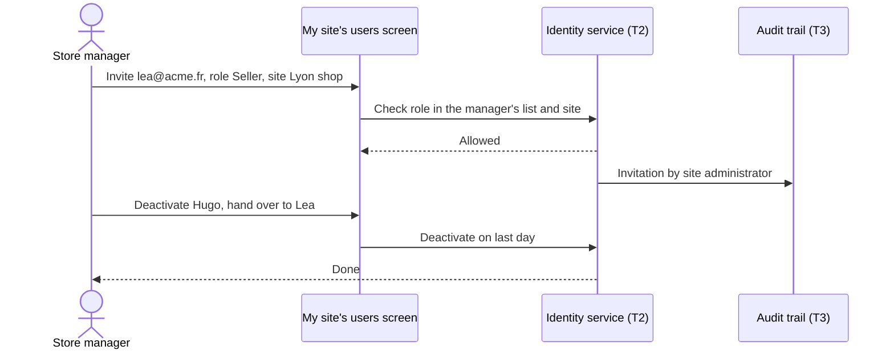

🏠 [Specs](../../../../README.md) › 🧩 [Functional capabilities](../../../README.md) ›
🛡️ [F1 Administration](../../README.md) › 📝 [Use cases](../README.md) ›
📝 [Use cases: FL-F1-10 Bring users in at scale](README.md) › 📝 UC-F1-15 Administer the users of one's own site

# 📝 UC-F1-15 Administer the users of one's own site

**Status:** ✅ specified

## Summary

A store or hotel manager invites, changes and deactivates the users of their own site, with the roles they are allowed
to give, without seeing the other sites' users.

## Personas

- [U23 Store manager](../../../../01-users/personas/u23-store-manager.md)
- [U02 Manager](../../../../01-users/personas/u02-manager.md)
- [U07 Administrator](../../../../01-users/personas/u07-administrator.md)

## Goal

Each site runs its own staff accounts without waiting for head office.

## Trigger

A hire, a change of shift role or a leaver at the site.

## Frequency

Weekly in shops, hotels and restaurants with turnover.

## Preconditions

- The administrator has made the manager a site administrator of that site, with the list of roles they may give
  ([BR-F1-23](../../business-rules/br-f01-23-site-administrators-stay-within-their-site-and-rights.md)).

## Postconditions

- **Succeeded:** the site's users are invited, changed or deactivated, each change in the audit trail.
- **Failed:** a change outside the site or above the manager's rights is refused; nothing is changed.

## Main flow

1. The store manager opens My site › Users
   ([S-F1-15](../../screens/10-bring-users-in-at-scale/s-f01-15-my-sites-users.md)): only their site's users and
   invitations show.
2. They invite a new seller with a role from the list they may give, and the site preset.
3. They change a user's role within that list, or set a last day.
4. They deactivate a leaver and pick a colleague of the site to take over open items
   ([BR-F1-01](../../business-rules/br-f01-01-offboarding-hand-over.md)).
5. The administrator sees every site manager's changes in the audit trail and in the users list.

## Alternative flows

- 2a. The new person already works at another site of the company: the manager asks the administrator to move them
  ([UC-F1-04](../03-user-lifecycle/uc-f01-04-change-a-users-role-or-site.md)).
- 3a. The change is dated: it applies on that date ([BR-F1-09](../../business-rules/br-f01-09-dated-changes.md)).

## Error flows

- 2e. The role chosen is not in the manager's list: not offered; through the API, refused.
- 4e. The leaver is the site's only manager: refused, the administrator is asked.
- 2e. The email has an account at another site: refused, the administrator is told
  ([BR-F1-07](../../business-rules/br-f01-07-one-account-per-email.md)).

## Business rules

- [BR-F1-23 Site administrators stay within their site and rights](../../business-rules/br-f01-23-site-administrators-stay-within-their-site-and-rights.md)
- [BR-F1-01 Offboarding hand-over](../../business-rules/br-f01-01-offboarding-hand-over.md)
- [BR-F1-07 One account per email](../../business-rules/br-f01-07-one-account-per-email.md)
- [BR-F1-09 Dated changes](../../business-rules/br-f01-09-dated-changes.md)

## Entities

- [E-F1-03 User](../../data/e-f01-03-user.md)
- [E-F1-06 Role](../../data/e-f01-06-role.md)
- [E-F1-02 Company site](../../data/e-f01-02-company-site.md)

## Permissions

A site administrator: a manager given that right on one or more sites; never on roles above their own rights.

## Notifications

- The invited person gets the invitation email.
- The administrator gets a weekly digest of the site managers' changes.

## Audit events

Every invitation, change and deactivation, with the site administrator's name and site.

## AI involvement

The AI assistant can explain the screen and prepare the change for the administrator to confirm; it never applies an
administration change itself
([BR-F3-07](../../../f03-assistant/business-rules/br-f03-07-no-deletes-no-irreversible-acts.md)).

## API, MCP and A2A exposure

T5 user operations, limited by the same site rule; no A2A skill.

## Screens

- [S-F1-15 My site's users](../../screens/10-bring-users-in-at-scale/s-f01-15-my-sites-users.md)
- [S-F1-05 Offboarding](../../screens/03-user-lifecycle/s-f01-05-offboarding.md)

## Flowchart

See [FL-F1-10 Bring users in at scale](../../flows/fl-f01-10-bring-users-in-at-scale.md#flowchart).

## Sequence diagram

## Acceptance criteria

1. **Given** Sophie, site administrator of the Lyon shop with the roles Seller and Cashier **when** she opens My site ›
   Users **then** she sees the Lyon shop's 12 users and no user of the Paris shop.
2. **Given** the same **when** she invites lea@acme.fr as Seller **then** the invitation is sent with the Lyon shop set.
3. **Given** the same **when** she tries to give the role Accounting **then** the role is not offered.
4. **Given** Hugo, a seller of the Lyon shop with 3 open orders **when** Sophie deactivates him with Lea as taker
   **then** the 3 orders move to Lea and Hugo is deactivated.
5. **Given** Sophie is the only manager of the Lyon shop **when** she tries to deactivate herself **then** it is refused
   and the administrator is asked.

## Non-functional notes

Works on a tablet and a phone, as the store manager is on the shop floor.

## Regulatory references

GDPR: a site administrator sees only the personal data of their site's users.

## Related use cases

- [UC-F1-03 Invite a user](../03-user-lifecycle/uc-f01-03-invite-a-user.md)
- [UC-F1-04 Change a user's role or site](../03-user-lifecycle/uc-f01-04-change-a-users-role-or-site.md)
- [UC-F1-05 Deactivate and offboard a user](../03-user-lifecycle/uc-f01-05-deactivate-and-offboard-a-user.md)

## Open questions

None.

---

⬅️ [UC-F1-14 Invite users in bulk](uc-f01-14-invite-users-in-bulk.md) · ⬆️ [Up](README.md) ·
➡️ [UC-F1-16](../11-team-delegation-and-access-review/uc-f01-16-delegate-approvals-during-an-absence.md)
