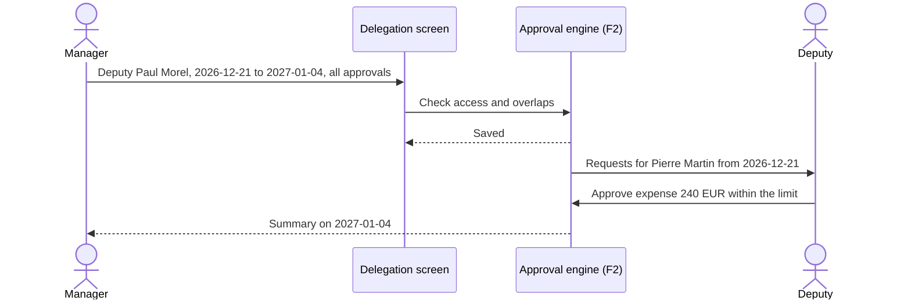

🏠 [Specs](../../../../README.md) › 🧩 [Functional capabilities](../../../README.md) ›
🛡️ [F1 Administration](../../README.md) › 📝 [Use cases](../README.md) ›
📝 [Use cases: FL-F1-11 Team, delegation and access review](README.md) › 📝 UC-F1-16 Delegate approvals during an absence

# 📝 UC-F1-16 Delegate approvals during an absence

**Status:** ✅ specified

## Summary

A manager going on leave hands their approvals (leave, purchases, expenses) to a deputy for the dates of their absence;
the deputy approves within the manager's limits.

## Personas

- [U02 Manager](../../../../01-users/personas/u02-manager.md)
- [U13 Owner](../../../../01-users/personas/u13-owner.md)

## Goal

Nothing waits for an absent manager, and nobody approves more than the manager could.

## Trigger

An approved leave, or a planned absence entered by the manager.

## Frequency

A few times a year per manager.

## Preconditions

- The deputy is an active user who can see the records concerned, or will through the delegation.

## Postconditions

- **Succeeded:** from the start date, requests go to the deputy; at the end date, they go back to the manager.
- **Failed:** no delegation is saved; requests keep going to the manager.

## Main flow

1. The manager opens My team › Delegation
   ([S-F1-16](../../screens/11-team-delegation-and-access-review/s-f01-16-delegation.md)), or accepts the suggestion
   shown when their leave is approved.
2. They choose the deputy, the start and end dates, and which approvals: leave, purchases, expenses, or all.
3. SimpleERP checks the deputy's access and the overlap with other delegations
   ([BR-F1-24](../../business-rules/br-f01-24-a-deputy-approves-within-the-delegators-limits.md)).
4. From the start date, new and waiting requests go to the deputy, marked "for Pierre Martin"; the deputy approves
   within the manager's amount limits.
5. At the end date, the remaining requests go back to the manager, who gets a summary of what was approved for them.

## Alternative flows

- 1a. The owner sets a delegation for an absent manager who could not
  ([U13](../../../../01-users/personas/u13-owner.md)).
- 4a. The deputy is away too: the requests go to the manager's own manager.
- 5a. The manager comes back early and ends the delegation at once.

## Error flows

- 3e. The deputy is the requester of a request: that request goes to the manager's manager instead, as nobody approves
  their own request.
- 3e. Overlapping delegation for the same approvals: refused, the existing one is shown.
- 2e. The deputy is deactivated during the delegation: the requests go back to the manager, who is told.

## Business rules

- [BR-F1-24 A deputy approves within the delegator's limits](../../business-rules/br-f01-24-a-deputy-approves-within-the-delegators-limits.md)

## Entities

- [E-F1-13 Approval delegation](../../data/e-f01-13-approval-delegation.md)
- [E-F1-03 User](../../data/e-f01-03-user.md)

## Permissions

Any manager for their own approvals; the owner and the administrator for anyone.

## Notifications

- The deputy is told at the start and the end.
- Requesters see who will approve.
- The manager gets the summary at the end.

## Audit events

Delegation created, changed, ended; each approval records the deputy and "for" the manager.

## AI involvement

The AI assistant suggests a delegation when a leave is approved; it never approves on anyone's behalf.

## API, MCP and A2A exposure

T5 delegation operations; the MCP tool of F1 with the caller's rights; no A2A skill.

## Screens

- [S-F1-16 Delegation](../../screens/11-team-delegation-and-access-review/s-f01-16-delegation.md)
- [S-F1-17 My team](../../screens/11-team-delegation-and-access-review/s-f01-17-my-team.md)

## Flowchart

See [FL-F1-11 Team, delegation and access review](../../flows/fl-f01-11-team-delegation-and-access-review.md#flowchart).

## Sequence diagram

## Acceptance criteria

1. **Given** Pierre Martin delegates all approvals to Paul Morel from 2026-12-21 to 2027-01-04 **when** an expense of
   240 EUR is submitted on 2026-12-22 **then** Paul Morel gets it, marked for Pierre Martin.
2. **Given** Pierre Martin's purchase limit of 5,000 EUR **when** Paul approves a 7,000 EUR purchase request **then**
   the request goes to the next level, as Pierre could not approve it alone.
3. **Given** a delegation ending 2027-01-04 **when** a leave request is still waiting on 2027-01-05 **then** it is back
   with Pierre Martin, who gets the summary.
4. **Given** Paul Morel submits his own expense during the delegation **when** it is routed **then** it goes to Pierre
   Martin's manager, not to Paul.
5. **Given** a delegation of purchases already from 2026-12-21 **when** a second one for the same dates is saved
   **then** it is refused and the first one is shown.

## Non-functional notes

Routing changes at 00:00 in the company's time zone on the start and end dates.

## Regulatory references

None.

## Related use cases

- [UC-F1-17 See my team's accounts and pending requests](uc-f01-17-see-my-teams-accounts-and-pending-requests.md)
- [UC-F9-04 Use employee self-service](../../../f09-hr-and-projects/use-cases/01-people/uc-f09-04-use-employee-self-service.md)
- [UC-F2-29 Set up an approval chain](../../../f02-no-code-configuration/use-cases/11-rights-translations-and-approvals/uc-f02-29-set-up-an-approval-chain.md)

## Open questions

None.

---

⬅️ [UC-F1-15](../10-bring-users-in-at-scale/uc-f01-15-administer-the-users-of-ones-own-site.md) · ⬆️ [Up](README.md) ·
➡️ [UC-F1-17 See my team's accounts and pending requests](uc-f01-17-see-my-teams-accounts-and-pending-requests.md)
