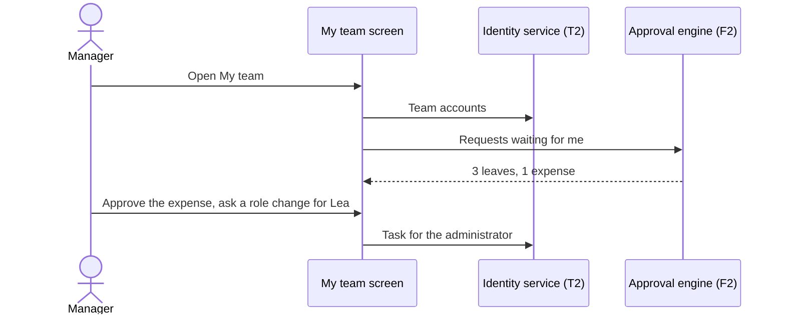

🏠 [Specs](../../../../README.md) › 🧩 [Functional capabilities](../../../README.md) ›
🛡️ [F1 Administration](../../README.md) › 📝 [Use cases](../README.md) ›
📝 [Use cases: FL-F1-11 Team, delegation and access review](README.md) ›
📝 UC-F1-17 See my team's accounts and pending requests

# 📝 UC-F1-17 See my team's accounts and pending requests

**Status:** 🔄 waiting for the owner

## Summary

A manager sees their team's accounts (status, roles, last sign-in) and every request waiting for them, and asks the
administrator for a change.

## Personas

- [U02 Manager](../../../../01-users/personas/u02-manager.md)

## Goal

Know who in the team can work in simple-ERP and clear what waits.

## Trigger

The manager opens My team, or a request waits.

## Frequency

Weekly per manager.

## Preconditions

- The manager is set as the manager of their team members
  ([D67](../../../../06-decisions/f01-administration/d67-what-an-invitation-sets.md)).

## Postconditions

- **Succeeded:** the manager sees the team; their requests to the administrator are sent.
- **Failed:** nothing changes; the manager cannot change accounts here.

## Main flow

1. The manager opens My team ([S-F1-17](../../screens/11-team-delegation-and-access-review/s-f01-17-my-team.md)): each
   member's status (active, invited, deactivated), roles, site and last sign-in.
2. Under Waiting for me, the leave, purchase and expense requests waiting for them are listed by age.
3. They approve or refuse a request from the list, or open it.
4. They ask the administrator for a change (a role, a site, a reactivation) with a comment; the administrator gets a
   task.

## Alternative flows

- 1a. An invitation expired: the manager asks the administrator to resend it.
- 3a. Many similar requests: the manager approves several at once (Proposed).

## Error flows

- 3e. A request was withdrawn meanwhile: shown as withdrawn, nothing to do.
- 4e. The administrator refuses the change: the manager sees the reason.

## Business rules

- [BR-F1-02 Administrator sees settings only](../../business-rules/br-f01-02-administrator-sees-settings-only.md)
- [BR-F1-24 A deputy approves within the delegator's limits](../../business-rules/br-f01-24-a-deputy-approves-within-the-delegators-limits.md)

## Entities

- [E-F1-03 User](../../data/e-f01-03-user.md)
- [E-F1-13 Approval delegation](../../data/e-f01-13-approval-delegation.md)

## Permissions

Managers, for the users whose manager they are; read-only on accounts.

## Notifications

The administrator gets the change request; the manager is told of the answer.

## Audit events

Change requested, approved or refused; approvals as in their own use cases.

## AI involvement

The AI assistant summarises what waits and suggests the oldest first; it never approves.

## API, MCP and A2A exposure

T5 read operations on the team; the MCP tool of F1 with the caller's rights.

## Screens

- [S-F1-17 My team](../../screens/11-team-delegation-and-access-review/s-f01-17-my-team.md)

## Flowchart

See [FL-F1-11 Team, delegation and access review](../../flows/fl-f01-11-team-delegation-and-access-review.md#flowchart).

## Sequence diagram

## Acceptance criteria

1. **Given** Pierre Martin manages 6 people, one invited **when** he opens My team **then** he sees 6 lines and Lea Roux
   as invited with the expiry time.
2. **Given** 3 leave requests waiting for Pierre **when** he opens Waiting for me **then** they are listed oldest first
   with their dates.
3. **Given** Pierre asks a Cashier role for Lea **when** he sends the request **then** the administrator gets a task
   with Pierre's comment.
4. **Given** a request withdrawn by its author **when** Pierre opens it **then** it shows as withdrawn and cannot be
   approved.

## Non-functional notes

Opens within 2 seconds for a team of 50 (Proposed); on a phone, the list becomes cards.

## Regulatory references

GDPR: the last sign-in is shown to the manager only for their team.

## Related use cases

- [UC-F1-16 Delegate approvals during an absence](uc-f01-16-delegate-approvals-during-an-absence.md)
- [UC-F1-04 Change a user's role or site](../03-user-lifecycle/uc-f01-04-change-a-users-role-or-site.md)

## Open questions

None.

---

⬅️ [UC-F1-16 Delegate approvals during an absence](uc-f01-16-delegate-approvals-during-an-absence.md) ·
⬆️ [Up](README.md) · ➡️ [UC-F1-18 Run an access review campaign](uc-f01-18-run-an-access-review-campaign.md)
