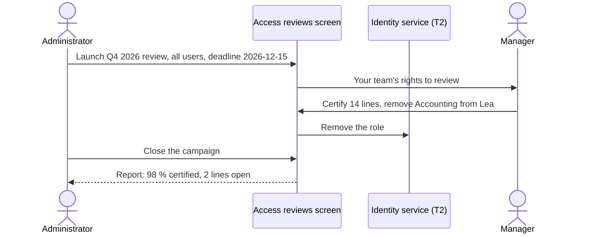

🏠 [Specs](../../../../README.md) › 🧩 [Functional capabilities](../../../README.md) ›
🛡️ [F1 Administration](../../README.md) › 📝 [Use cases](../README.md) ›
📝 [Use cases: FL-F1-11 Team, delegation and access review](README.md) › 📝 UC-F1-18 Run an access review campaign

# 📝 UC-F1-18 Run an access review campaign

**Status:** 🔄 waiting for the owner

## Summary

Each quarter, the administrator launches a review in which every manager certifies or removes each right of their team;
the result is the evidence of the access controls.

## Personas

- [U07 Administrator](../../../../01-users/personas/u07-administrator.md)
- [U02 Manager](../../../../01-users/personas/u02-manager.md)
- [U13 Owner](../../../../01-users/personas/u13-owner.md)

## Goal

Rights that match each person's job, with a dated proof that they were reviewed.

## Trigger

The quarterly date (Proposed), an audit, or a security incident.

## Frequency

Quarterly per company (Proposed).

## Preconditions

- Every user has a manager; users without one go to the administrator.

## Postconditions

- **Succeeded:** every right is certified or removed; the campaign report is kept.
- **Failed:** rights left uncertified at the deadline are listed for the administrator; none is removed without a
  decision ([BR-F1-25](../../business-rules/br-f01-25-uncertified-rights-are-reported-not-removed.md)).

## Main flow

1. The administrator opens Administration › Access reviews
   ([S-F1-18](../../screens/11-team-delegation-and-access-review/s-f01-18-access-reviews.md)) and launches a campaign
   with its scope (all users, a site, a role) and a deadline.
2. Each manager gets their list: each team member's roles, sites and outside connections, with the last use of each
   right.
3. The manager certifies or removes each line, with a comment for a removal.
4. Removals apply when the manager confirms; the user is told.
5. At the deadline, the administrator closes the campaign; the report shows who certified what and when, and the lines
   left open.

## Alternative flows

- 2a. A right unused for 90 days (Proposed) is marked so that the manager can remove it.
- 3a. The manager delegated during an absence: the deputy reviews
  ([UC-F1-16](uc-f01-16-delegate-approvals-during-an-absence.md)).

## Error flows

- 3e. Removing the last administrator's rights: refused
  ([BR-F1-17](../../business-rules/br-f01-17-administrators-keep-a-password.md)).
- 5e. Lines left open at the deadline: reminders, then the administrator decides each one.

## Business rules

- [BR-F1-25 Uncertified rights are reported, not removed](../../business-rules/br-f01-25-uncertified-rights-are-reported-not-removed.md)
- [BR-F1-08 Rights add up](../../business-rules/br-f01-08-rights-add-up.md)
- [BR-F1-17 Administrators keep a password](../../business-rules/br-f01-17-administrators-keep-a-password.md)

## Entities

- [E-F1-16 Access review campaign](../../data/e-f01-16-access-review-campaign.md)
- [E-F1-06 Role](../../data/e-f01-06-role.md)
- [E-F1-03 User](../../data/e-f01-03-user.md)

## Permissions

The administrator launches and closes; managers review their team; the owner reads the reports.

## Notifications

- Managers are told at launch, then reminded 3 days before the deadline (Proposed).
- Users are told when a right is removed.

## Audit events

Campaign launched and closed; each line certified or removed with who, when and comment.

## AI involvement

The AI assistant highlights rights that are unused or unusual for the job; the manager decides.

## API, MCP and A2A exposure

T5 read of campaigns and their report; no change through the API.

## Screens

- [S-F1-18 Access reviews](../../screens/11-team-delegation-and-access-review/s-f01-18-access-reviews.md)
- [S-F1-24 Access rights dashboard](../../screens/09-administration-reports/s-f01-24-access-rights-dashboard.md)

## Flowchart

See [FL-F1-11 Team, delegation and access review](../../flows/fl-f01-11-team-delegation-and-access-review.md#flowchart).

## Sequence diagram

## Acceptance criteria

1. **Given** a Q4 campaign over 40 users and 6 managers **when** it is launched **then** each manager gets the list of
   their team's rights.
2. **Given** Lea's Accounting role unused for 120 days **when** Pierre reviews his list **then** the line is marked
   unused.
3. **Given** Pierre removes Lea's Accounting role with the comment "moved to sales" **when** he confirms **then** the
   role is removed and Lea is told.
4. **Given** 2 lines left at the deadline **when** the administrator closes the campaign **then** the report lists them
   as open and nothing is removed without a decision.
5. **Given** the report of the Q4 campaign **when** the owner exports it **then** a PDF lists every line, who reviewed
   it and when.

## Non-functional notes

A campaign of 500 users and 5,000 lines stays usable (Proposed).

## Regulatory references

(Proposed) to read: ISO/IEC 27001:2022 Annex A 5.18, access rights review.

## Related use cases

- [UC-F1-06 Edit a role and its record rules](../04-edit-a-role/uc-f01-06-edit-a-role-and-its-record-rules.md)
- [UC-F1-12 Draft the record of processing activities](../09-administration-reports/uc-f01-12-draft-the-record-of-processing-activities.md)
- [UC-F1-16 Delegate approvals during an absence](uc-f01-16-delegate-approvals-during-an-absence.md)

## Open questions

None.

---

⬅️ [UC-F1-17 See my team's accounts and pending requests](uc-f01-17-see-my-teams-accounts-and-pending-requests.md) ·
⬆️ [Up](README.md) ·
➡️ [UC-F1-19 Manage portal accounts](../12-portal-accounts-and-integrations/uc-f01-19-manage-portal-accounts.md)
