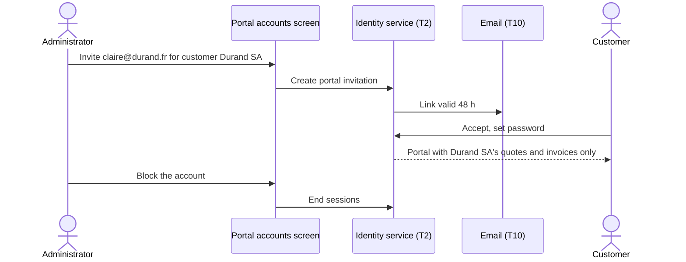

🏠 [Specs](../../../../README.md) › 🧩 [Functional capabilities](../../../README.md) ›
🛡️ [F1 Administration](../../README.md) › 📝 [Use cases](../README.md) ›
📝 [Use cases: FL-F1-12 Portal accounts and integrations](README.md) › 📝 UC-F1-19 Manage portal accounts

# 📝 UC-F1-19 Manage portal accounts

**Status:** 🔄 waiting for the owner

## Summary

The administrator invites, blocks, resets and audits the accounts of people outside the company who use a portal:
customers, suppliers, and the people of sector record types such as families, tenants or learners.

## Personas

- [U07 Administrator](../../../../01-users/personas/u07-administrator.md)
- [U09 Customer](../../../../01-users/personas/u09-customer.md)
- [U10 Supplier](../../../../01-users/personas/u10-supplier.md)

## Goal

Outside people get the access they need to their own records, and lose it when they should.

## Trigger

A customer, supplier or record contact needs the portal; a misuse or a lost access.

## Frequency

Daily in companies with portals; a few a month otherwise.

## Preconditions

The portal of that record type is on. For customers:
[UC-F6-11](../../../f06-customers-and-sales/use-cases/02-quote-to-order/uc-f06-11-use-the-customer-portal.md); for
suppliers: [UC-F7-12](../../../f07-purchasing-and-stock/use-cases/01-procure/uc-f07-12-use-the-supplier-portal.md); for
sector record types:
[UC-F2-20 Expose a record type on a portal](../../../f02-no-code-configuration/use-cases/09-portals-and-offline-forms/uc-f02-20-expose-a-record-type-on-a-portal.md).

## Postconditions

- **Succeeded:** the outside person has an account that sees only their own records
  ([BR-F1-26](../../business-rules/br-f01-26-portal-accounts-see-only-their-own-records.md)).
- **Failed:** no account; a blocked account cannot sign in and its sessions end.

## Main flow

1. The administrator, or a user with the right, opens a record (a customer, a supplier, a family) and chooses Invite to
   the portal, or opens Administration › Portal accounts
   ([S-F1-19](../../screens/12-portal-accounts-and-integrations/s-f01-19-portal-accounts.md)).
2. SimpleERP sends an invitation to the record's contact email, valid 48 hours
   ([BR-F1-06](../../business-rules/br-f01-06-invitation-link-valid-48-hours.md)).
3. The person accepts, sets a password and, if the portal requires it, two-factor authentication; they see only the
   records linked to them.
4. The administrator blocks an account, resets its password or two-factor, or reads its sign-ins and actions.
5. When the record ends (a lease, a contract, a course), the account is deactivated on that date (Proposed).

## Alternative flows

- 1a. Several contacts of one customer: each gets their own account on the same customer.
- 3a. The person already has a portal account for another record of the company: the new record is added to it.

## Error flows

- 2e. The record has no contact email: the invitation is not offered, with the reason.
- 3e. The link expired: the person asks again from the portal sign-in page.
- 4e. Too many failed sign-ins: the account is locked as the security policy says
  ([UC-F1-21](../13-security-and-audit/uc-f01-21-set-the-security-policies.md)).

## Business rules

- [BR-F1-26 Portal accounts see only their own records](../../business-rules/br-f01-26-portal-accounts-see-only-their-own-records.md)
- [BR-F1-06 Invitation link valid 48 hours](../../business-rules/br-f01-06-invitation-link-valid-48-hours.md)
- [BR-F1-28 Security policies never lock out every administrator](../../business-rules/br-f01-28-security-policies-never-lock-out-every-administrator.md)

## Entities

- [E-F1-17 Portal account](../../data/e-f01-17-portal-account.md)

## Permissions

The administrator; users with the portal right on that record type (for example sales for customers).

## Notifications

- The invitation and reset emails, in the person's language.
- The administrator is told of locked accounts.

## Audit events

Invitation, acceptance, block, unblock, reset, sign-ins and every change made through the portal.

## AI involvement

The AI assistant can explain to the administrator what an outside person sees; portal users get no AI assistant
([D460](../../../../06-decisions/f03-assistant/d460-f03-gaps-and-improvements.md)).

## API, MCP and A2A exposure

T5 portal account operations for administrators; no MCP tool.

## Screens

- [S-F1-19 Portal accounts](../../screens/12-portal-accounts-and-integrations/s-f01-19-portal-accounts.md)

## Flowchart

See [FL-F1-12 Portal accounts and integrations](../../flows/fl-f01-12-portal-accounts-and-integrations.md#flowchart).

## Sequence diagram

## Acceptance criteria

1. **Given** customer Durand SA with contact claire@durand.fr **when** the administrator invites her **then** she gets a
   link valid 48 hours.
2. **Given** Claire's portal account **when** she signs in **then** she sees Durand SA's quotes and invoices and no
   other customer's.
3. **Given** a blocked account **when** Claire tries to sign in **then** she is refused and told to contact the company.
4. **Given** a family contact of a home-care recipient **when** the portal of that record type is on and she is invited
   **then** she sees that recipient's visits only.
5. **Given** a supplier record without an email **when** the administrator opens it **then** Invite to the portal is not
   offered, with the reason.

## Non-functional notes

Portal pages work on a phone; a portal of 5,000 accounts keeps its list searchable (Proposed).

## Regulatory references

GDPR: outside people's sign-ins are personal data, kept as the retention of
[CR-FR-052](../../../../10-country-packs/france/data-protection/cr-fr-052-storage-limitation.md) says.

## Related use cases

- [UC-F6-11 Use the customer portal](../../../f06-customers-and-sales/use-cases/02-quote-to-order/uc-f06-11-use-the-customer-portal.md)
- [UC-F7-12 Use the supplier portal](../../../f07-purchasing-and-stock/use-cases/01-procure/uc-f07-12-use-the-supplier-portal.md)
- [UC-F2-20 Expose a record type on a portal](../../../f02-no-code-configuration/use-cases/09-portals-and-offline-forms/uc-f02-20-expose-a-record-type-on-a-portal.md)

## Open questions

None.

---

⬅️ [UC-F1-18](../11-team-delegation-and-access-review/uc-f01-18-run-an-access-review-campaign.md) · ⬆️ [Up](README.md) ·
➡️ [UC-F1-20](uc-f01-20-create-and-revoke-api-tokens-and-service-accounts.md)
