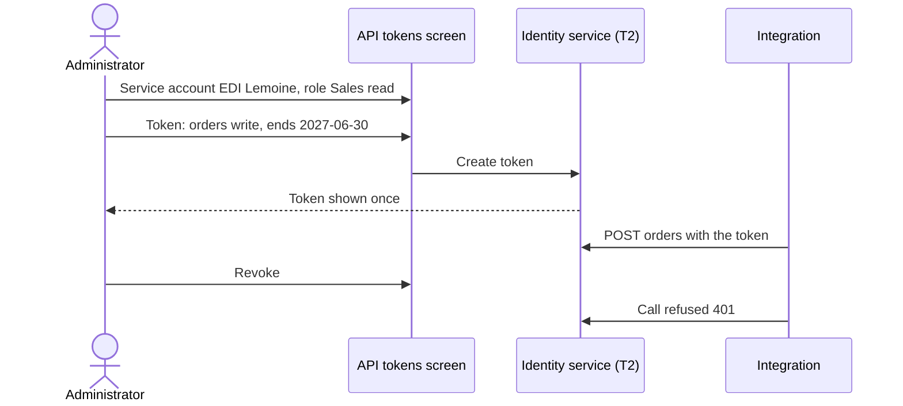

🏠 [Specs](../../../../README.md) › 🧩 [Functional capabilities](../../../README.md) ›
🛡️ [F1 Administration](../../README.md) › 📝 [Use cases](../README.md) ›
📝 [Use cases: FL-F1-12 Portal accounts and integrations](README.md) ›
📝 UC-F1-20 Create and revoke API tokens and service accounts

# 📝 UC-F1-20 Create and revoke API tokens and service accounts

**Status:** 🔄 waiting for the owner

## Summary

The administrator creates a service account for an integration, gives it a role, issues tokens with scopes and an end
date, and revokes them.

## Personas

- [U07 Administrator](../../../../01-users/personas/u07-administrator.md)
- [U11 IT provider administrator](../../../../01-users/personas/u11-provider-admin.md)

## Goal

Integrations that use only what they need, and can be cut off at once.

## Trigger

A new integration (an EDI partner, a reporting tool), a leaked key, a token about to expire.

## Frequency

A few a year per company.

## Preconditions

- The administrator holds the administration rights.

## Postconditions

- **Succeeded:** the integration calls the API with its token, within its role and scopes.
- **Failed:** no token, or a revoked one: every call is refused.

## Main flow

1. The administrator opens Administration › API tokens
   ([S-F1-20](../../screens/12-portal-accounts-and-integrations/s-f01-20-api-tokens.md)) and creates a service account
   with a name, an owner and a role.
2. They issue a token: its scopes (read or write per record type), an end date, and allowed IP addresses if wanted.
3. simple-ERP shows the token once
   ([BR-F1-27](../../business-rules/br-f01-27-tokens-are-scoped-dated-and-shown-once.md)); the administrator copies it
   into the integration.
4. The list shows each token's last use and calls this month.
5. The administrator revokes a token: calls with it are refused at once.

## Alternative flows

- 2a. The token is for a personal script of a user: it gets that user's rights, never more.
- 4a. A token ending within 14 days (Proposed): its owner is told to renew it.

## Error flows

- 2e. Scopes beyond the service account's role: refused with the scopes in excess.
- 5e. A call with a revoked or expired token: refused with 401 and logged.

## Business rules

- [BR-F1-27 Tokens are scoped, dated and shown once](../../business-rules/br-f01-27-tokens-are-scoped-dated-and-shown-once.md)
- [BR-F1-08 Rights add up](../../business-rules/br-f01-08-rights-add-up.md)

## Entities

- [E-F1-18 API token](../../data/e-f01-18-api-token.md)
- [E-F1-06 Role](../../data/e-f01-06-role.md)

## Permissions

The administrator; the IT provider administrator ([D53](../../../../06-decisions/ux/d53-provider-access-always.md)).

## Notifications

The owner of a service account is told when a token is about to end and when one is revoked.

## Audit events

Service account and token created, revoked, expired; each API call with its token name.

## AI involvement

The AI assistant can explain the screen and prepare the change for the administrator to confirm; it never applies an
administration change itself
([BR-F3-07](../../../f03-assistant/business-rules/br-f03-07-no-deletes-no-irreversible-acts.md)).

## API, MCP and A2A exposure

T5 authenticates with these tokens; the token operations themselves are on the screen only.

## Screens

- [S-F1-20 API tokens](../../screens/12-portal-accounts-and-integrations/s-f01-20-api-tokens.md)

## Flowchart

See [FL-F1-12 Portal accounts and integrations](../../flows/fl-f01-12-portal-accounts-and-integrations.md#flowchart).

## Sequence diagram

## Acceptance criteria

1. **Given** a service account EDI Lemoine with the role Sales **when** a token with orders write ending 2027-06-30 is
   issued **then** it is shown once and then only its last four characters.
2. **Given** the same token **when** the integration creates an order **then** the order is created and signed EDI
   Lemoine.
3. **Given** the same token **when** the administrator revokes it **then** the next call is refused with 401.
4. **Given** the role Sales read **when** a token with accounting write is asked **then** it is refused, naming the
   scope.
5. **Given** a token ending 2027-06-30 **when** it is 2027-06-16 **then** the owner is told to renew it.

## Non-functional notes

A revocation takes effect within a minute (Proposed).

## Regulatory references

None.

## Related use cases

- [UC-F1-07 Connect an external MCP server or A2A agent](../05-connect-an-external-tool/uc-f01-07-connect-an-external-mcp-server-or-a2a-agent.md)
- [UC-F24-01 Browse the connector catalogue](../../../f24-integrations-hub/use-cases/01-find-and-connect/uc-f24-01-browse-the-connector-catalogue.md)

## Open questions

None.

---

⬅️ [UC-F1-19 Manage portal accounts](uc-f01-19-manage-portal-accounts.md) · ⬆️ [Up](README.md) ·
➡️ [UC-F1-21 Set the security policies](../13-security-and-audit/uc-f01-21-set-the-security-policies.md)
