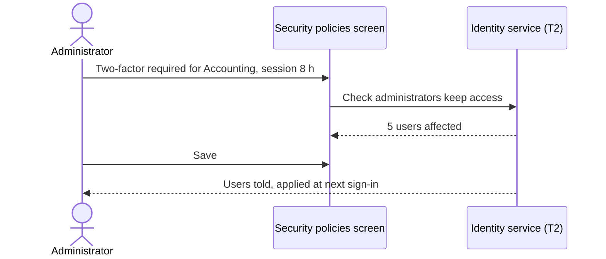

🏠 [Specs](../../../../README.md) › 🧩 [Functional capabilities](../../../README.md) ›
🛡️ [F1 Administration](../../README.md) › 📝 [Use cases](../README.md) ›
📝 [Use cases: FL-F1-13 Security and audit](README.md) › 📝 UC-F1-21 Set the security policies

# 📝 UC-F1-21 Set the security policies

**Status:** 🔄 waiting for the owner

## Summary

The administrator sets the company's password rules, session length, two-factor authentication per role, and IP and
device limits.

## Personas

- [U07 Administrator](../../../../01-users/personas/u07-administrator.md)

## Goal

Security rules that fit the company's risks, the same for every user of a role.

## Trigger

Setting up the company, an audit, an incident, a customer's security questionnaire.

## Frequency

Once, then a few times a year.

## Preconditions

- The administrator holds the administration rights.

## Postconditions

- **Succeeded:** the policies apply; stricter ones at each user's next sign-in.
- **Failed:** the policies are unchanged.

## Main flow

1. The administrator opens Administration › Security policies
   ([S-F1-21](../../screens/13-security-and-audit/s-f01-21-security-policies.md)).
2. They set the password length and expiry, the session length and idle timeout, two-factor required per role, and the
   IP ranges or device types allowed per role.
3. simple-ERP shows who the change affects and checks that at least one administrator keeps access
   ([BR-F1-28](../../business-rules/br-f01-28-security-policies-never-lock-out-every-administrator.md)).
4. They save; affected users are told, and stricter rules apply at their next sign-in.

## Alternative flows

- 2a. Single sign-on is on: password rules are the provider's, and only session and IP rules apply.
- 4a. A user without two-factor when it becomes required: they set it at their next sign-in.

## Error flows

- 3e. A rule that would lock out every administrator: refused with the reason.
- 3e. An IP range written wrongly: refused next to the field.

## Business rules

- [BR-F1-28 Security policies never lock out every administrator](../../business-rules/br-f01-28-security-policies-never-lock-out-every-administrator.md)
- [BR-F1-17 Administrators keep a password](../../business-rules/br-f01-17-administrators-keep-a-password.md)

## Entities

- [E-F1-19 Security policy](../../data/e-f01-19-security-policy.md)

## Permissions

The administrator only.

## Notifications

Affected users are told by email before the rule applies.

## Audit events

Each policy change, with the values before and after.

## AI involvement

The AI assistant can explain the screen and prepare the change for the administrator to confirm; it never applies an
administration change itself
([BR-F3-07](../../../f03-assistant/business-rules/br-f03-07-no-deletes-no-irreversible-acts.md)).

## API, MCP and A2A exposure

None: policies are changed on the screen only.

## Screens

- [S-F1-21 Security policies](../../screens/13-security-and-audit/s-f01-21-security-policies.md)

## Flowchart

See [FL-F1-13 Security and audit](../../flows/fl-f01-13-security-and-audit.md#flowchart).

## Sequence diagram

## Acceptance criteria

1. **Given** two-factor not required for Accounting **when** the administrator requires it **then** the 5 accounting
   users must set it at their next sign-in.
2. **Given** an IP rule allowing only 192.0.2.0/24 for administrators **when** the administrator saves it from another
   address **then** it is refused, as it would lock them out.
3. **Given** an idle timeout of 30 minutes **when** a user is idle 31 minutes **then** they are signed out.
4. **Given** single sign-on on **when** the administrator opens the password rules **then** they are shown as the
   provider's.

## Non-functional notes

A policy change reaches every server within a minute (Proposed).

## Regulatory references

(Proposed) to read: ANSSI password recommendations.

## Related use cases

- [UC-F1-09 Set up single sign-on](../07-set-up-single-sign-on/uc-f01-09-set-up-single-sign-on.md)
- [UC-F1-19 Manage portal accounts](../12-portal-accounts-and-integrations/uc-f01-19-manage-portal-accounts.md)

## Open questions

None.

---

⬅️ [UC-F1-20](../12-portal-accounts-and-integrations/uc-f01-20-create-and-revoke-api-tokens-and-service-accounts.md) ·
⬆️ [Up](README.md) · ➡️ [UC-F1-22](uc-f01-22-search-the-audit-trail-and-export-it-to-a-siem.md)
