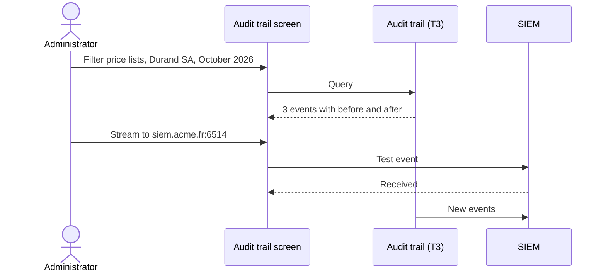

🏠 [Specs](../../../../README.md) › 🧩 [Functional capabilities](../../../README.md) ›
🛡️ [F1 Administration](../../README.md) › 📝 [Use cases](../README.md) ›
📝 [Use cases: FL-F1-13 Security and audit](README.md) › 📝 UC-F1-22 Search the audit trail and export it to a SIEM

# 📝 UC-F1-22 Search the audit trail and export it to a SIEM

**Status:** ✅ specified

## Summary

The administrator searches the audit trail by person, action, record and date, exports it, or streams it to the
company's security tool (SIEM).

## Personas

- [U07 Administrator](../../../../01-users/personas/u07-administrator.md)
- [U13 Owner](../../../../01-users/personas/u13-owner.md)

## Goal

Answer "who changed this, when" in seconds, and give the security team the events live.

## Trigger

A question on a record, an incident, an auditor's request, setting up the SIEM.

## Frequency

Weekly searches; the SIEM stream is set once.

## Preconditions

- The audit trail records every change ([T3](../../../../03-technical/t03-audit-trail/README.md)).

## Postconditions

- **Succeeded:** the events searched are shown or exported; the SIEM receives each new event.
- **Failed:** nothing is exported; a failing stream is retried and the administrator warned.

## Main flow

1. The administrator opens Administration › Audit trail
   ([S-F1-22](../../screens/13-security-and-audit/s-f01-22-audit-trail.md)).
2. They filter by person, action, record type, record, site and date; the events show with the values before and after.
3. They export the result as CSV or JSON with its checksum chain
   ([BR-F1-29](../../business-rules/br-f01-29-audit-exports-carry-the-checksum-chain.md)).
4. For the SIEM, they set a destination (syslog over TLS or HTTPS), test it and turn it on; new events are streamed.

## Alternative flows

- 1a. The owner opens the history of one record from that record's page.
- 3a. The export is large: it is prepared in the background and the administrator is told.

## Error flows

- 4e. The SIEM refuses or is unreachable: events are kept and retried; after an hour the administrator is
  warned.
- 3e. A broken checksum chain is found: the export says where, and the administrator is warned.

## Business rules

- [BR-F1-29 Audit exports carry the checksum chain](../../business-rules/br-f01-29-audit-exports-carry-the-checksum-chain.md)
- [BR-F1-02 Administrator sees settings only](../../business-rules/br-f01-02-administrator-sees-settings-only.md)

## Entities

- [E-F1-20 SIEM destination](../../data/e-f01-20-siem-destination.md)

## Permissions

The administrator; the owner for reading; the IT provider administrator
([D53](../../../../06-decisions/ux/d53-provider-access-always.md)).

## Notifications

The administrator is told when an export is ready and when the stream fails.

## Audit events

Searches that export and SIEM settings are themselves recorded.

## AI involvement

The AI assistant turns a question ("who changed Durand's price list in October") into filters; it never changes the
trail.

## API, MCP and A2A exposure

T5 read of audit events with the audit scope; the MCP tool of F1 with the caller's rights.

## Screens

- [S-F1-22 Audit trail](../../screens/13-security-and-audit/s-f01-22-audit-trail.md)
- [S-F1-26 Security events dashboard](../../screens/09-administration-reports/s-f01-26-security-events-dashboard.md)

## Flowchart

See [FL-F1-13 Security and audit](../../flows/fl-f01-13-security-and-audit.md#flowchart).

## Sequence diagram

## Acceptance criteria

1. **Given** 3 changes of Durand SA's price list in October 2026 **when** the administrator filters on it **then** the 3
   events show with who, when and the values before and after.
2. **Given** the same **when** they export as CSV **then** the file holds the 3 events and their checksums.
3. **Given** a SIEM at siem.acme.fr **when** the test runs **then** a test event is received and the stream can be
   turned on.
4. **Given** the SIEM unreachable for 2 hours **when** events happen **then** they are kept, sent when it is back, and
   the administrator was warned.

## Non-functional notes

A search over one year of a 50-user company answers within 3 seconds.

## Regulatory references

Accounting changes are kept 10 years,
[CR-FR-002](../../../../10-country-packs/france/accounting/cr-fr-002-accounting-records-kept-ten-years.md).

## Related use cases

- [UC-F1-12 Draft the record of processing activities](../09-administration-reports/uc-f01-12-draft-the-record-of-processing-activities.md)
- [UC-F1-11 Enter a client company to support it](../08-provider-and-client-companies/uc-f01-11-enter-a-client-company-to-support-it.md)

## Open questions

None.

---

⬅️ [UC-F1-21 Set the security policies](uc-f01-21-set-the-security-policies.md) · ⬆️ [Up](README.md) ·
➡️ [UC-F1-23](../14-close-a-company/uc-f01-23-close-a-company-and-export-all-its-data.md)
