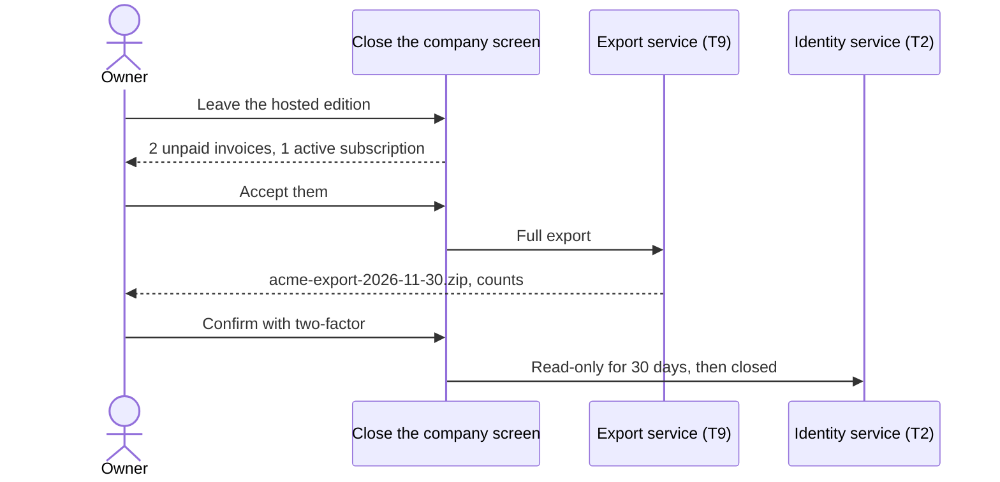

🏠 [Specs](../../../../README.md) › 🧩 [Functional capabilities](../../../README.md) ›
🛡️ [F1 Administration](../../README.md) › 📝 [Use cases](../README.md) ›
📝 [Use cases: FL-F1-14 Close a company](README.md) › 📝 UC-F1-23 Close a company and export all its data

# 📝 UC-F1-23 Close a company and export all its data

**Status:** 🔄 waiting for the owner

## Summary

The owner closes the company or moves it out of the hosted edition; every record, document and log is exported in open
formats before anything is closed.

## Personas

- [U13 Owner](../../../../01-users/personas/u13-owner.md)
- [U07 Administrator](../../../../01-users/personas/u07-administrator.md)
- [U11 IT provider administrator](../../../../01-users/personas/u11-provider-admin.md)

## Goal

Leave with all the data, in formats another tool can read, and close cleanly.

## Trigger

The company stops, merges, or switches to another provider or to self-hosting.

## Frequency

Once in a company's life.

## Preconditions

- The person asking is the owner; the hosted edition, or the provider's platform.

## Postconditions

- **Succeeded:** the full export is downloaded; the company is read-only, then closed; data the law requires is kept,
  the rest deleted.
- **Failed:** the company keeps working as before.

## Main flow

1. The owner opens Administration › Close the company
   ([S-F1-23](../../screens/14-close-a-company/s-f01-23-close-the-company.md)) and chooses close, or leave the hosted
   edition.
2. SimpleERP lists what is still open: unpaid invoices, unposted entries, active subscriptions, running payroll.
3. Once cleared or accepted, it prepares the full export: every record as CSV and JSON, documents as files, the
   accounting FEC, and the audit trail
   ([BR-F1-31](../../business-rules/br-f01-31-exports-are-complete-and-in-open-formats.md)).
4. The owner downloads it, checks the summary of counts, and confirms with two-factor.
5. The company becomes read-only for 30 days (Proposed), then is closed; what the law requires is kept for its period
   ([BR-F1-30](../../business-rules/br-f01-30-a-closed-company-keeps-only-what-the-law-requires.md)).

## Alternative flows

- 1a. Leaving for another provider: the export also follows the switching duty of
  [CR-FR-170](../../../../10-country-packs/france/digital/cr-fr-170-data-act-switching.md).
- 5a. The owner reopens within the 30 days: the company works again.

## Error flows

- 2e. Open items not accepted: the closing waits.
- 3e. The export fails part way: it resumes from where it stopped; nothing is closed.
- 4e. The person confirming is not the owner: refused.

## Business rules

- [BR-F1-30 A closed company keeps only what the law requires](../../business-rules/br-f01-30-a-closed-company-keeps-only-what-the-law-requires.md)
- [BR-F1-31 Exports are complete and in open formats](../../business-rules/br-f01-31-exports-are-complete-and-in-open-formats.md)
- [BR-F1-03 A company is usable once set up](../../business-rules/br-f01-03-company-usable-once-set-up.md)

## Entities

- [E-F1-21 Company closing](../../data/e-f01-21-company-closing.md)
- [E-F1-01 Company](../../data/e-f01-01-company.md)
- [E-F8-27 FEC file](../../../f08-accounting/data/e-f08-27-fec-file.md)

## Permissions

The owner confirms; the administrator prepares; the IT provider administrator archives.

## Notifications

- Every user is told 7 days before the company becomes read-only (Proposed).
- The owner is told when the export is ready.

## Audit events

Closing asked, export prepared and downloaded, confirmed, reopened, closed; kept with the legal archive.

## AI involvement

The AI assistant explains what is still open and how to clear it; it never confirms a closing.

## API, MCP and A2A exposure

T5 export operations for the owner; no MCP tool or A2A skill.

## Screens

- [S-F1-23 Close the company](../../screens/14-close-a-company/s-f01-23-close-the-company.md)

## Flowchart

See [FL-F1-14 Close a company](../../flows/fl-f01-14-close-a-company.md#flowchart).

## Sequence diagram

## Acceptance criteria

1. **Given** Acme Bâtiment with 2 unpaid invoices **when** the owner asks to close **then** both are listed and the
   closing waits for her answer.
2. **Given** the export ready **when** she downloads it **then** it holds the records as CSV and JSON, the documents,
   the FEC and the audit trail, with a summary of counts.
3. **Given** the closing confirmed on 2026-11-30 **when** a user signs in on 2026-12-10 **then** they can read but not
   change anything.
4. **Given** an export failing at 60 % **when** it is retried **then** it resumes at 60 % and nothing is closed.
5. **Given** the administrator, not the owner **when** they confirm the closing **then** it is refused.

## Non-functional notes

An export of 10 GB is prepared within 4 hours (Proposed).

## Regulatory references

[CR-FR-170](../../../../10-country-packs/france/digital/cr-fr-170-data-act-switching.md); accounting records kept 10
years, [CR-FR-002](../../../../10-country-packs/france/accounting/cr-fr-002-accounting-records-kept-ten-years.md); GDPR
erasure after the periods
([CR-FR-052](../../../../10-country-packs/france/data-protection/cr-fr-052-storage-limitation.md)).

## Related use cases

- [UC-F1-01 Set up a new company](../01-guided-setup/uc-f01-01-set-up-a-new-company.md)
- [UC-F1-12 Draft the record of processing activities](../09-administration-reports/uc-f01-12-draft-the-record-of-processing-activities.md)

## Open questions

None.

---

⬅️ [UC-F1-22](../13-security-and-audit/uc-f01-22-search-the-audit-trail-and-export-it-to-a-siem.md) ·
⬆️ [Up](README.md) · ➡️ [UC-F1-24](../15-security-and-group-data/uc-f01-24-manage-sessions-and-trusted-devices.md)
