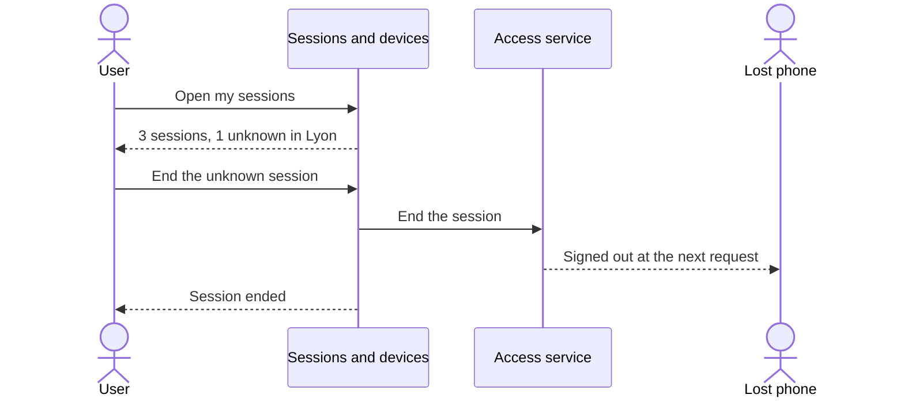

🏠 [Specs](../../../../README.md) › 🧩 [Functional capabilities](../../../README.md) ›
🛡️ [F1 Administration](../../README.md) › 📝 [Use cases](../README.md) ›
📝 [Use cases: FL-F1-15 Security and group data](README.md) › 📝 UC-F1-24 Manage sessions and trusted devices

# 📝 UC-F1-24 Manage sessions and trusted devices

**Status:** ✅ specified

## Summary

Every browser, app and phone a user is signed in on is a session the user can see and end. The administrator sees the
sessions of the company, ends one or all of a user's sessions and revokes a trusted device. A device the user trusts
skips the second factor for a limited time. Sessions end by themselves when the user's role, site or rights change or
the account is deactivated.

## Personas

- [U07 Administrator](../../../../01-users/personas/u07-administrator.md)
- [U01 Employee](../../../../01-users/personas/u01-employee.md), who sees and ends their own sessions on a phone

## Goal

Nobody stays signed in on a device they no longer hold, and a lost phone is cut off in one tap.

## Trigger

A user opens their sessions to check or end one, or the administrator investigates a security event or a lost device.

## Frequency

Users, now and then; the administrator, a few times a month.

## Preconditions

- The user has an account ([E-F1-03 User](../../data/e-f01-03-user.md)) and is signed in.
- The security policies are set: session length, idle time and trusted devices
  ([UC-F1-21](../13-security-and-audit/uc-f01-21-set-the-security-policies.md),
  [E-F1-19 Security policy](../../data/e-f01-19-security-policy.md)).
- The administrator has the right to read and end sessions
  ([BR-F1-02](../../business-rules/br-f01-02-administrator-sees-settings-only.md)).

## Postconditions

- **Succeeded:** the session is ended or the device revoked
  ([E-F1-23 User session](../../data/e-f01-23-user-session.md)), the person on that device is signed out at their next
  request and told why, and the event is in the audit trail.
- **Failed:** the session stays as it was and the screen says why.

## Main flow

1. The user opens Sessions and devices
   ([S-F1-27](../../screens/15-security-and-group-data/s-f01-27-sessions-and-devices.md)) from their profile; the list
   shows each session: device name, kind, application, place by country and town, last activity and whether it is the
   current one.
2. The user ends a session they do not recognise or no longer use; that device is signed out at its next request.
3. The user signs out everywhere else: every session but the current one ends.
4. On a device they use often, the user chooses Trust this device; it skips the second factor for 30 days by default
   ([E-F1-19 Security policy](../../data/e-f01-19-security-policy.md) sets the limit) and shows in the trusted list with
   its end date.
5. The administrator opens the sessions of the company, filters by user, device kind or place, and opens a user.
6. The administrator ends one session, ends all of a user's sessions, or revokes a trusted device; the reason is asked
   and kept.
7. When a role, site or right changes or an account is deactivated, every session of that user ends and their trusted
   devices are revoked ([BR-F1-33](../../business-rules/br-f01-33-sessions-end-on-role-change-or-revocation.md)).

## Alternative flows

- 2a. The user ends the current session: they are signed out and sent to the sign-in page.
- 4a. The security policy switches trusted devices off: the choice is not offered and existing trusted devices are
  revoked ([UC-F1-21](../13-security-and-audit/uc-f01-21-set-the-security-policies.md)).
- 6a. The administrator ends every session of the company after a security incident; a second administrator
  must confirm, as policies never lock out every administrator
  ([BR-F1-28](../../business-rules/br-f01-28-security-policies-never-lock-out-every-administrator.md)).

## Error flows

- 2e. The session ended while the user read the list: the row shows Already ended and nothing changes.
- 6e. The administrator tries to end the session of the last administrator: refused with the reason
  ([BR-F1-28](../../business-rules/br-f01-28-security-policies-never-lock-out-every-administrator.md)).
- 6f. The place of a session cannot be told: the row shows Place unknown, never a guess.
- Any step: a service does not answer; the call is retried first
  ([BR-F3-32](../../../f03-assistant/business-rules/br-f03-32-retry-before-an-error.md)), then the message follows the
  error pattern ([D122](../../../../06-decisions/ux/d122-error-message-standard.md)) and the session list stays as it
  was.

## Business rules

- [BR-F1-33 Sessions end on role change or revocation](../../business-rules/br-f01-33-sessions-end-on-role-change-or-revocation.md)
- [BR-F1-28 Security policies never lock out every administrator](../../business-rules/br-f01-28-security-policies-never-lock-out-every-administrator.md)
- [BR-F1-21 Deprovisioned users are deactivated, never deleted](../../business-rules/br-f01-21-deprovisioned-users-are-deactivated-never-deleted.md)
- [BR-F1-17 Administrators keep a password](../../business-rules/br-f01-17-administrators-keep-a-password.md)

## Entities

- [E-F1-23 User session](../../data/e-f01-23-user-session.md): created at sign-in, changed, ended
- [E-F1-03 User](../../data/e-f01-03-user.md): read
- [E-F1-19 Security policy](../../data/e-f01-19-security-policy.md): read

## Permissions

Every user sees and ends their own sessions only. The administrator sees the sessions of the company and ends them; a
site administrator only those of their site
([BR-F1-23](../../business-rules/br-f01-23-site-administrators-stay-within-their-site-and-rights.md)). Nobody sees
another user's session tokens.

## Notifications

- The user, by email and in the app: a session ended by the administrator, with the reason.
- The user, by email: a sign-in from a new device or a new country.

## Audit events

Session started, ended by the user, ended by the administrator or by a role change, with the reason; device trusted and
revoked; every sign-out everywhere; each time the administrator opens another user's sessions.

## AI involvement

None: sessions and trust are never decided by the AI assistant; it may open the screen
([BR-F3-34](../../../f03-assistant/business-rules/br-f03-34-every-capability-is-reachable-from-the-assistant.md)) but
never ends a session.

## API, MCP and A2A exposure

T5 operations for the user's own sessions; the administrator's operations need the administrator right. No MCP tool ends
a session and there is no A2A skill.

## Screens

- [S-F1-27 Sessions and devices](../../screens/15-security-and-group-data/s-f01-27-sessions-and-devices.md)

## Flowchart

See [FL-F1-15 Security and group data](../../flows/fl-f01-15-security-and-group-data.md#flowchart).

## Sequence diagram

## Acceptance criteria

1. **Given** Claire signed in on 3 devices **when** she opens Sessions and devices **then** she sees 3 rows with the
   current one marked.
2. **Given** a session she does not know **when** she ends it **then** that device is signed out at its next request.
3. **Given** trusted devices switched off in the security policy **when** she opens the page **then** Trust this device
   is not offered.
4. **Given** a user whose role changed **when** the change is saved **then** every session of that user ends and their
   trusted devices are revoked.
5. **Given** the only administrator **when** another administrator tries to end their sessions **then** it is refused.

## Non-functional notes

A revoked session is refused within 1 minute on every channel, including the API and the phone app.

## Regulatory references

Access control and the security of processing: GDPR,
[Regulation (EU) 2016/679](https://eur-lex.europa.eu/eli/reg/2016/679/oj), article 32;
[CR-FR-050](../../../../10-country-packs/france/data-protection/cr-fr-050-privacy-by-design.md).

## Related use cases

- [UC-F1-04 Change a user's role or site](../03-user-lifecycle/uc-f01-04-change-a-users-role-or-site.md)
- [UC-F1-05 Deactivate and offboard a user](../03-user-lifecycle/uc-f01-05-deactivate-and-offboard-a-user.md)
- [UC-F1-21 Set the security policies](../13-security-and-audit/uc-f01-21-set-the-security-policies.md)
- [UC-F1-20 Create and revoke API tokens and service accounts](../12-portal-accounts-and-integrations/uc-f01-20-create-and-revoke-api-tokens-and-service-accounts.md)
- [UC-F1-22 Search the audit trail and export it to a SIEM](../13-security-and-audit/uc-f01-22-search-the-audit-trail-and-export-it-to-a-siem.md)

## Open questions

None.

---

⬅️ [UC-F1-23](../14-close-a-company/uc-f01-23-close-a-company-and-export-all-its-data.md) · ⬆️ [Up](README.md) ·
➡️ [UC-F1-25 Set retention and purge personal data](uc-f01-25-set-retention-and-purge-personal-data.md)
