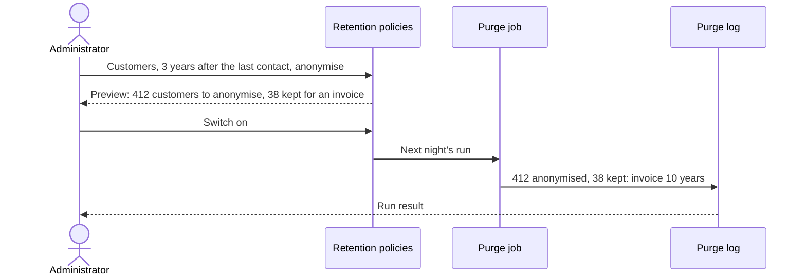

🏠 [Specs](../../../../README.md) › 🧩 [Functional capabilities](../../../README.md) ›
🛡️ [F1 Administration](../../README.md) › 📝 [Use cases](../README.md) ›
📝 [Use cases: FL-F1-15 Security and group data](README.md) › 📝 UC-F1-25 Set retention and purge personal data

# 📝 UC-F1-25 Set retention and purge personal data

**Status:** ✅ specified

## Summary

The administrator sets, for each kind of record that holds personal data, how long it is kept and what happens at the
end: deletion or anonymisation. Before a policy is switched on, a preview counts what the next purge would remove.
Purges run by themselves, are logged, and never touch a record the law requires the company to keep.

## Personas

- [U07 Administrator](../../../../01-users/personas/u07-administrator.md)

## Goal

Personal data does not stay longer than its purpose needs, and the company can show what was purged and why a record was
kept.

## Trigger

Setting up a company, a change of purpose, a request of the data protection officer or an audit.

## Frequency

Set up once, reviewed yearly; purges run on their own, usually every night.

## Preconditions

- The record types and their personal-data fields are known
  ([E-F2-05 Record type](../../../f02-no-code-configuration/data/e-f02-05-record-type.md),
  [UC-F1-12](../09-administration-reports/uc-f01-12-draft-the-record-of-processing-activities.md)).
- The country pack gives the legal minimum keeping periods
  ([CR-FR-052](../../../../10-country-packs/france/data-protection/cr-fr-052-storage-limitation.md),
  [CR-FR-002](../../../../10-country-packs/france/accounting/cr-fr-002-accounting-records-kept-ten-years.md),
  [CR-FR-047](../../../../10-country-packs/france/labour/cr-fr-047-hr-records-retention.md)).
- The administrator has the right to set retention policies
  ([BR-F1-02](../../business-rules/br-f01-02-administrator-sees-settings-only.md)).

## Postconditions

- **Succeeded:** the policy is active ([E-F1-24 Retention policy](../../data/e-f01-24-retention-policy.md)), each run
  purged what had passed its period, its result is in the purge log, and the record of processing activities shows the
  periods ([E-F1-22 Record of processing activities](../../data/e-f01-22-record-of-processing-activities.md)).
- **Failed:** nothing is purged and the policy stays a draft or paused with the reason.

## Main flow

1. The administrator opens Retention policies
   ([S-F1-28](../../screens/15-security-and-group-data/s-f01-28-retention-policies.md)); the screen lists each record
   type with personal data, its current period and the legal minimum from the country pack.
2. The administrator picks a record type, the event the period starts from (creation, last activity, end of contract),
   the period, and the action at the end: delete or anonymise.
3. simple-ERP refuses a period shorter than the legal minimum and marks the records under a legal hold
   ([BR-F1-34](../../business-rules/br-f01-34-purges-are-logged-and-never-touch-legal-records.md)).
4. The administrator runs the preview: the number of records the policy would purge now, by kind, and the number kept
   for a legal reason.
5. The administrator switches the policy on; the next run purges the records past their period.
6. Each run writes a purge log line: policy, records purged, records kept and why, run time.
7. The administrator opens the purge log to answer an audit or a person's question.

## Alternative flows

- 2a. The administrator picks anonymisation: the fields that identify the person are replaced and the record stays for
  statistics.
- 5a. The administrator switches a policy on in preview mode: runs only count and report, nothing is purged,
  for one month.
- 7a. A person asked to be erased
  ([CR-FR-051](../../../../10-country-packs/france/data-protection/cr-fr-051-access-and-erasure.md)): the request uses
  the same purge, with the record's legal minimum applied and the person told what is kept and why.

## Error flows

- 3e. The period is under the legal minimum: refused, the minimum is shown.
- 5e. A run finds a record another record still needs (an invoice that refers to a customer): the record is kept,
  anonymised if the law allows, and listed as kept with the reason.
- 5f. A run fails part way: the records already purged stay purged, the others wait for the next run and the log says
  where it stopped.
- Any step: a service does not answer; the call is retried first
  ([BR-F3-32](../../../f03-assistant/business-rules/br-f03-32-retry-before-an-error.md)), then the message follows the
  error pattern ([D122](../../../../06-decisions/ux/d122-error-message-standard.md)) and the policy and the preview stay
  as they were.

## Business rules

- [BR-F1-34 Purges are logged and never touch legal records](../../business-rules/br-f01-34-purges-are-logged-and-never-touch-legal-records.md)
- [BR-F1-30 A closed company keeps only what the law requires](../../business-rules/br-f01-30-a-closed-company-keeps-only-what-the-law-requires.md)
- [BR-F2-01 Archive, never delete](../../../f02-no-code-configuration/business-rules/br-f02-01-archive-never-delete.md)
- [BR-F1-02 Administrator sees settings only](../../business-rules/br-f01-02-administrator-sees-settings-only.md)

## Entities

- [E-F1-24 Retention policy](../../data/e-f01-24-retention-policy.md): created, changed
- [E-F1-22 Record of processing activities](../../data/e-f01-22-record-of-processing-activities.md): read
- [E-F2-05 Record type](../../../f02-no-code-configuration/data/e-f02-05-record-type.md): read

## Permissions

The administrator only. The data protection officer, when the company has one, reads the policies and the purge log.
A second administrator confirms a period shortened below its current value, since a shorter period purges
more.

## Notifications

- The administrator: the policy's first run, with its result.
- The administrator: a run that failed or kept records for a reason it cannot solve.

## Audit events

Each policy created, changed, switched on, paused or retired; each preview; each run with its counts; each record kept
for a legal reason; never the content of a purged record.

## AI involvement

The AI assistant may suggest the periods of the country pack for the administrator to confirm
([BR-F3-07](../../../f03-assistant/business-rules/br-f03-07-no-deletes-no-irreversible-acts.md): it never purges); a
purge is never run by an AI agent.

## API, MCP and A2A exposure

T5 operations of F1 for the administrator (list, create, change a policy, run a preview, read the purge log). No MCP
tool runs a purge and there is no A2A skill.

## Screens

- [S-F1-28 Retention policies](../../screens/15-security-and-group-data/s-f01-28-retention-policies.md)

## Flowchart

See [FL-F1-15 Security and group data](../../flows/fl-f01-15-security-and-group-data.md#flowchart).

## Sequence diagram

## Acceptance criteria

1. **Given** a legal minimum of 10 years for accounting records **when** the administrator sets 5 years **then** it is
   refused with the minimum shown.
2. **Given** a policy in preview **when** the administrator reads it **then** it shows the counts and purges nothing.
3. **Given** a customer with an invoice still inside its legal period **when** the run reaches it **then** the customer
   is kept and listed as kept for the invoice.
4. **Given** a purge that ran **when** the administrator opens the log **then** each run shows its counts and no
   personal data.
5. **Given** a person asks for erasure **when** the request is handled **then** the purge applies and says what is kept.

## Non-functional notes

A purge of 100,000 records completes in one night's window and never blocks users during the day.

## Regulatory references

Storage limitation: GDPR, [Regulation (EU) 2016/679](https://eur-lex.europa.eu/eli/reg/2016/679/oj), article 5(1)(e);
[CR-FR-052](../../../../10-country-packs/france/data-protection/cr-fr-052-storage-limitation.md); accounting records:
[CR-FR-002](../../../../10-country-packs/france/accounting/cr-fr-002-accounting-records-kept-ten-years.md); HR records:
[CR-FR-047](../../../../10-country-packs/france/labour/cr-fr-047-hr-records-retention.md); erasure requests:
[CR-FR-051](../../../../10-country-packs/france/data-protection/cr-fr-051-access-and-erasure.md).

## Related use cases

- [UC-F1-12 Draft the record of processing activities](../09-administration-reports/uc-f01-12-draft-the-record-of-processing-activities.md)
- [UC-F1-23 Close a company and export all its data](../14-close-a-company/uc-f01-23-close-a-company-and-export-all-its-data.md)
- [UC-F1-05 Deactivate and offboard a user](../03-user-lifecycle/uc-f01-05-deactivate-and-offboard-a-user.md)
- [UC-F2-26 Find unused configuration](../../../f02-no-code-configuration/use-cases/10-change-safely/uc-f02-26-find-unused-configuration.md)

## Open questions

None.

---

⬅️ [UC-F1-24 Manage sessions and trusted devices](uc-f01-24-manage-sessions-and-trusted-devices.md) ·
⬆️ [Up](README.md) · ➡️ [UC-F1-26 Share master data across the group](uc-f01-26-share-master-data-across-the-group.md)
