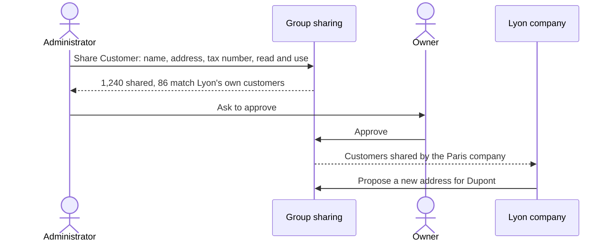

🏠 [Specs](../../../../README.md) › 🧩 [Functional capabilities](../../../README.md) ›
🛡️ [F1 Administration](../../README.md) › 📝 [Use cases](../README.md) ›
📝 [Use cases: FL-F1-15 Security and group data](README.md) › 📝 UC-F1-26 Share master data across the group

# 📝 UC-F1-26 Share master data across the group

**Status:** ✅ specified

## Summary

In a group of companies, one company owns a master record (a customer, a supplier, a product, an account) and the others
read or use it without copying it. The administrator sets a sharing rule: which record type, which fields, which
companies and whether they may only read or also use the record in their own documents. Only the owner company changes
the record.

## Personas

- [U07 Administrator](../../../../01-users/personas/u07-administrator.md)
- [U13 Owner](../../../../01-users/personas/u13-owner.md), who approves what the group shares

## Goal

A customer or a product exists once in the group, and every company that needs it sees the same record.

## Trigger

A second company is created in the group, or a record is found twice.

## Frequency

Set up once per record type, reviewed when the group changes.

## Preconditions

- The group has at least two companies on the same installation ([E-F1-01 Company](../../data/e-f01-01-company.md)).
- Each company has its own users, roles and data, isolated by default
  ([data isolation](../../../../05-non-functional/data-isolation.md)).
- The administrator has the right in the owner company and the owner approves
  ([BR-F1-35](../../business-rules/br-f01-35-shared-records-keep-one-owner-company.md)).

## Postconditions

- **Succeeded:** the sharing rule is active ([E-F1-25 Sharing rule](../../data/e-f01-25-sharing-rule.md)), the other
  companies see the shared records marked as shared, and each shared record still has one owner company.
- **Failed:** nothing is shared and each company keeps its own records.

## Main flow

1. The administrator opens Group sharing ([S-F1-29](../../screens/15-security-and-group-data/s-f01-29-group-sharing.md))
   in the owner company and picks a record type, for example Customer.
2. The administrator chooses the fields to share (name, address, tax number) and keeps the commercial fields (price
   list, credit limit) private to each company.
3. The administrator chooses the companies the rule applies to and the mode: read only, or use in own documents and
   propose changes.
4. The preview shows how many records are shared and how many match records the other companies already hold.
5. The owner approves the rule; it becomes active.
6. A user of another company opens a customer: the shared fields show with a Shared by mark and the owner company's
   name; the user adds their own private fields and uses the customer in quotes and invoices.
7. A user of another company proposes a change to a shared field; it goes to the owner company's administrator.

## Alternative flows

- 4a. Matches are found: the administrator chooses to link each matching record to the shared one or to leave them
  apart, after which they are merged with the cleaning tool, see
  [UC-F2-35](../../../f02-no-code-configuration/use-cases/13-low-code-bulk-and-cleaning/uc-f02-35-clean-duplicates-and-stale-records.md).
- 6a. The rule is paused: the other companies keep a read-only view of what they used; no new record is shared.
- 7a. The owner company accepts, refuses or edits the proposal; the proposer is told.

## Error flows

- 3e. A company of the rule belongs to another group or another installation: refused, sharing stays inside one group.
- 5e. The owner has not approved: the rule stays a draft.
- 6e. A shared record is deleted by the owner: it is archived
  ([BR-F2-01](../../../f02-no-code-configuration/business-rules/br-f02-01-archive-never-delete.md)) and the other
  companies keep their documents that used it, with a read-only copy of what they used.
- Any step: a service does not answer; the call is retried first
  ([BR-F3-32](../../../f03-assistant/business-rules/br-f03-32-retry-before-an-error.md)), then the message follows the
  error pattern ([D122](../../../../06-decisions/ux/d122-error-message-standard.md)) and the rule stays a draft.

## Business rules

- [BR-F1-35 Shared records keep one owner company](../../business-rules/br-f01-35-shared-records-keep-one-owner-company.md)
- [BR-F2-01 Archive, never delete](../../../f02-no-code-configuration/business-rules/br-f02-01-archive-never-delete.md)
- [BR-F1-23 Site administrators stay within their site and rights](../../business-rules/br-f01-23-site-administrators-stay-within-their-site-and-rights.md)
- [BR-F1-08 Rights add up](../../business-rules/br-f01-08-rights-add-up.md)

## Entities

- [E-F1-25 Sharing rule](../../data/e-f01-25-sharing-rule.md): created, changed
- [E-F1-01 Company](../../data/e-f01-01-company.md): read
- [E-F2-05 Record type](../../../f02-no-code-configuration/data/e-f02-05-record-type.md): read

## Permissions

The administrator of the owner company writes the rule; the owner approves it; the administrators of the other companies
accept it. Users of the other companies see only the shared fields, within their own roles
([BR-F1-08](../../business-rules/br-f01-08-rights-add-up.md)).

## Notifications

- The administrators of the other companies: a rule offered or paused.
- The owner company's administrator: a change proposed by another company.

## Audit events

Each rule created, approved, paused or ended; each record shared or unshared; each proposal and its answer; each time
another company reads a shared personal record.

## AI involvement

The AI assistant may find the records that exist twice in the group and suggest a rule; the administrator decides
([BR-F3-07](../../../f03-assistant/business-rules/br-f03-07-no-deletes-no-irreversible-acts.md)).

## API, MCP and A2A exposure

T5 operations of F1 for the administrators; shared records are read through each company's own operations. No MCP tool
changes a rule and there is no A2A skill.

## Screens

- [S-F1-29 Group sharing](../../screens/15-security-and-group-data/s-f01-29-group-sharing.md)

## Flowchart

See [FL-F1-15 Security and group data](../../flows/fl-f01-15-security-and-group-data.md#flowchart).

## Sequence diagram

## Acceptance criteria

1. **Given** a Customer rule between Paris and Lyon **when** it is active **then** Lyon sees the shared fields marked as
   shared by Paris.
2. **Given** a shared customer **when** Lyon edits a shared field **then** it is a proposal to Paris, not a change.
3. **Given** Lyon's own credit limit **when** the rule is active **then** it stays private to Lyon.
4. **Given** a rule not approved by the owner **when** the administrator saves it **then** it stays a draft.
5. **Given** the owner deletes a shared customer **when** Lyon had invoiced it **then** Lyon keeps its invoices and a
   read-only copy.

## Non-functional notes

A shared record opens as fast as a company's own; sharing adds no copy to keep in step.

## Regulatory references

Sharing personal data between legal entities of a group needs a legal basis and an information of the people: GDPR,
[Regulation (EU) 2016/679](https://eur-lex.europa.eu/eli/reg/2016/679/oj), articles 6, 13 and 26; the France-pack rule on data shared inside a group is [CR-FR-280 Personal data shared inside a group](../../../../10-country-packs/france/data-protection/cr-fr-280-personal-data-shared-inside-a-group.md).

## Related use cases

- [UC-F1-01 Set up a new company](../01-guided-setup/uc-f01-01-set-up-a-new-company.md)
- [UC-F1-02 Add or change a site](../02-manage-sites/uc-f01-02-add-or-change-a-site.md)
- [UC-F7-15 Trade between group companies](../../../f07-purchasing-and-stock/use-cases/06-benchmark-additions/uc-f07-15-trade-between-group-companies.md)
- [UC-F8-13 Consolidate the group](../../../f08-accounting/use-cases/05-close-report-and-consolidate/uc-f08-13-consolidate-the-group.md)
- [UC-F2-35 Clean duplicates and stale records](../../../f02-no-code-configuration/use-cases/13-low-code-bulk-and-cleaning/uc-f02-35-clean-duplicates-and-stale-records.md)

## Open questions

None.

---

⬅️ [UC-F1-25 Set retention and purge personal data](uc-f01-25-set-retention-and-purge-personal-data.md) ·
⬆️ [Up](README.md) · ➡️ [UC-F1-27 Act as a user with consent](uc-f01-27-act-as-a-user-with-consent.md)
