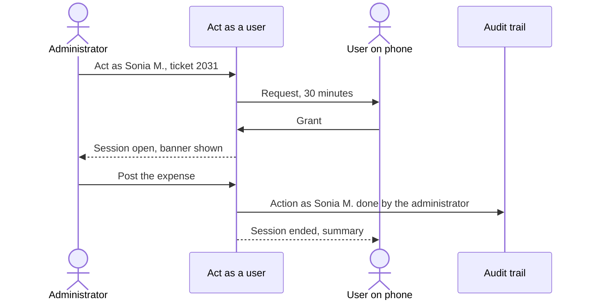

🏠 [Specs](../../../../README.md) › 🧩 [Functional capabilities](../../../README.md) ›
🛡️ [F1 Administration](../../README.md) › 📝 [Use cases](../README.md) ›
📝 [Use cases: FL-F1-15 Security and group data](README.md) › 📝 UC-F1-27 Act as a user with consent

# 📝 UC-F1-27 Act as a user with consent

**Status:** ✅ specified

## Summary

To help a colleague who is stuck, or to reproduce a problem, the administrator asks to act as that user. The user
receives the request on their phone and grants or refuses it. A granted request opens a short, visible session in which
the administrator sees the user's screens and acts with the user's rights, every action audited with both names, and the
user can stop it at any time.

## Personas

- [U07 Administrator](../../../../01-users/personas/u07-administrator.md)
- [U01 Employee](../../../../01-users/personas/u01-employee.md), who grants or refuses on a phone

## Goal

The administrator solves the problem on the user's own screens, and the user stays in control of who acts under their
name.

## Trigger

A user reports a problem that the administrator cannot reproduce with their own rights.

## Frequency

A few times a month in a company of 50 people.

## Preconditions

- The administrator has the right to ask to act as a user, which no ready-made role gives by default
  ([BR-F1-02](../../business-rules/br-f01-02-administrator-sees-settings-only.md)).
- The user is active and has a way to receive the request: the app or email
  ([E-F1-03 User](../../data/e-f01-03-user.md)).
- The security policy allows acting as a user
  ([UC-F1-21](../13-security-and-audit/uc-f01-21-set-the-security-policies.md),
  [E-F1-19 Security policy](../../data/e-f01-19-security-policy.md)).

## Postconditions

- **Succeeded:** the session was granted, used within its time limit and ended
  ([E-F1-26 Act-as session](../../data/e-f01-26-act-as-session.md)); each action is in the audit trail under both names,
  and the user was told when it ended.
- **Failed:** nothing is shown or changed under the user's name.

## Main flow

1. The administrator opens Act as a user ([S-F1-30](../../screens/15-security-and-group-data/s-f01-30-act-as-user.md)),
   searches the user and gives the reason, for example "cannot post an expense, ticket 2031".
2. SimpleERP sends the user a request with the administrator's name, the reason and the time asked, 30 minutes by
   default.
3. The user opens the request on their phone and grants or refuses it
   ([BR-F1-36](../../business-rules/br-f01-36-acting-as-a-user-needs-consent-and-is-audited.md)).
4. On a grant, the administrator's session opens with a red banner: "Acting as Sonia M., ends at 10:30"; the user sees
   the same marker on their own account.
5. The administrator works with the user's rights: they see what the user sees and do what the user may do, except what
   the rule keeps out of reach.
6. The session ends when the administrator ends it, the user stops it, or the time runs out.
7. The user receives a summary of what was done, and the session is kept in the audit trail.

## Alternative flows

- 2a. The user is away: the request waits 24 hours then expires; the administrator may ask again.
- 6a. The time runs out while the administrator needs more: they ask again and the user grants again; a session is never
  extended silently.
- 6b. The user opens the list of what was done during the session and flags one action they do not recognise:
  the owner is told.

## Error flows

- 3e. The user refuses: the administrator is told; nothing opens and the refusal is audited.
- 5e. The administrator tries an action kept out of reach (change the user's password or second factor, grant rights,
  approve one's own request, sign a legal document in the user's name): refused with the reason
  ([BR-F1-36](../../business-rules/br-f01-36-acting-as-a-user-needs-consent-and-is-audited.md)).
- 1e. The administrator asks to act as the owner or as another administrator: refused, since policies never leave the
  company without an administrator that nobody impersonates
  ([BR-F1-28](../../business-rules/br-f01-28-security-policies-never-lock-out-every-administrator.md)).
- Any step: a service does not answer; the call is retried first
  ([BR-F3-32](../../../f03-assistant/business-rules/br-f03-32-retry-before-an-error.md)), then the message follows the
  error pattern ([D122](../../../../06-decisions/ux/d122-error-message-standard.md)) and no session opens.

## Business rules

- [BR-F1-36 Acting as a user needs consent and is audited](../../business-rules/br-f01-36-acting-as-a-user-needs-consent-and-is-audited.md)
- [BR-F1-28 Security policies never lock out every administrator](../../business-rules/br-f01-28-security-policies-never-lock-out-every-administrator.md)
- [BR-F1-08 Rights add up](../../business-rules/br-f01-08-rights-add-up.md)
- [BR-F1-02 Administrator sees settings only](../../business-rules/br-f01-02-administrator-sees-settings-only.md)

## Entities

- [E-F1-26 Act-as session](../../data/e-f01-26-act-as-session.md): created, changed
- [E-F1-03 User](../../data/e-f01-03-user.md): read
- [E-T03-01 Audit entry](../../../../03-technical/t03-audit-trail/data/e-t03-01-audit-entry.md): created

## Permissions

Only a role with the right to act as a user; the ready-made roles give it to nobody and the owner adds it to
a chosen role. The user concerned reads every request and session about them.

## Notifications

- The user, at once on their phone: the request, with a Grant and a Refuse button.
- The user, when the session ends: what was done.
- The owner: a session opened on a user with the right to approve payments.

## Audit events

Request, grant or refusal with the time, session start and end, each action with the user's name and the
administrator's, and the reason; the session cannot be erased from the audit trail.

## AI involvement

None: the AI assistant never acts as another user and an AI agent never starts or grants such a session
([BR-F3-35](../../../f03-assistant/business-rules/br-f03-35-agents-follow-thresholds-and-limits.md)).

## API, MCP and A2A exposure

T5 operations of F1 for the administrator (ask, list own sessions) and for the user (grant, refuse, stop). No MCP tool
and no A2A skill: this session is never opened by a program.

## Screens

- [S-F1-30 Act as a user](../../screens/15-security-and-group-data/s-f01-30-act-as-user.md)

## Flowchart

See [FL-F1-15 Security and group data](../../flows/fl-f01-15-security-and-group-data.md#flowchart).

## Sequence diagram

## Acceptance criteria

1. **Given** a request to act as Sonia **when** she refuses it **then** nothing opens and the administrator is told.
2. **Given** a granted session of 30 minutes **when** the time runs out **then** it ends and the banner disappears.
3. **Given** an action made in the session **when** the audit trail is read **then** it shows Sonia and the
   administrator.
4. **Given** the administrator in the session **when** they try to change Sonia's password **then** it is refused.
5. **Given** the administrator **when** they ask to act as the owner **then** it is refused.

## Non-functional notes

The request reaches the user's phone within 10 seconds; the banner stays on every screen of the session.

## Regulatory references

Accountability for who accessed personal data: GDPR,
[Regulation (EU) 2016/679](https://eur-lex.europa.eu/eli/reg/2016/679/oj), articles 5(2) and 32;
[CR-FR-050](../../../../10-country-packs/france/data-protection/cr-fr-050-privacy-by-design.md).

## Related use cases

- [UC-F1-11 Enter a client company to support it](../08-provider-and-client-companies/uc-f01-11-enter-a-client-company-to-support-it.md)
- [UC-F1-21 Set the security policies](../13-security-and-audit/uc-f01-21-set-the-security-policies.md)
- [UC-F1-22 Search the audit trail and export it to a SIEM](../13-security-and-audit/uc-f01-22-search-the-audit-trail-and-export-it-to-a-siem.md)
- [UC-F1-24 Manage sessions and trusted devices](uc-f01-24-manage-sessions-and-trusted-devices.md)

## Open questions

None.

---

⬅️ [UC-F1-26 Share master data across the group](uc-f01-26-share-master-data-across-the-group.md) · ⬆️ [Up](README.md)
