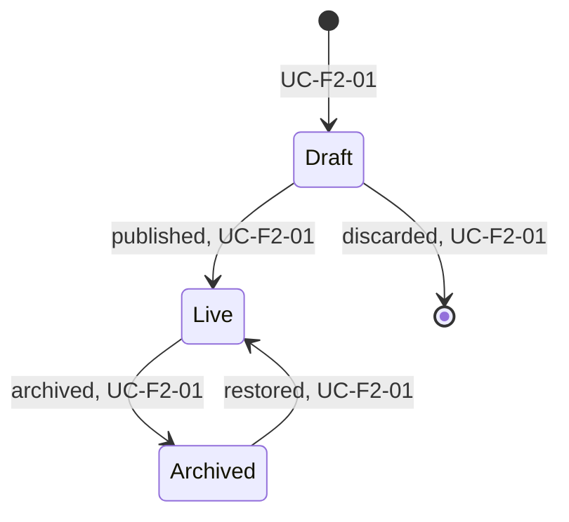

🏠 [Specs](../../../README.md) › 🧩 [Functional capabilities](../../README.md) ›
🔧 [F2 No-code configuration](../README.md) › 🗃️ [Data](README.md) › 🗃️ E-F2-01 Custom field

# 🗃️ E-F2-01 Custom field

**Status:** ✅ specified

## Purpose

A field a company adds to a record type (D94, D101).

## Fields

| Name | Type | Required | Validation | Default | Example | Personal data | Custom fields |
|---|---|---|---|---|---|---|---|
| record type | record type | yes | open to custom fields (D103) | - | Quotes | no | - |
| name | text | yes | unique on the record type | - | vehicle | no | - |
| type | list | yes | one of the fourteen (D101) | text | link to a record | no | - |
| rules | required, default, min, max, unique, format | no | | none | required | no | - |
| formula | text | for computed | valid, no loop | - | price - cost | no | - |
| visible to | roles, see or see and change | no | - | everyone who sees the record | HR, see and change | no | - |
| labels | per language | yes in the main language | - | - | Véhicule / Vehicle | no | - |
| status | list | yes | draft, live, archived | draft | live | no | - |

## Relations

Belongs to one record type; a link field points to another record type.

## Lifecycle

## Indexes and search

Text, list and link fields can be searched and filtered.

## Retention

An archived field's values are kept (BR-F2-01).

## Audit

See UC-F2-01's audit events.

## Import and export

Not in spreadsheet imports and exports (D100); part of a configuration pack (UC-F2-11).

## Used by

- [UC-F2-01](../use-cases/01-configure-a-record-type/uc-f02-01-add-a-custom-field-to-a-record-type.md)
- [UC-F2-23 See the impact of a change before publishing](../use-cases/10-change-safely/uc-f02-23-see-the-impact-of-a-change-before-publishing.md)
- [UC-F2-27 Set field-level rights and validation rules](../use-cases/11-rights-translations-and-approvals/uc-f02-27-set-field-level-rights-and-validation-rules.md)

## Open questions

None.

---

⬆️ [Up](README.md) · ➡️ [E-F2-02 Status and transition](e-f02-02-status-and-transition.md)
