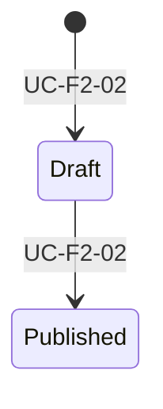

🏠 [Specs](../../../README.md) › 🧩 [Functional capabilities](../../README.md) ›
🔧 [F2 No-code configuration](../README.md) › 🗃️ [Data](README.md) › 🗃️ E-F2-02 Status and transition

# 🗃️ E-F2-02 Status and transition

**Status:** ✅ specified

## Purpose

The statuses of a record type and the moves allowed between them (D105).

## Fields

| Name | Type | Required | Validation | Default | Example | Personal data | Custom fields |
|---|---|---|---|---|---|---|---|
| record type | record type | yes | - | - | Quotes | no | - |
| status label | per language | yes | unique on the record type | - | Waiting for site visit | no | - |
| order | number | yes | - | last | 2 | no | - |
| core | yes or no | yes | set by SimpleERP (BR-F2-05) | no | no | no | - |
| colour, icon | token, Lucide icon | no | - | - | indigo, send | no | - |
| transitions | from, to, needed role, needed fields | no | - | - | Waiting -> Sent, Manager | no | - |

## Relations

Many statuses per record type; transitions link two statuses of the same type.

## Lifecycle

Drafted and published with the record type's configuration (D97).

## Indexes and search

Records can be filtered by status.

## Retention

A removed status stays in the history of the records that passed through it.

## Audit

See UC-F2-02's audit events.

## Import and export

Part of a configuration pack (UC-F2-11).

## Used by

- [UC-F2-02](../use-cases/01-configure-a-record-type/uc-f02-02-change-the-statuses-of-a-record-type.md)

## Open questions

None.

---

⬅️ [E-F2-01 Custom field](e-f02-01-custom-field.md) · ⬆️ [Up](README.md) ·
➡️ [E-F2-03 Form layout](e-f02-03-form-layout.md)
