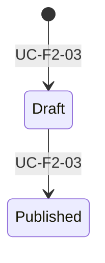

🏠 [Specs](../../../README.md) › 🧩 [Functional capabilities](../../README.md) ›
🔧 [F2 No-code configuration](../README.md) › 🗃️ [Data](README.md) › 🗃️ E-F2-03 Form layout

# 🗃️ E-F2-03 Form layout

**Status:** ✅ specified

## Purpose

How a record type's form is arranged for a role, on desktop and phone (D108, D110).

## Fields

| Name | Type | Required | Validation | Default | Example | Personal data | Custom fields |
|---|---|---|---|---|---|---|---|
| record type | record type | yes | - | - | Quotes | no | - |
| role | role | no | - | every role | Field worker | no | - |
| sections | ordered list of sections and fields | yes | every required field present | the record type's fields | Customer, Lines | no | - |
| conditions | field shown when another has a value | no | the other field is on the form | - | Vehicle when Delivery | no | - |
| read-only from | field and status | no | a status of the record type | - | Price from Sent | no | - |
| phone layout | ordered list | no | - | derived (D110) | Today, Time | no | - |

## Relations

One default layout per record type, plus one per role at most.

## Lifecycle

Drafted and published with the configuration (D97).

## Indexes and search

By record type and role.

## Retention

Kept in the configuration versions (UC-F2-10).

## Audit

See UC-F2-03's audit events.

## Import and export

Part of a configuration pack (UC-F2-11).

## Used by

- [UC-F2-03](../use-cases/01-configure-a-record-type/uc-f02-03-arrange-a-form.md)
- [UC-F2-21 Make a phone form work offline](../use-cases/09-portals-and-offline-forms/uc-f02-21-make-a-phone-form-work-offline.md)

## Open questions

None.

---

⬅️ [E-F2-02 Status and transition](e-f02-02-status-and-transition.md) · ⬆️ [Up](README.md) ·
➡️ [E-F2-04 List view](e-f02-04-list-view.md)
