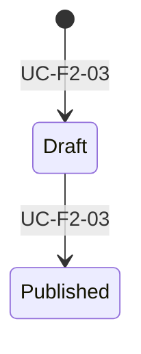

🏠 [Specs](../../../README.md) › 🧩 [Functional capabilities](../../README.md) ›
🔧 [F2 No-code configuration](../README.md) › 🗃️ [Data](README.md) › 🗃️ E-F2-04 List view

# 🗃️ E-F2-04 List view

**Status:** ✅ specified

## Purpose

A saved arrangement of a list, shared per role or personal (D109); on a record type that has a place, the list can
also be shown as a map, for the roles that hold the map right (D501, D502).

## Fields

| Name | Type | Required | Validation | Default | Example | Personal data | Custom fields |
|---|---|---|---|---|---|---|---|
| name | text | yes | - | - | My open quotes | no | - |
| record type | record type | yes | - | - | Quotes | no | - |
| columns, filters, sort, grouping | settings | yes | fields the user may see | - | Customer, Amount | no | - |
| layout | table, map | yes | map only on a record type with a place field, for roles with the map right ([BR-F1-32](../../f01-administration/business-rules/br-f01-32-map-right-for-planners-and-managers.md)) | table | map | no | - |
| map settings | place field, colour, label | for the map layout | a place field of the record type | the record type's first place field | Address, by state, customer name | no | - |
| owner | user | for personal views | - | - | Marie Dupont | yes | - |
| shared with | roles | for shared views | - | - | Sales | no | - |

The map layout shows the same rows as the table, filtered the same way, within the user's permissions; it uses
[C-17 Map](../../../04-ux/design-system/components/c-17-map.md) and the
[aggregated list view](../../../04-ux/design-system/patterns/aggregated-list-view.md). A user without the map right sees
a view saved with the map layout as a table. The other views of UC-F2-17 (kanban, calendar, Gantt, timeline) are
unchanged.

## Relations

A view belongs to one record type.

## Lifecycle

Personal views are saved at once; shared views are drafted and published (D97).

## Indexes and search

By record type and owner.

## Retention

A leaver's personal views are deleted with their account's deactivation.

## Audit

Shared views only.

## Import and export

Shared views are part of a configuration pack (UC-F2-11).

## Used by

- [UC-F2-03](../use-cases/01-configure-a-record-type/uc-f02-03-arrange-a-form.md)
- [UC-F2-17 Add a kanban, calendar, map, Gantt or timeline view](../use-cases/08-views-and-bookings/uc-f02-17-add-a-kanban-calendar-map-gantt-or-timeline-view.md)
- [UC-F9-36 See work and places on a map](../../f09-hr-and-projects/use-cases/12-schedule-customer-requests/uc-f09-36-see-work-and-places-on-a-map.md)

## Open questions

None.

---

⬅️ [E-F2-03 Form layout](e-f02-03-form-layout.md) · ⬆️ [Up](README.md) ·
➡️ [E-F2-05 Record type](e-f02-05-record-type.md)
