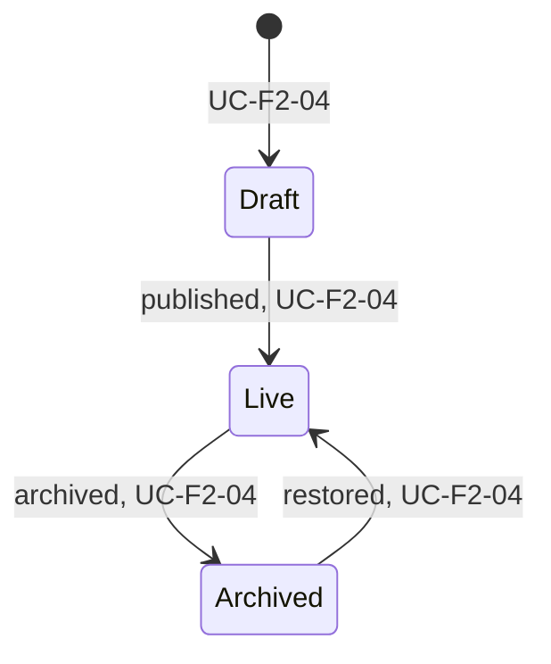

🏠 [Specs](../../../README.md) › 🧩 [Functional capabilities](../../README.md) ›
🔧 [F2 No-code configuration](../README.md) › 🗃️ [Data](README.md) › 🗃️ E-F2-05 Record type

# 🗃️ E-F2-05 Record type

**Status:** ✅ specified

## Purpose

A kind of record: core, from a plugin, or created in F2 (D94, D111).

## Fields

| Name | Type | Required | Validation | Default | Example | Personal data | Custom fields |
|---|---|---|---|---|---|---|---|
| name | per language | yes | unique | - | Véhicules / Vehicles | no | - |
| icon | Lucide icon | yes | - | box | truck | no | - |
| source | list | yes | core, plugin, F2 | F2 | F2 | no | - |
| open to custom fields | yes or no | yes | set by its plugin for plugin types (D103) | yes | yes | no | - |
| model | gallery model | no | - | - | Vehicles | no | - |
| status | list | yes | draft, live, archived | draft | live | no | - |

## Relations

A record type has custom fields (E-F2-01), statuses (E-F2-02), layouts (E-F2-03) and list views (E-F2-04).

## Lifecycle

## Indexes and search

By name.

## Retention

An archived record type's records are kept (BR-F2-01).

## Audit

See UC-F2-04's audit events.

## Import and export

Part of a configuration pack (UC-F2-11).

## Used by

- [UC-F2-04](../use-cases/01-configure-a-record-type/uc-f02-04-create-a-new-record-type.md)
- [UC-F2-18 Make a record type bookable](../use-cases/08-views-and-bookings/uc-f02-18-make-a-record-type-bookable.md)
- [UC-F2-20 Expose a record type on a portal](../use-cases/09-portals-and-offline-forms/uc-f02-20-expose-a-record-type-on-a-portal.md)

## Open questions

None.

---

⬅️ [E-F2-04 List view](e-f02-04-list-view.md) · ⬆️ [Up](README.md) ·
➡️ [E-F2-06 Document template](e-f02-06-document-template.md)
