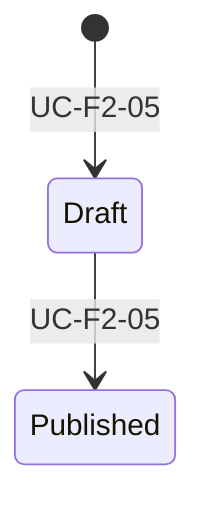

🏠 [Specs](../../../README.md) › 🧩 [Functional capabilities](../../README.md) ›
🔧 [F2 No-code configuration](../README.md) › 🗃️ [Data](README.md) › 🗃️ E-F2-06 Document template

# 🗃️ E-F2-06 Document template

**Status:** ✅ specified

## Purpose

How one document type looks, in one language (D117, D118).

## Fields

| Name | Type | Required | Validation | Default | Example | Personal data | Custom fields |
|---|---|---|---|---|---|---|---|
| document type | list | yes | quote, invoice, credit note, delivery note, purchase order, ... | - | invoice | no | - |
| name | text | yes | unique per type | Standard | Short | no | - |
| language | list | yes | a language of the company | the main language | en | no | - |
| layout | blocks, or HTML and CSS | yes | legal mentions present (BR-F2-10) | the shipped template | - | no | - |
| applies to | per document or per customer | no | - | default | customers set to short | no | - |

## Relations

Each issued document keeps the template version it was issued with.

## Lifecycle

Drafted and published with the configuration (D97).

## Indexes and search

By type and language.

## Retention

Every published version, for reprints.

## Audit

See UC-F2-05's audit events.

## Import and export

Part of a configuration pack (UC-F2-11).

## Used by

- [UC-F2-05](../use-cases/02-customise-documents-and-emails/uc-f02-05-edit-a-document-template.md)

## Open questions

None.

---

⬅️ [E-F2-05 Record type](e-f02-05-record-type.md) · ⬆️ [Up](README.md) ·
➡️ [E-F2-07 Email template](e-f02-07-email-template.md)
