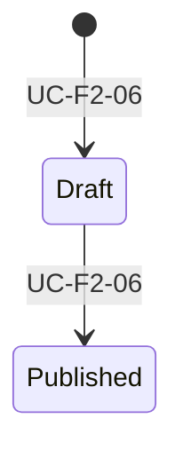

🏠 [Specs](../../../README.md) › 🧩 [Functional capabilities](../../README.md) ›
🔧 [F2 No-code configuration](../README.md) › 🗃️ [Data](README.md) › 🗃️ E-F2-07 Email template

# 🗃️ E-F2-07 Email template

**Status:** ✅ specified

## Purpose

The subject and body of one outgoing email, per language (D119).

## Fields

| Name | Type | Required | Validation | Default | Example | Personal data | Custom fields |
|---|---|---|---|---|---|---|---|
| email | list | yes | every outgoing email of simple-ERP and plugins | - | invoice sent | no | - |
| language | list | yes | a language of the company | - | fr | no | - |
| subject, body | text with fields | yes | required fields present | the shipped text | Facture {invoice.number} | no | - |

## Relations

The branding and sender address are company settings shared by every email.

## Lifecycle

Drafted and published with the configuration (D97).

## Indexes and search

By email and language.

## Retention

Every published version.

## Audit

See UC-F2-06's audit events.

## Import and export

Part of a configuration pack (UC-F2-11).

## Used by

- [UC-F2-06](../use-cases/02-customise-documents-and-emails/uc-f02-06-edit-an-email-template.md)

## Open questions

None.

---

⬅️ [E-F2-06 Document template](e-f02-06-document-template.md) · ⬆️ [Up](README.md) ·
➡️ [E-F2-08 Automation rule](e-f02-08-automation-rule.md)
