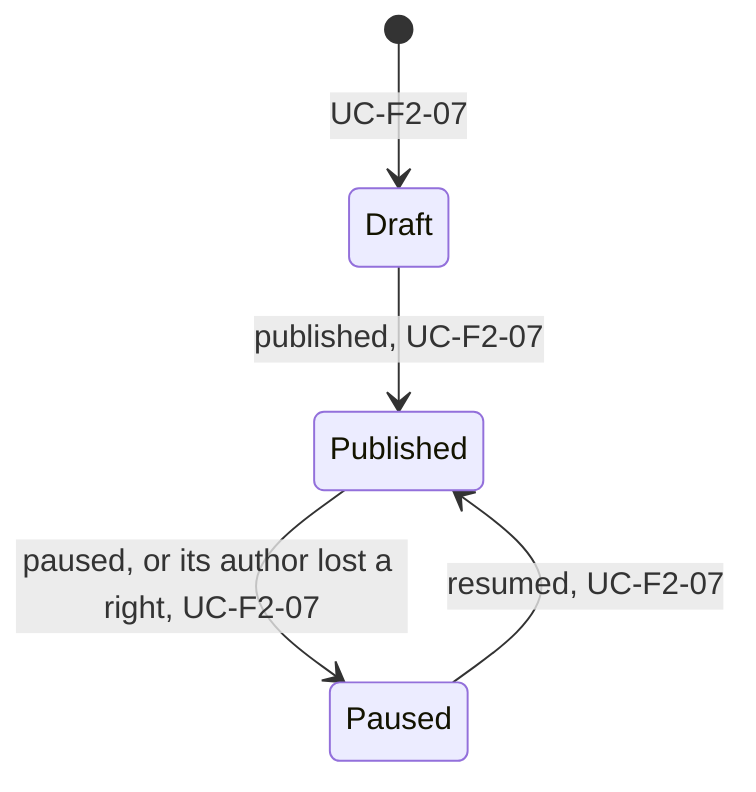

🏠 [Specs](../../../README.md) › 🧩 [Functional capabilities](../../README.md) ›
🔧 [F2 No-code configuration](../README.md) › 🗃️ [Data](README.md) › 🗃️ E-F2-08 Automation rule

# 🗃️ E-F2-08 Automation rule

**Status:** ✅ specified

## Purpose

A "when, if, then" rule and its rule account (D125 to D127).

## Fields

| Name | Type | Required | Validation | Default | Example | Personal data | Custom fields |
|---|---|---|---|---|---|---|---|
| name | text | yes | unique | - | Remind after 3 days | no | - |
| trigger | record, date, schedule, outside event | yes | - | - | Quote in Sent for 3 days | no | - |
| conditions | list | no | fields the author may see | - | Amount over 1,000 EUR | no | - |
| actions | list | yes | at least one | - | Notify, create task | no | - |
| rule account rights | role matrix rows | yes | at most the author's (BR-F2-12) | - | Quotes See, Tasks Create | no | - |
| author | user | yes | - | the creator | Marie Dupont | yes | - |
| status | list | yes | draft, published, paused | draft | published | no | - |

## Relations

A rule has many runs, each with its outcome.

## Lifecycle

## Indexes and search

By name, record type and status.

## Retention

Run logs kept 13 months.

## Audit

See UC-F2-07's audit events.

## Import and export

Part of a configuration pack (UC-F2-11).

## Used by

- [UC-F2-07](../use-cases/03-automate-with-a-rule/uc-f02-07-create-a-simple-rule.md)
- [UC-F2-24 Test rules and workflows with test cases](../use-cases/10-change-safely/uc-f02-24-test-rules-and-workflows-with-test-cases.md)

## Open questions

None.

---

⬅️ [E-F2-07 Email template](e-f02-07-email-template.md) · ⬆️ [Up](README.md) ·
➡️ [E-F2-09 Workflow](e-f02-09-workflow.md)
