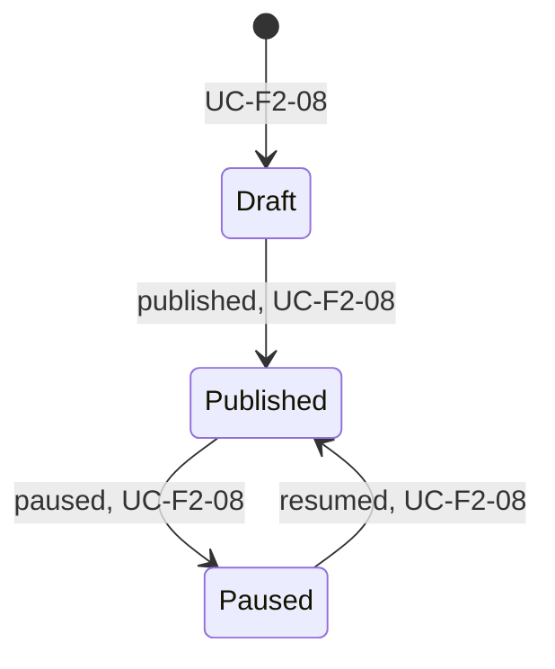

🏠 [Specs](../../../README.md) › 🧩 [Functional capabilities](../../README.md) ›
🔧 [F2 No-code configuration](../README.md) › 🗃️ [Data](README.md) › 🗃️ E-F2-09 Workflow

# 🗃️ E-F2-09 Workflow

**Status:** ✅ specified

## Purpose

A multi-step automation drawn in the designer (D129, D130).

## Fields

| Name | Type | Required | Validation | Default | Example | Personal data | Custom fields |
|---|---|---|---|---|---|---|---|
| name | text | yes | unique | - | Supplier invoices by email | no | - |
| trigger | as rules (D125) | yes | - | - | an email arrives | no | - |
| blocks | ordered graph of blocks | yes | every block complete | - | AI, If, Ask, Call | no | - |
| account rights | role matrix rows | yes | at most the author's | - | Invoices Create | no | - |
| status | list | yes | draft, published, paused | draft | published | no | - |

## Relations

A workflow has many instances, each with its log.

## Lifecycle

## Indexes and search

By name and status; instances by record and state.

## Retention

Instance logs kept 13 months.

## Audit

See UC-F2-08's audit events.

## Import and export

Part of a configuration pack (UC-F2-11).

## Used by

- [UC-F2-08](../use-cases/04-design-a-visual-workflow/uc-f02-08-design-a-visual-workflow.md)

## Open questions

None.

---

⬅️ [E-F2-08 Automation rule](e-f02-08-automation-rule.md) · ⬆️ [Up](README.md) ·
➡️ [E-F2-10 Configuration version](e-f02-10-configuration-version.md)
