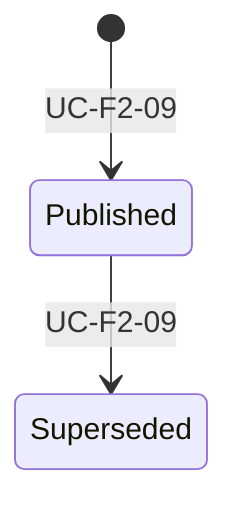

🏠 [Specs](../../../README.md) › 🧩 [Functional capabilities](../../README.md) ›
🔧 [F2 No-code configuration](../README.md) › 🗃️ [Data](README.md) › 🗃️ E-F2-10 Configuration version

# 🗃️ E-F2-10 Configuration version

**Status:** ✅ specified

## Purpose

A published state of the whole configuration (D97, D131, D132).

## Fields

| Name | Type | Required | Validation | Default | Example | Personal data | Custom fields |
|---|---|---|---|---|---|---|---|
| number | number | yes | increasing | - | 16 | no | - |
| published at | date and time | yes | - | now | 2026-11-10 15:02 | no | - |
| published by | user | yes | - | - | Marie Dupont | yes | - |
| changes | list in plain words | yes | - | - | Field Vehicle added to Quotes | no | - |
| rolled back from | version | no | - | - | 14 | no | - |

## Relations

Every version is kept.

## Lifecycle

Published, then superseded by the next version; never deleted.

## Indexes and search

By number and date.

## Retention

Every version, for the life of the company.

## Audit

It is the configuration's audit.

## Import and export

A version can be exported as a pack (UC-F2-11).

## Used by

- [UC-F2-09](../use-cases/05-publish-and-roll-back/uc-f02-09-draft-preview-and-publish-a-change.md)
- [UC-F2-10](../use-cases/05-publish-and-roll-back/uc-f02-10-roll-a-configuration-back.md)
- [UC-F2-23 See the impact of a change before publishing](../use-cases/10-change-safely/uc-f02-23-see-the-impact-of-a-change-before-publishing.md)
- [UC-F2-25 Merge a sector pack upgrade with local changes](../use-cases/10-change-safely/uc-f02-25-merge-a-sector-pack-upgrade-with-local-changes.md)
- [UC-F2-26 Find unused configuration](../use-cases/10-change-safely/uc-f02-26-find-unused-configuration.md)

## Open questions

None.

---

⬅️ [E-F2-09 Workflow](e-f02-09-workflow.md) · ⬆️ [Up](README.md) ·
➡️ [E-F2-11 Configuration pack](e-f02-11-configuration-pack.md)
