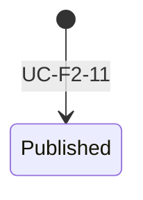

🏠 [Specs](../../../README.md) › 🧩 [Functional capabilities](../../README.md) ›
🔧 [F2 No-code configuration](../README.md) › 🗃️ [Data](README.md) › 🗃️ E-F2-11 Configuration pack

# 🗃️ E-F2-11 Configuration pack

**Status:** ✅ specified

## Purpose

A shareable bundle of configuration (D134, D135); sector packs are packs.

## Fields

| Name | Type | Required | Validation | Default | Example | Personal data | Custom fields |
|---|---|---|---|---|---|---|---|
| name | text | yes | - | - | Fleet | no | - |
| simple-ERP version | text | yes | - | the exporting one | 1.3.0 | no | - |
| content | record types, templates, automations, roles | yes | no data, users or secrets (BR-F2-15) | - | Vehicles, 2 rules | no | - |
| plugins needed | list | no | - | - | - | no | - |
| sector | sector | no | one of SC01 to SC16 | - | SC07 Transport | no | - |

## Relations

A sector pack is a pack linked to a sector (08-sectors).

## Lifecycle

Exported, then imported or published; versions follow simple-ERP's.

## Indexes and search

By name and sector, in the store.

## Retention

As files; in the store as long as published.

## Audit

See UC-F2-11's audit events.

## Import and export

It is the export format.

## Used by

- [UC-F2-11](../use-cases/06-share-a-configuration/uc-f02-11-export-or-import-a-configuration-as-a-pack.md)
- [UC-F2-25 Merge a sector pack upgrade with local changes](../use-cases/10-change-safely/uc-f02-25-merge-a-sector-pack-upgrade-with-local-changes.md)

## Open questions

None.

---

⬅️ [E-F2-10 Configuration version](e-f02-10-configuration-version.md) · ⬆️ [Up](README.md) ·
➡️ [E-F2-12 Spreadsheet](e-f02-12-spreadsheet.md)
