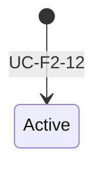

🏠 [Specs](../../../README.md) › 🧩 [Functional capabilities](../../README.md) ›
🔧 [F2 No-code configuration](../README.md) › 🗃️ [Data](README.md) › 🗃️ E-F2-12 Spreadsheet

# 🗃️ E-F2-12 Spreadsheet

**Status:** ✅ specified

## Purpose

A spreadsheet or dashboard fed live by ERP data.

## Fields

| Name | Type | Required | Validation | Default | Example | Personal data | Custom fields |
|---|---|---|---|---|---|---|---|
| name | text | yes | - | - | Sales by site | no | no |
| sources | queries on records, within the viewer's rights | yes | - | - | Invoices 2026 | no | no |
| shared with | users, roles | no | - | - | Managers | no | no |

## Relations

As its use cases.

## Lifecycle

## Indexes and search

By name, date, owner.

## Retention

Kept for the period of its kind of record in the country pack (D293), or else its kind's default in the
[retention schedule](../../../05-non-functional/data-retention.md).

## Audit

Every change.

## Import and export

CSV.

## Used by

- [UC-F2-12](../use-cases/07-benchmark-additions/uc-f02-12-build-live-spreadsheets-and-dashboards.md)

## Open questions

None.

---

⬅️ [E-F2-11 Configuration pack](e-f02-11-configuration-pack.md) · ⬆️ [Up](README.md) ·
➡️ [E-F2-13 Document](e-f02-13-document.md)
