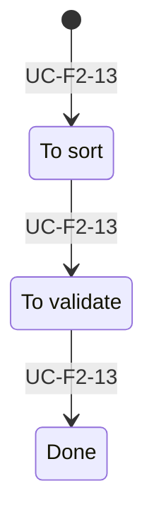

🏠 [Specs](../../../README.md) › 🧩 [Functional capabilities](../../README.md) ›
🔧 [F2 No-code configuration](../README.md) › 🗃️ [Data](README.md) › 🗃️ E-F2-13 Document

# 🗃️ E-F2-13 Document

**Status:** ✅ specified

## Purpose

A file in the documents workspace.

## Fields

| Name | Type | Required | Validation | Default | Example | Personal data | Custom fields |
|---|---|---|---|---|---|---|---|
| folder | folder | yes | - | Inbox | Supplier bills | no | no |
| tags | list | no | - | - | To pay | no | no |
| linked record | record | no | - | - | Bill 2026-118 | no | no |
| state | to sort, to validate, done | yes | - | to sort | done | no | no |

## Relations

As its use cases.

## Lifecycle

## Indexes and search

By name, date, owner.

## Retention

Kept for the period of its kind of record in the country pack (D293), or else its kind's default in the
[retention schedule](../../../05-non-functional/data-retention.md).

## Audit

Every change.

## Import and export

CSV.

## Used by

- [UC-F2-13](../use-cases/07-benchmark-additions/uc-f02-13-manage-documents-in-a-workspace.md)

## Open questions

None.

---

⬅️ [E-F2-12 Spreadsheet](e-f02-12-spreadsheet.md) · ⬆️ [Up](README.md) ·
➡️ [E-F2-14 Signature request](e-f02-14-signature-request.md)
