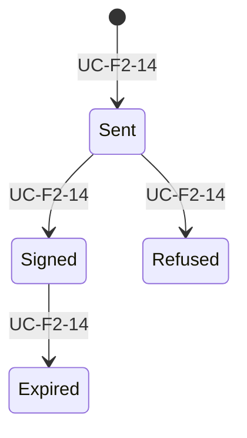

🏠 [Specs](../../../README.md) › 🧩 [Functional capabilities](../../README.md) ›
🔧 [F2 No-code configuration](../README.md) › 🗃️ [Data](README.md) › 🗃️ E-F2-14 Signature request

# 🗃️ E-F2-14 Signature request

**Status:** ✅ specified

## Purpose

A document sent for signature.

## Fields

| Name | Type | Required | Validation | Default | Example | Personal data | Custom fields |
|---|---|---|---|---|---|---|---|
| document | file | yes | - | - | Contract.pdf | no | no |
| signers | contacts, roles, order | yes | - | - | 1. Client, 2. CEO | yes | no |
| level | simple, advanced, qualified | yes | CR-FR-020 | simple | advanced | no | no |
| state | sent, signed, refused, expired | yes | - | sent | signed | no | no |

## Relations

As its use cases.

## Lifecycle

## Indexes and search

By name, date, owner.

## Retention

Kept for the period of its kind of record in the country pack (D293), or else its kind's default in the
[retention schedule](../../../05-non-functional/data-retention.md).

## Audit

Every change.

## Import and export

CSV.

## Used by

- [UC-F2-14](../use-cases/07-benchmark-additions/uc-f02-14-send-documents-for-e-signature.md)

## Open questions

None.

---

⬅️ [E-F2-13 Document](e-f02-13-document.md) · ⬆️ [Up](README.md) · ➡️ [E-F2-15 Sandbox](e-f02-15-sandbox.md)
