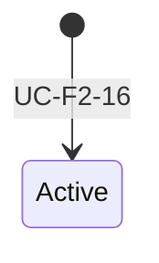

🏠 [Specs](../../../README.md) › 🧩 [Functional capabilities](../../README.md) ›
🔧 [F2 No-code configuration](../README.md) › 🗃️ [Data](README.md) › 🗃️ E-F2-15 Sandbox

# 🗃️ E-F2-15 Sandbox

**Status:** ✅ specified

## Purpose

A copy of the company for trials.

## Fields

| Name | Type | Required | Validation | Default | Example | Personal data | Custom fields |
|---|---|---|---|---|---|---|---|
| copied at | time | yes | - | - | 2026-11-11 14:00 | no | no |
| changes | list | no | BR-F2-16 | - | New workflow | no | no |
| expires | date | yes | - | +30 days | 2026-12-11 | no | no |

## Relations

As its use cases.

## Lifecycle

## Indexes and search

By name, date, owner.

## Retention

Kept for the period of its kind of record in the country pack (D293), or else its kind's default in the
[retention schedule](../../../05-non-functional/data-retention.md).

## Audit

Every change.

## Import and export

CSV.

## Used by

- [UC-F2-15](../use-cases/07-benchmark-additions/uc-f02-15-build-with-plain-language.md)
- [UC-F2-16](../use-cases/07-benchmark-additions/uc-f02-16-try-a-change-in-a-sandbox.md)

## Open questions

None.

---

⬅️ [E-F2-14 Signature request](e-f02-14-signature-request.md) · ⬆️ [Up](README.md) ·
➡️ [E-F2-16 Visual view](e-f02-16-visual-view.md)
