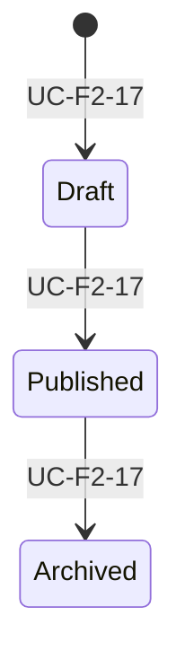

🏠 [Specs](../../../README.md) › 🧩 [Functional capabilities](../../README.md) ›
🔧 [F2 No-code configuration](../README.md) › 🗃️ [Data](README.md) › 🗃️ E-F2-16 Visual view

# 🗃️ E-F2-16 Visual view

**Status:** 🔄 waiting for the owner

## Purpose

A kanban, calendar, map, Gantt or timeline view of a record type.

## Fields

| Name | Type | Required | Validation | Default | Example | Personal data | Custom fields |
|---|---|---|---|---|---|---|---|
| type | list | yes | kanban, calendar, map, Gantt, timeline | - | Gantt | no | - |
| fields used | column, date, start and end, address, colour | yes | exist on the record type | - | start, end, colour by site | no | - |
| card fields | list | no | up to 4 (Proposed) | name | name, customer | no | - |
| shared with | roles | no | for the type map, only roles with the map right ([BR-F1-32](../../f01-administration/business-rules/br-f01-32-map-right-for-planners-and-managers.md)) | personal | Site manager | no | - |

## Relations

Belongs to one Record type; beside its List views (E-F2-04).

## Lifecycle

Draft, published, archived, as every configuration
([D97](../../../06-decisions/f02-no-code-configuration/d97-draft-preview-publish.md)).

## Indexes and search

Listed in the record type's view switcher.

## Retention

As the configuration versions.

## Audit

Created, changed, shared, archived.

## Import and export

None.

## Used by

- [UC-F2-17 Add a kanban, calendar, map, Gantt or timeline view](../use-cases/08-views-and-bookings/uc-f02-17-add-a-kanban-calendar-map-gantt-or-timeline-view.md)

## Open questions

None.

---

⬅️ [E-F2-15 Sandbox](e-f02-15-sandbox.md) · ⬆️ [Up](README.md) ·
➡️ [E-F2-17 Bookable resource setting](e-f02-17-bookable-resource-setting.md)
